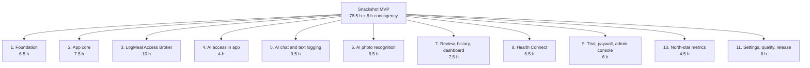
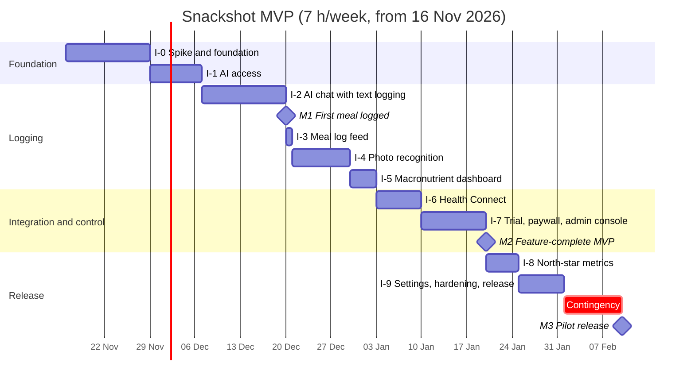
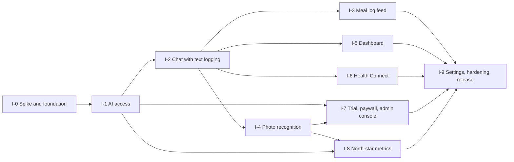

# WBS and MVP Implementation Plan

**Snackshot: AI-Powered Nutrition & Calorie Tracker**

**Status:** DRAFT
**Document Version:** 1.2
**Date:** November 15, 2026

## 1. Purpose

This document breaks the Snackshot MVP into a Work Breakdown Structure (WBS) and orders the work into feature-by-feature increments, with dependencies and a Definition of Done for each increment. It covers roadmap step 4 of the [Project Charter](01_project_charter.md) ("Prepare WBS and plan of implementation (feature by feature) for the MVP").

Effort estimates (§5.2) and the schedule (§7.3) are planning values; they are re-checked at each milestone against actual hours.

Sources:

- [01 Project Charter](01_project_charter.md) §5 (MVP scope)
- [03 Feature List](03_feature_list.md) and [Features list](Features%20list/)
- [Architecture answers](Architecture/02_answers-architecture-checklist.md), [Stack analysis](Architecture/04_stack-comparative-analysis.md)
- [C4 container](Architecture/06_c4-container-diagram.md) and [component](Architecture/07_c4-component-diagram.md) diagrams, [process flows](Architecture/09_process-flow-diagrams.md)
- [Architecture & UX specification](Architecture/10_architecture_ux_spec.md) (screens S-01 … S-20)
- [LogMeal access token management](Architecture/11_logmeal-access-token-management.md) (broker, trial, admin console)
- [LogMeal OpenAPI](services_documentation/logmeal/LogMeal_openapi_docs.yaml), [LogMeal multi-language support](services_documentation/logmeal/multi-language-support.md)

## 2. Decisions recorded (15 November 2026)

| # | Decision | Effect on this plan |
| --- | --- | --- |
| 1 | **Keep the MVP scope and extend the timeline.** | All features in §3 are built before the pilot release. The charter's one-month / 28-hour constraint no longer applies. |
| 2 | **F-05 AI Chat is in the MVP; F-10 Manual Text Search and F-11 Quick Add Calories are not.** | The chat is the main logging entry point (text, photo, gallery). The feature list already shows this; the charter and feature files are updated to match. |
| 3 | **Food lookup by text uses LogMeal, localized by country and language.** | Chat text input is matched against LogMeal's dish catalog in the user's language; the APIUser profile carries the user's country and language. No separate food database is bundled. The same component is reused when F-10 is built after the MVP. |
| 4 | **North-star metrics are sent through the LogMeal Access Broker, fully anonymized.** | New broker endpoint and storage for anonymous daily metric aggregates (§6). No personal data, food names, images, or nutrition values leave the device for metrics. |

## 3. MVP scope baseline

| Feature | Name | In MVP | Note |
| --- | --- | --- | --- |
| F-01 | AI Food Identification | Yes | Photo recognition, started from the chat |
| F-02 | Volume / Portion Estimation | Yes | LogMeal grams + history/reference calibration |
| F-03 | Fast Fix of Recognized Values | Yes | Shared review / edit sheet |
| F-05 | AI Chat | Yes | Text, photo, and gallery input; food logging only. Voice input is F-06 (post-MVP). |
| F-09 | Phone Gallery Usage | Yes (low-cost) | Gallery button in the chat and on the camera screen; F-01 and F-05 require it |
| F-16 | Macronutrient Dashboard | Yes | Day, history, week + averages |
| F-19 | Connect to Health Connect | Yes | |
| F-20 | Google Health Connect Sync | Yes | |
| F-23 | Calories & Macros Log Feed | Yes | |
| F-30 | Account-free App Access | Yes | Anonymous identity, no sign-in |
| F-32 | Free AI Trial & Paywall | Yes | Paywall screen only, no payments |
| F-33 | Broker Admin Console | Yes (minimal) | Clients, Client detail, Waitlist, Metrics |
| F-10 | Manual Text Search | No | Post-MVP; reuses the LogMeal food search built for F-05 |
| F-11 | Quick Add Calories | No | Post-MVP |
| F-06 | AI Chat / Voice Logging | No | Post-MVP |
| F-07 | Best Photo Practices | Optional | One line of guidance copy on the camera screen if convenient |

## 4. Technical baseline

- **App:** native Android, Kotlin, Jetpack Compose, CameraX, Android Photo Picker, Health Connect SDK, LogMeal REST API ([04](Architecture/04_stack-comparative-analysis.md) §9).
- **Broker:** Firebase Auth (anonymous), Cloud Functions (TypeScript), Firestore, Secret Manager, App Check, Remote Config, Hosting ([11](Architecture/11_logmeal-access-token-management.md) §0).
- **Local persistence (proposed):** Room behind repository interfaces. Confirmed in WBS 1.2.
- **Estimation basis:** AI-assisted (GitHub Copilot) development hours for one developer, including unit tests for each item. Contingency is about 10 %.
- **Capacity and start:** 7 hours per week (Mon 2 h, Wed 2 h, Sun 3 h), starting Monday, November 16, 2026.
- **LogMeal food search:**
  - The broker sets `language` and `country` on each APIUser (`POST /v2/users/modifyUserProfileInfo/{userId}`) at provisioning, taken from the device locale. The user can change them in Settings.
  - The app downloads the dish catalog (`GET /v2/dataset/dishes?language=…`, with portion sizes) and caches it on the device. It refreshes the catalog when the language changes or the cache is old. Text matching runs locally against the cache.
  - Nutrition for the selected dish and grams comes from LogMeal (manual intake `POST /v2/intake/manualInput/{userId}` and `nutritionalInfo`, or `compute_nutrients`). The exact call chain and credit cost are confirmed in the spike (WBS 1.1).
  - LogMeal's dish catalog supports a limited set of languages (spa, cat, eng, ita, nld, fre, ger, tur, gre, heb). Other device languages fall back to English. Country refines recognition and dish relevance.

## 5. Work Breakdown Structure

### 5.1 WBS overview



### 5.2 WBS dictionary

| WBS | Work package | Features | Deliverable / scope | Est. (h) |
| --- | --- | --- | --- | --- |
| **1** | **Foundation** | | | **6.5** |
| 1.1 | LogMeal + Health Connect technical spike | F-01, F-02, F-05, F-20 | Throwaway build on a physical device with a dev-only APIUser token (never shipped). Photo → `segmentation/complete` → nutrition → quantity (grams). Text → dish catalog match → nutrition for a chosen dish and grams. One `NutritionRecord` write. Record latency, grams quality, credits per call, catalog size per language, ARCore availability. Decision-gate evidence for [04](Architecture/04_stack-comparative-analysis.md) §10. | 3 |
| 1.2 | Close open decisions | — | Confirm persistence technology, the LogMeal plan for the pilot, and the open product questions in §8; update affected documents. | 0.5 |
| 1.3 | Android project skeleton | — | Kotlin + Compose project, Gradle version catalog, packages/modules (`domain`, `data-local`, `logmeal`, `healthconnect`, `access`, `metrics`, `ui`), Hilt, ktlint/lint, GitHub Actions (build + unit tests). | 2 |
| 1.4 | Firebase project | F-30, F-33 | Firebase project on Blaze, budget alert, Emulator Suite for development, APICompany token in Secret Manager readable only by the broker service account. | 1 |
| **2** | **App core** | | | **7.5** |
| 2.1 | Design system | all | Material 3 theme and tokens ([10](Architecture/10_architecture_ux_spec.md) §3), shared state contract components (loading, empty, error + retry, snackbar). | 1.5 |
| 2.2 | Navigation shell and entry screens | F-05, F-30 | Global navigation with the chat as the start screen, S-01 Welcome, S-01A Privacy details (including the anonymous metrics notice). No sign-in screens. | 1.5 |
| 2.3 | Domain model and nutrition calculation | F-01, F-03, F-05 | `MealEntry`, `NutritionValues`, `MealDraft`, `ChatMessage`, `SyncState`; Atwater calculation and recalculation after a grams edit; unit tests. | 1.5 |
| 2.4 | Local persistence | F-05, F-16, F-20, F-23 | Room schema (meals, chat messages, goals, settings, sync metadata, dish catalog cache, metric counters), DAOs, repositories, migration strategy, app-private storage. | 2 |
| 2.5 | Meal draft and image store | F-01, F-05 | Draft survives backgrounding and process death; processed image stored locally (raw photo deleted, 365-day retention) per [02](Architecture/02_answers-architecture-checklist.md) §1.5, §8.4. | 1 |
| **3** | **LogMeal Access Broker** | | | **10** |
| 3.1 | Broker project setup | F-30 | Cloud Functions (TypeScript), Firestore collections (`clients`, `devices`, `usage`, `audit`, `settings`, `metrics_daily`) with deny-all client rules, LogMeal company client, token encryption, emulator config. | 1.5 |
| 3.2 | `provision` and `status` endpoints | F-30, F-32 | Anonymous ID token + App Check verification; device re-attach by hashed device ID; `signUp` APIUser; set APIUser `language` and `country`; pilot cap of 5 → waitlist; status with picture counter. | 3 |
| 3.3 | `profile` endpoint | F-05, F-30 | Update APIUser `language` / `country` when the user changes them in Settings. | 0.5 |
| 3.4 | `picture` and `DELETE /account` endpoints | F-32, F-30 | Idempotent picture count by `requestId`; trial ends at 90; account deletion keeps the device picture counter. | 1.5 |
| 3.5 | Client state machine | F-32, F-33 | Trial → TrialEnded / Waitlisted / Paused / Suspended / Cancelled; read-before-`toggleEnabled`; `deleteAPIUser`; serialized per-client jobs; audit records. | 1.5 |
| 3.6 | Cost controls | F-33 | Remote Config global kill switch; scheduled credit check with alert e-mail. | 1 |
| 3.7 | Broker tests | — | Emulator tests for provision, waitlist, profile, picture idempotency, trial end, delete, metrics. | 1 |
| **4** | **AI access in app** | | | **4** |
| 4.1 | AI Access module | F-30 | Silent anonymous sign-in on the first AI action; hashed device ID; Play Integrity App Check; broker client; token in DataStore encrypted with Tink + Android Keystore; backup exclusion; `LogMealCredentialProvider`; status cache (~1 h). | 3.5 |
| 4.2 | Language and country | F-05 | Detect device locale on provisioning; map to a LogMeal-supported language (fallback English) and ISO 3166-1 country. | 0.5 |
| **5** | **AI chat and text logging** | | | **9.5** |
| 5.1 | Chat screen | F-05 | Start screen with message history (text, photos, results with kcal and macros), input bar (text, camera, gallery), navigation to other areas; chat answers food-logging input only. | 3 |
| 5.2 | LogMeal dish catalog cache | F-05 | Download, store, and refresh `GET /v2/dataset/dishes` per language; local full-text index. | 1.5 |
| 5.3 | Text input parsing and matching | F-05 | Split the message into items (for example "2 eggs, toast and coffee"); extract quantities and units; match each item to catalog dishes; show the best match with alternatives. | 2.5 |
| 5.4 | Nutrition lookup for text items | F-05, F-02 | LogMeal nutrition for each matched dish and grams; default grams from the catalog portion size or the user's history. | 1.5 |
| 5.5 | Multi-item results | F-05 | A list message shows several entries; each can be reviewed, edited, or removed separately. | 1 |
| **6** | **AI photo recognition** | | | **8.5** |
| 6.1 | Camera and gallery (S-03, S-04) | F-01, F-09 | CameraX capture, contextual permission with rationale, flash, close; Photo Picker for gallery; started from the chat. | 2.5 |
| 6.2 | Image preprocessing | F-01 | Resize, EXIF orientation, JPEG compression, size/format validation. | 1 |
| 6.3 | LogMeal recognition adapter | F-01, F-02 | Recognition → nutrition → quantity calls; mapping to domain; 80% confidence threshold; error mapping (401, 403/116, 429); retry once; redact `Authorization` in logs. | 3 |
| 6.4 | Recognition progress and failure handling (S-05) | F-01 | Progress in the chat; cancel preserves the draft; failure → retry once → ask the user to describe the meal in text, with the draft kept. | 1 |
| 6.5 | Portion calibration | F-02 | Use the user's last grams for the same dish and reference average weights when LogMeal grams are missing or low-confidence. | 1 |
| **7** | **Review, history, dashboard** | | | **7.5** |
| 7.1 | Meal review and edit sheet (S-15, S-07) | F-03 | Shared review: name, grams, kcal, macros, confidence; edit sheet with instant recalculation; reset to estimate; change the matched dish. Used by photo results, text results, and history. | 2.5 |
| 7.2 | Meal history feed (S-14) | F-23 | Reverse-chronological list with time, name, photo thumbnail, kcal, macros; "show more" after 7 days; open → edit; delete with S-17 confirmation and undo. | 2 |
| 7.3 | Dashboard (S-12, S-13) | F-16 | Today's totals; day picker for earlier days; week view with 7 daily totals and daily averages; cached aggregates. | 3 |
| **8** | **Health Connect** | | | **6.5** |
| 8.1 | Connect flow | F-19 | `getSdkStatus`, S-10 first-save prompt with privacy copy, permission request contract, S-11 result, local-only mode, revocation handling. | 2.5 |
| 8.2 | Write path | F-20 | Insert/upsert `NutritionRecord` with `clientRecordId` / `clientRecordVersion` on create and edit; delete on local delete; pending-sync queue. | 1.5 |
| 8.3 | Read path and sync triggers | F-20 | Goals refresh; bootstrap import on first connect; `getChangesToken` / `getChanges` pull; sync on app resume and manual sync; syncing state in UI. | 2.5 |
| **9** | **Trial, paywall, admin console** | | | **6** |
| 9.1 | Trial and paywall UI | F-32 | "N of 90 free pictures left" in the chat/camera and S-16; one-time heads-up at 10 left; S-19 paywall (screen only); S-20 waitlist; LogMeal daily-limit message; async picture report. | 2 |
| 9.2 | Admin functions | F-33 | Admin custom-claim script; `adminListClients`, `adminGetClient`, `adminSetStatus`, `adminGrantPictures`, `adminDeleteClient`, `adminApproveWaitlist`, `adminGetMetrics` — each checks the claim; actions write audit. | 1.5 |
| 9.3 | Admin SPA | F-33 | React + Vite on Firebase Hosting: Google admin sign-in, Clients list, Client detail actions (reason + confirmation), Waitlist approve/reject, Metrics page (§6.4). | 2.5 |
| **10** | **North-star metrics** | | | **4.5** |
| 10.1 | On-device metric collector | — | Record metric events locally (§6.2) and compute daily aggregates. | 1.5 |
| 10.2 | Upload job | — | WorkManager job sends the previous day's aggregates once per day through the broker; retries with backoff; deletes sent aggregates. Respects the Settings opt-out. | 1 |
| 10.3 | Broker `metrics` endpoint and storage | — | `POST /v1/metrics` validates the payload against an allow-list schema, drops unknown fields, and stores it in `metrics_daily` without any client or device identifier (§6.3). | 1 |
| 10.4 | Metrics aggregation | — | Scheduled function computes pilot-level north-star values (§6.4) for the admin console. | 1 |
| **11** | **Settings, quality, release** | | | **8** |
| 11.1 | Settings (S-16) | F-05, F-19, F-30, F-32 | Health Connect connect/disconnect/sync; AI section (pictures left, status); food language and country; anonymous metrics on/off; privacy; "Delete all data" (local + `DELETE /account`); S-17 dialogs. | 2 |
| 11.2 | Accessibility pass | all | TalkBack labels, font scaling, contrast, touch targets per [10](Architecture/10_architecture_ux_spec.md) §5. | 1 |
| 11.3 | End-to-end device testing and fixes | all | Full test pass on physical devices: chat text and photo, lists, offline, HC denied/revoked, reinstall, waitlist, trial end, metrics upload. | 2.5 |
| 11.4 | Google Play release | — | Signing, internal testing track, privacy policy page (including anonymous metrics), Data safety form, Health Connect permission declaration, store listing. | 2.5 |
| | **Total** | | | **78.5** |
| | Contingency (~10 %) | | | 8 |
| | **Total with contingency** | | | **86.5** |

## 6. North-star metrics through the broker

### 6.1 Principles

- Metrics are **anonymous aggregates**, not events. The device sends one small record per day.
- A metrics record carries **no client ID, device ID, Firebase UID, LogMeal user ID, IP-derived data, food names, images, nutrition values, or free text**.
- The broker verifies the request (App Check and the anonymous Firebase ID token, like every other endpoint) but **does not store** the caller's identity with the record. Request logs for this endpoint must not include the UID.
- Fields come from a fixed allow-list; numbers are counts or coarse buckets, so a record cannot identify a person.
- The user can switch metrics off in Settings. The privacy details screen and the Play Data safety form describe the data.

### 6.2 Collected on the device

| North-star metric ([charter §6](01_project_charter.md)) | Local measurement |
| --- | --- |
| Quality of food recognition | Recognitions with confidence ≥ 80 %; results where the user changed the dish; results where the user changed only grams |
| Speed of food recognition | Time from photo sent to result shown |
| Zero-Edit rate | Results saved without any edit / all saved AI results |
| Core habit formation | Days with at least 2 logged meals in the last 7 days |
| Time-to-log | Time from app open (or chat input start) to save |

### 6.3 Daily payload

```json
{
  "schema": 1,
  "day": "2026-11-15",
  "appVersion": "1.0.0",
  "locale": "eng-GB",
  "photoRecognitions": 4,
  "textLookups": 2,
  "highConfidence": 3,
  "savedZeroEdit": 3,
  "savedGramsEdited": 1,
  "savedDishChanged": 0,
  "recognitionLatencyMs": { "p50": 1800, "p95": 2900 },
  "timeToLogSec": { "p50": 14, "p95": 41 },
  "mealsLogged": 3,
  "daysWith2PlusMealsLast7": 5
}
```

The broker stores it in `metrics_daily/{autoId}` exactly as validated. Latency values are rounded to 100 ms and time-to-log to whole seconds.

### 6.4 Reporting

A scheduled function aggregates `metrics_daily` into pilot-level values: recognition success rate, p50/p95 recognition latency, Zero-Edit rate, share of reports with 4 or more habit days, and p50/p95 time-to-log. The admin console Metrics page shows them per day and per week. With a 5-user pilot, values are shown only as pilot totals, never per record.

## 7. Implementation plan (feature by feature)

### 7.1 Ordering principles

1. **Remove the biggest risk first.** The LogMeal + Health Connect spike (1.1) runs before any production code. If LogMeal cannot return usable grams, latency, or text matches, the plan changes before production work starts.
2. **AI access comes before logging.** With F-10 and F-11 out of the MVP, every way of logging a meal goes through LogMeal. The broker and the AI Access module are therefore built before the chat.
3. **Text before photo.** Text logging in the chat creates the full path — chat, LogMeal lookup, review, local save — with fewer moving parts than the camera. Photo recognition then plugs into the same path.
4. **Each increment produces a working app** that can be installed on a phone and demonstrated.

### 7.2 Increments

| # | Increment | Features | WBS items | Effort (h) | Cumulative (h) | Target finish |
| --- | --- | --- | --- | --- | --- | --- |
| I-0 | Spike and foundation | — | 1.1, 1.2, 1.3, 1.4, 2.1, 2.2, 2.3, 2.4 | 13 | 13 | Sun, Nov 29 |
| I-1 | AI access (broker core + app module) | F-30 | 3.1, 3.2, 3.3, 3.7 (core tests, 0.5 h), 4.1, 4.2 | 9.5 | 22.5 | Mon, Dec 7 |
| I-2 | AI chat with text logging | F-05, F-03 | 5.1, 5.2, 5.3, 5.4, 5.5, 7.1 | 12 | 34.5 | Sun, Dec 20 |
| **M1** | **Milestone: first meal logged end to end (text → LogMeal → review → local save)** | | | | | **Sun, Dec 20** |
| I-3 | Meal log feed | F-23 | 7.2 | 2 | 36.5 | Mon, Dec 21 |
| I-4 | Photo recognition in the chat | F-01, F-02, F-09 | 2.5, 6.1, 6.2, 6.3, 6.4, 6.5 | 9.5 | 46 | Wed, Dec 30 |
| I-5 | Macronutrient dashboard | F-16 | 7.3 | 3 | 49 | Sun, Jan 3 |
| I-6 | Health Connect | F-19, F-20 | 8.1, 8.2, 8.3 | 6.5 | 55.5 | Sun, Jan 10 |
| I-7 | Free AI trial, paywall, admin console | F-32, F-33 | 3.4, 3.5, 3.6, 3.7 (remaining tests, 0.5 h), 9.1, 9.2, 9.3 | 10.5 | 66 | Wed, Jan 20 |
| **M2** | **Milestone: feature-complete MVP** | | | | | **Wed, Jan 20** |
| I-8 | North-star metrics | — | 10.1, 10.2, 10.3, 10.4 | 4.5 | 70.5 | Mon, Jan 25 |
| I-9 | Settings, hardening, and release | F-05, F-19, F-30, F-32 | 11.1, 11.2, 11.3, 11.4 | 8 | 78.5 | Mon, Feb 1 |
| — | Contingency | — | — | 8 | 86.5 | Wed, Feb 10 |
| **M3** | **Milestone: pilot release (Google Play internal testing, 5 users)** | | | | | **Wed, Feb 10, 2027** |

### 7.3 Schedule



> The schedule assumes all 7 hours are available every week (Mon 2 h, Wed 2 h, Sun 3 h). The December 21 – January 3 holidays fall inside I-3 to I-5; if those two weeks are lost, M2 and M3 move by up to two weeks.

### 7.4 Dependencies



I-3, I-5, and I-6 depend only on I-2 and can be reordered. I-8 can start once photo recognition exists, because most metrics measure it.

### 7.5 Increment details and Definition of Done

#### I-0 Spike and foundation

- **Goal:** prove the risky integrations, then create the project that all features build on.
- **Done when:**
  - Spike results (photo latency, grams, text-match quality per language, credits per call, HC write) are recorded in the architecture docs, and the [04](Architecture/04_stack-comparative-analysis.md) §10 decision gates pass or the plan is revised.
  - The open questions in §8 have an owner decision.
  - The app builds in CI and opens S-01 → chat; navigation to History, Dashboard, and Settings works (placeholder screens allowed).
  - The Firebase project exists with the APICompany token in Secret Manager.
  - Room schema and nutrition calculation have unit tests.

#### I-1 AI access — F-30

- **Goal:** each anonymous install gets its own LogMeal access, with language and country set, and no credentials in the app.
- **Done when:** on the first AI action a new install silently provisions an APIUser with the device's language and country; the first 5 devices get access and the 6th is waitlisted; reinstall on the same device re-attaches; the token is stored encrypted and excluded from backup; broker emulator tests pass.

#### I-2 AI chat with text logging — F-05, F-03

- **Goal:** the user types what they ate in the chat and gets entries with grams, kcal, and macros.
- **Done when:** the chat is the start screen and keeps its history after restart; a single item and a list of items both produce entries; each entry can be opened, edited (dish, grams, values with instant recalculation), or removed; accepted entries are saved locally; the dish catalog is cached per language and refreshed when the language changes.
- **M1:** the first meal is logged end to end.

#### I-3 Meal log feed — F-23

- **Goal:** a clear history of all logged meals.
- **Done when:** S-14 lists entries newest first with time, name, photo (when present), kcal, and macros; entries can be edited and deleted with confirmation and undo; the chat and the feed show the same data.

#### I-4 Photo recognition in the chat — F-01, F-02, F-09

- **Goal:** photo or gallery image → AI result in the chat → review → save.
- **Done when:** camera and gallery images are recognized; grams, kcal, and macros appear in the chat; low-confidence or failed results ask the user to describe the meal in text, with the draft kept; the draft survives process death; recognition latency is measured on a physical device (target p98 < 3 s); each successful recognition is reported to the broker as one picture.

#### I-5 Macronutrient dashboard — F-16

- **Goal:** daily and weekly totals for calories, protein, carbs, and fat.
- **Done when:** today's totals are visible; earlier days can be selected; the week view shows 7 daily totals and daily averages; totals update immediately after save, edit, and delete.

#### I-6 Health Connect — F-19, F-20

- **Goal:** optional, local-first sync with Health Connect.
- **Done when:** the first save shows S-10; declining keeps local-only mode; accepting shows the system dialog; create/edit/delete are reflected in Health Connect; goals are read; sync runs on app resume and from a manual action; revoked permission is handled without data loss.

#### I-7 Free AI trial, paywall, admin console — F-32, F-33

- **Goal:** the trial is enforced and visible, and the owner can manage pilot users.
- **Done when:** the picture counter is correct after restart and reinstall; the heads-up shows once at 10 left; S-19 appears on the first AI action after 90 pictures; S-20 appears when the pilot is full and disappears after admin approval; the kill switch and credit alert work; the admin console lists clients, pauses/resumes/deletes them, approves the waitlist, and every action is in the audit log.
- **M2:** all MVP features are implemented.

#### I-8 North-star metrics

- **Goal:** the five north-star metrics are measurable for the pilot without any personal data.
- **Done when:** the device sends one daily aggregate that matches §6.3; the broker rejects unknown fields and stores no identifier; turning metrics off in Settings stops uploads; the admin console Metrics page shows pilot totals per day and week.

#### I-9 Settings, hardening, and release

- **Goal:** a pilot build on Google Play internal testing.
- **Done when:** Settings covers Health Connect, AI status, food language and country, metrics opt-out, privacy, and "Delete all data"; the accessibility pass is done; the end-to-end test list passes on physical devices; the Data safety form, privacy policy, and Health Connect declaration are submitted; 5 pilot testers can install the app.

## 8. Open questions

| # | Question | Why it matters | Options |
| --- | --- | --- | --- |
| 1 | **How does a user log a meal after the 90-picture trial ends, or while waitlisted?** | With F-10 and F-11 out of the MVP, every logging path uses LogMeal. In the current broker design, TrialEnded and Waitlisted users have no enabled APIUser, so they cannot log anything. S-19 and S-20 currently offer "Search food" and "Quick add", which are no longer in the MVP. | (a) Keep the APIUser enabled after the trial and block only photo recognition, so text logging stays free (costs LogMeal credits); (b) proxy text lookups through the broker with the company token for users without access; (c) bring F-11 Quick Add back as a minimal free fallback; (d) accept that logging stops until a subscription exists. |
| 2 | Do text lookups count toward the 90 free pictures? | F-32 defines a picture as an image recognition. Text lookups still use LogMeal credits. | Proposed: no, they do not count; monitor credits with the alarm (3.6). |
| 3 | What happens when photo recognition fails? | The fallback used to be manual search / quick add. | Proposed: ask the user to describe the meal in text in the chat (I-4). |
| 4 | Which LogMeal plan covers the pilot? | The free trial (200 queries) cannot cover 5 × 90 pictures plus text lookups ([11](Architecture/11_logmeal-access-token-management.md) §0). | Analyse plan from pilot start (proposed). |
| 5 | Can LogMeal's dish catalog handle free-text quantities and dishes outside the catalog? | LogMeal has no natural-language parser; matching is done in the app (5.3). | Confirm in the spike; unmatched items are shown with alternatives and an "edit" action. |

## 9. Documents to align

The following documents describe F-10 / F-11 as MVP fallbacks or treat F-05 as post-MVP and need updating after the open questions in §8 are answered:

- [10_architecture_ux_spec.md](Architecture/10_architecture_ux_spec.md) — the chat as the start screen instead of the S-02 Home carousel; S-08 / S-09 out of the MVP; fallback paths; S-19 / S-20 buttons. (Scope list §1.1 and traceability §6 are already updated.)
- [11_logmeal-access-token-management.md](Architecture/11_logmeal-access-token-management.md) — `profile` and `metrics` endpoints, `metrics_daily` collection, language/country at provisioning, behaviour for TrialEnded / Waitlisted users.
- [F-32](Features%20list/F-32-free-ai-trial-paywall.md) — paywall and waitlist buttons.
- [09_process-flow-diagrams.md](Architecture/09_process-flow-diagrams.md) — text logging flow through the chat; metrics upload flow.

## 10. Risks

| Risk | Impact | Mitigation |
| --- | --- | --- |
| LogMeal grams, latency, or text matching are not good enough | Core value not proven | Spike in I-0 before production code; SMALL/MEDIUM/BIG portion confirmation as fallback; decision gate in [04](Architecture/04_stack-comparative-analysis.md) §10 |
| Estimates are optimistic | Schedule slip | Re-plan at each milestone using actual hours; contingency week |
| Every logging path depends on LogMeal and the broker | No logging when LogMeal or the broker is down, or after the trial | Clear retryable errors; keep the draft; decide open question 1 |
| LogMeal dish catalog does not cover the user's language | Poor text matching | English fallback; country set on the APIUser; check catalog coverage in the spike |
| LogMeal credits run out | AI stops during the pilot | Buy the Analyse plan before M3; credit alarm; kill switch |
| Metrics could identify a pilot user (5 users) | Privacy breach | Aggregates only, no identifiers, coarse values, pilot totals only in the console, opt-out |
| Health Connect behaves differently across devices | Sync bugs | Test on at least two physical devices in I-6 and 11.3 |
| Google Play review of Health Connect permissions takes long | Release delay | Prepare the declaration and privacy policy early in I-6; use the internal testing track |

## 11. Out of scope of this plan

Post-MVP features (F-04, F-06, F-07, F-08, F-10, F-11, F-13, F-14, F-15, F-21, F-24, F-25, F-27), Google Play Billing payments ([11](Architecture/11_logmeal-access-token-management.md) §6.4), the full admin console (dashboard, audit UI, settings UI, LogMeal sync), and iOS / Kotlin Multiplatform extraction are planned separately.
