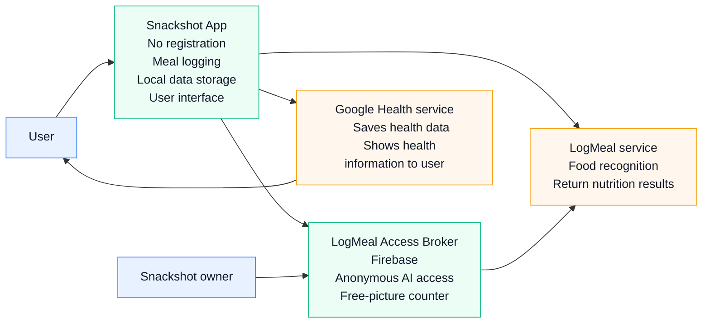

# C4 Context Diagram for Snackshot

## 1. System purpose

Snackshot is an Android-first, local-first nutrition tracking application that helps users:

- capture a food photo or choose an image from the gallery,
- identify the food item and estimate nutrition values,
- review and correct the AI result,
- save the meal to local device storage,
- optionally synchronize nutrition data with Google Health Connect,
- view a daily summary of calories and macronutrients.

This is a Level 1 C4 context diagram: it shows the system boundary, the primary user, and the external systems that the application depends on.

## 2. Scope and architectural boundary

This is a high-level context diagram. It shows only the main actors and the external systems that interact with the application, without internal modules or implementation details.

## 3. C4 System Context Diagram

## 4. Key interpretation of the diagram

### Primary actor
- User: registers in the app, logs meals, and uses Google Health to review health information.

### Key external systems
- Snackshot App: stores user data locally, provides the interface for meal logging, and communicates with external services.
- LogMeal Service: receives meal data or images from the app, recognizes the food, and returns the result.
- Google Health Service: stores health data and presents the information to the user in a health dashboard.
- LogMeal Access Broker (Snackshot-owned, Firebase): gives each anonymous app install its own LogMeal access, counts free AI pictures (90 per user), and lets the owner pause, cancel, or waitlist users through an admin console. It stores no health data. See [11_logmeal-access-token-management.md](./11_logmeal-access-token-management.md).
- Snackshot owner: operates the broker through the admin console (F-33).

### Important design constraint
- The app is the user-facing system.
- Data is stored locally in Snackshot.
- LogMeal is used for recognition and nutrition estimation.
- Google Health is used for health data storage and user health overview.

## 5. Relationship summary

| Relationship | Meaning |
| --- | --- |
| User -> Snackshot App | Logs meals in the application without registration |
| Snackshot App -> LogMeal Service | Sends meal data or images and receives recognition results, using the user's own LogMeal token |
| Snackshot App -> LogMeal Access Broker | Obtains AI access silently, reports used pictures, receives trial/paywall/waitlist status |
| LogMeal Access Broker -> LogMeal Service | Creates, enables, disables, and deletes per-user LogMeal accounts; reads usage |
| Snackshot owner -> LogMeal Access Broker | Manages users and costs in the admin console |
| Snackshot App -> Google Health Service | Saves health-related data and provides user health information |
| User -> Google Health Service | Reviews health-related information in Google Health |

## 6. Business and technical implications

1. The application boundary is intentionally narrow: it is a client application, not a full backend-driven product. The only server component is the LogMeal Access Broker, which handles AI credentials and usage, never health data.
2. Health Connect is an optional integration and not a mandatory onboarding blocker for the core app flow.
3. The AI provider is a stateless processing dependency; the app remains the source of truth for user nutrition history.
4. The user experience is designed around low-friction logging: capture photo, confirm result, save, and review totals.

## 7. Decision status

This context diagram reflects the current project decisions recorded in the architecture documents:

- Android-only MVP
- Kotlin + Jetpack Compose native Android stack
- Local-first architecture
- Optional Google Health Connect sync
- LogMeal as the selected AI provider for the MVP

The diagram should be reviewed again if the product later changes to require a cloud backend for user data, a mandatory sign-in flow, real payments (Google Play Billing, post-MVP), or a broader multi-platform scope.

## 8. Source basis

This C4 context diagram is based on the following project evidence:

- [Project charter](../01_project_charter.md)
- [Architecture checklist](01_must-answer-architecture-checklist.md)
- [Architecture answers](02_answers-architecture-checklist.md)
- [Technology stack analysis](04_stack-comparative-analysis.md)
- [AI provider analysis](03_ai-model-comparative-analysis.md)
- [Feature F-19: Connect to Health Connect](../Features%20list/F-19-connect-health-connect.md)
- [Feature F-20: Google Health Connect Sync](../Features%20list/F-20-google-health-connect-sync.md)
- [Feature F-30: Account-free App Access](../Features%20list/F-30-google-account-registration-login.md)
- [LogMeal access token management](./11_logmeal-access-token-management.md)
