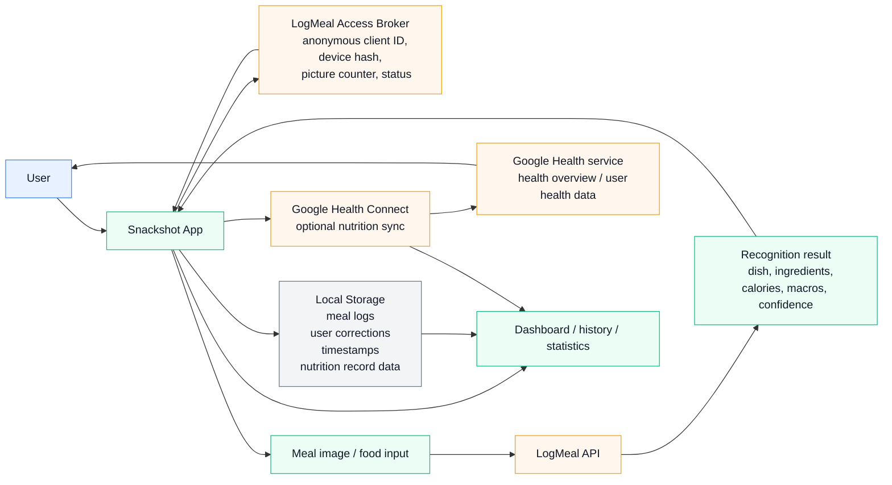

# Data Flow Diagram for Snackshot

## 1. Purpose

This diagram describes how nutrition data moves between the main actors and system components:

- User
- Snackshot application
- Local storage
- Google Health Connect (GHC)
- LogMeal API
- LogMeal Access Broker (Firebase; AI access and usage only)

The design follows the project's local-first architecture: the application keeps its own local data as the primary source of truth, and Google Health can be used as an optional synchronization target.

## 2. Data flow overview

## 3. Detailed data movement

### 3.1 User to application
The user enters data through the UI in one of the following ways:
- photo capture or gallery image
- text input / chat-like meal entry
- manual correction of detected food items and values
- Google Health consent and connection flow

### 3.1a Application to LogMeal Access Broker
No registration is needed. On the first AI action:
1. the app signs in anonymously to Firebase (silent, no personal data)
2. the app sends a hashed device ID and app language to the broker
3. the broker returns the user's own LogMeal token and the free-picture counter, or a waitlist / trial-ended status
4. after each successful recognition the app reports one used picture; the broker reconciles the counter hourly with LogMeal's usage log

The broker never receives photos, recognition results, or nutrition values. Details: [LogMeal access token management](./11_logmeal-access-token-management.md).

### 3.2 Application to LogMeal
The application sends the prepared image and context to LogMeal for image recognition and nutritional estimation.

Typical flow:
1. user selects or captures an image
2. app preprocesses the image
3. app sends the request to LogMeal
4. LogMeal returns recognized food, ingredients, quantity, and nutrition data

### 3.3 Application to local storage
After the AI response is reviewed and the user accepts or edits it, the app stores the result in local storage.

Local storage keeps:
- meal id
- timestamp
- food name
- quantity
- calories
- protein
- fat
- carbs
- photo reference or image metadata
- user corrections / edit history
- sync information

### 3.4 Local storage to Google Health Connect
If the user is logged in and Health Connect is enabled, the app writes nutrition records to Google Health Connect using the Health Connect SDK.

This follows the Health Connect sync model:
- app keeps its own datastore as the source of truth
- app writes new or updated nutrition records to Health Connect
- app can pull changes back from Health Connect using changes tokens
- app can delete records from Health Connect when deleted locally

### 3.5 Google Health Connect to local storage on first run or after local reset
When Health Connect is connected and the local database is empty, the app performs a bootstrap import before normal incremental synchronization:

1. request and verify the required Health Connect permissions
2. read available `NutritionRecord` data using `readRecords()`
3. upsert records that are missing from local storage
4. store Health Connect record identifiers and sync metadata locally
5. initialize or resume the changes-token flow for future synchronization

The same bootstrap import runs after the user deletes all local application data. Health Connect remains a secondary store; after import, the local application database is again the source of truth.

### 3.6 Google Health to user
Google Health shows the user relevant health and nutrition data, including the data that was written by the app or synchronized through Health Connect.

## 4. Data flow by record type

| Data | Source | Destination | Notes |
| --- | --- | --- | --- |
| Meal photo | User / camera / gallery | Snackshot app | Preprocessed before AI request |
| AI access request | Snackshot app | LogMeal Access Broker | Anonymous ID token + hashed device ID + language; no personal data |
| Per-user LogMeal token, status, picture counter | LogMeal Access Broker | Snackshot app | Token stored encrypted on device |
| Used-picture report | Snackshot app | LogMeal Access Broker | One count per successful recognition |
| User management, usage | LogMeal Access Broker | LogMeal API | Company token; signUp, toggleEnabled, deleteAPIUser, info/usages |
| Recognition request | Snackshot app | LogMeal API | Image + user context, authenticated with the user's own LogMeal token |
| AI result | LogMeal API | Snackshot app | Food, ingredients, quantity, nutrients |
| Meal log record | Snackshot app | Local storage | Primary app source of truth |
| Nutrition entry | Snackshot app | Google Health Connect | Optional sync when enabled |
| Health data / goals | Google Health Connect | Snackshot app | Read for dashboard and sync |
| Health summary | Google Health service | User | UI displayed in Google Health |
| Dashboard data | Local storage / GHC | Snackshot UI | Statistics and history |

## 5. Sequence interpretation

The app should not treat LogMeal as the primary database. Instead:

- LogMeal is an analysis service
- local storage is the permanent app datastore
- Google Health Connect is a health-data sharing and sync target

This matches the product constraint that the application is local-first and does not rely on an external app server for user nutrition history. The LogMeal Access Broker is the only Snackshot server component and handles AI access and usage counters only.

## 6. Source basis

This diagram is grounded in the project documents and external integration guides:

- [Health Connect sync documentation](../services_documentation/health-connect/HC_sync_data.md)
- [Health Connect write data documentation](../services_documentation/health-connect/HC_write_data.md)
- [LogMeal recognition capabilities](../services_documentation/logmeal/recognition-capabilities.md)
- [LogMeal image preprocessing guide](../services_documentation/logmeal/image-pre-processing.md)
- [LogMeal user access tokens guide](../services_documentation/logmeal/users-and-access-tokens.md)
- [LogMeal access token management](./11_logmeal-access-token-management.md)
