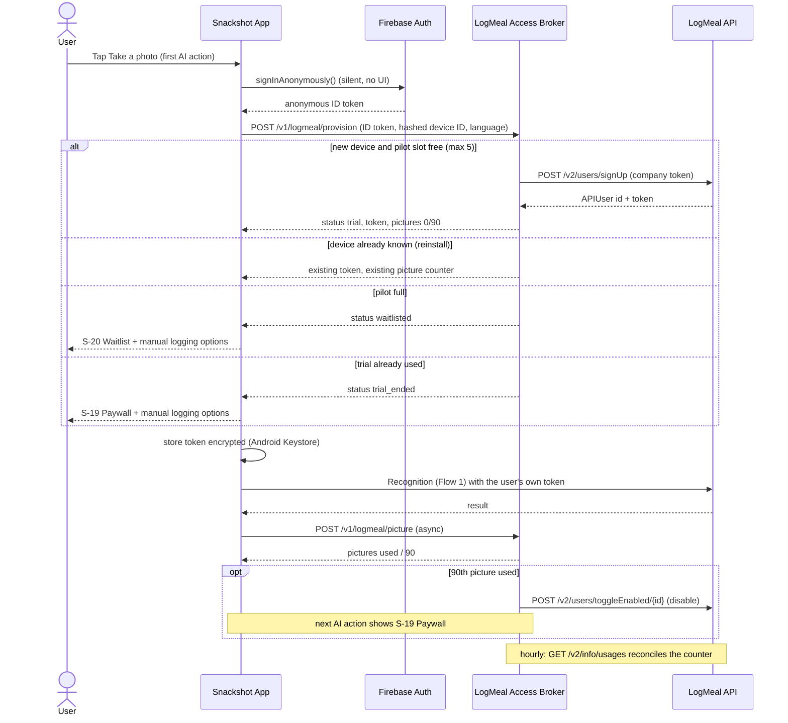
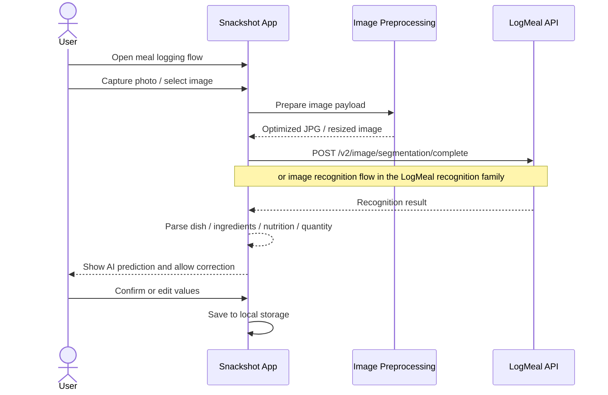
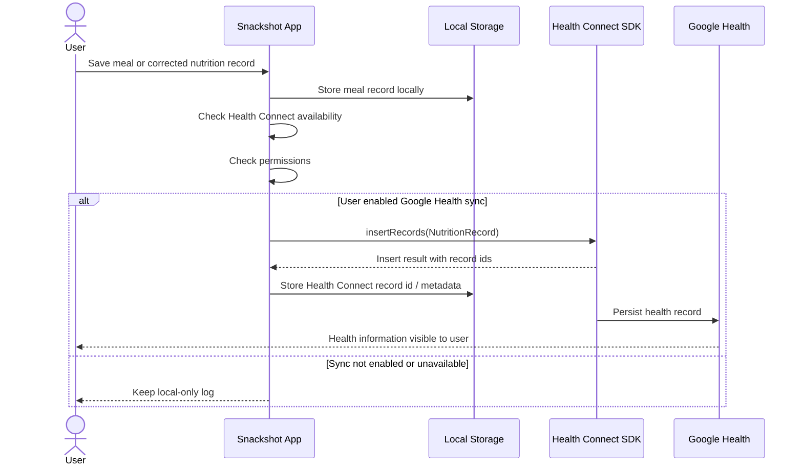
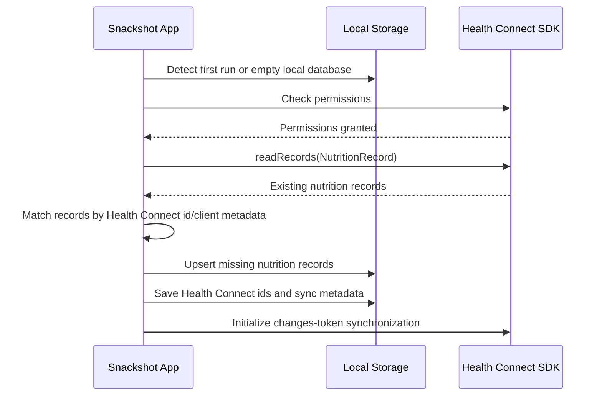
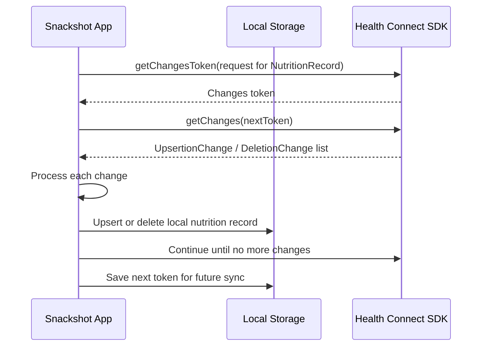
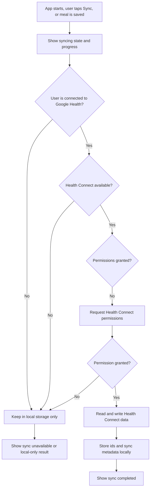
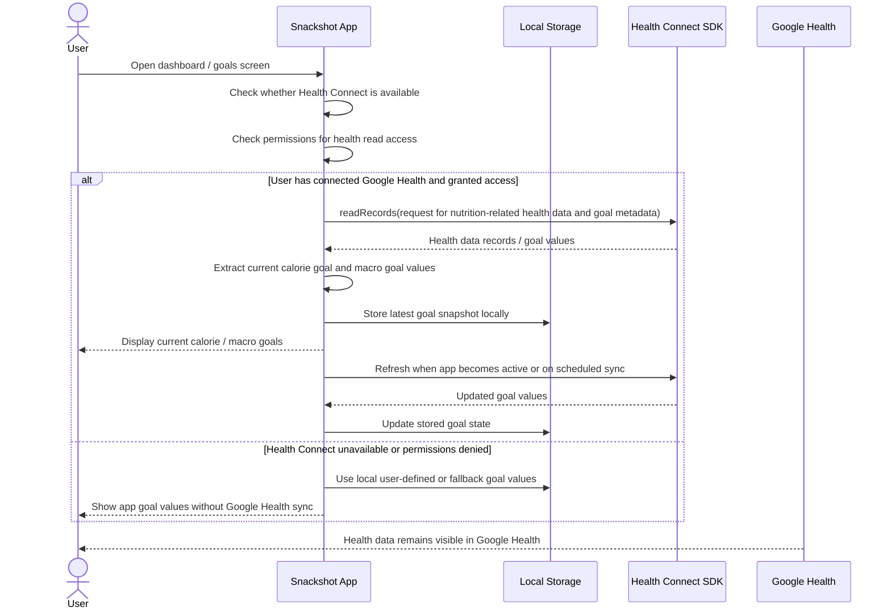

# Process Flow Diagrams for Snackshot

## 1. Purpose

This document shows the process flows for the main data movements between the app and external services.

It covers:
- AI access, free-picture trial, and paywall flow (Flow 0)
- application-to-LogMeal API flow
- application-to-Health Connect sync flow
- local storage synchronization flow
- user health data access flow

## 1a. Flow 0: AI access without registration, trial counter, and paywall

Details: [LogMeal access token management](./11_logmeal-access-token-management.md).

## 2. Flow 1: LogMeal recognition and nutrition process

### LogMeal API methods relevant to this flow

Based on the LogMeal API documentation, the recognition flow should use the image-recognition endpoints in the LogMeal recognition family, especially:

- POST /v2/image/segmentation/complete
- quantity estimation endpoints in the segmentation / quantity family when enabled
- confirmation endpoints for correction / user confirmation if the app allows manual validation

These are appropriate because the documentation describes the process as:
- upload an optimized image
- identify dishes or ingredients
- estimate nutrition and optionally quantity
- confirm or refine the result before saving

### LogMeal preparation rules from project docs

Before sending the image, the app should follow the LogMeal pre-processing guidance:

- convert to JPG
- preserve EXIF orientation
- resize max side to 1000 px
- keep file under 1 MB if possible
- avoid blurry or cluttered photos

Source:
- [LogMeal image preprocessing guide](../services_documentation/logmeal/image-pre-processing.md)
- [LogMeal recognition capabilities guide](../services_documentation/logmeal/recognition-capabilities.md)

## 3. Flow 2: Local save and sync to Google Health Connect

### Health Connect API methods relevant to this flow

These are the core Health Connect methods the app should use:

- HealthConnectClient.getSdkStatus(context)
- PermissionController.createRequestPermissionResultContract()
- HealthPermission.getReadPermission(...)
- HealthPermission.getWritePermission(...)
- healthConnectClient.insertRecords(listOf(record))
- healthConnectClient.updateRecords(...)
- healthConnectClient.getChangesToken(...)
- healthConnectClient.getChanges(...)
- healthConnectClient.deleteRecords(...)
- healthConnectClient.readRecords(...)

These methods align directly with the Health Connect docs:
- request permission before writing
- insert or upsert records
- read changes from Health Connect
- sync local state with Health Connect
- delete records when local data is removed

## 4. Flow 3: Bootstrap Health Connect data into local app storage

This flow runs when the user connects Health Connect for the first time or when the local application data has been deleted. It is also applicable whenever the app detects that its local database is empty while Health Connect contains available nutrition data.

The imported records are copied into local storage. The local application database remains the source of truth after the bootstrap import; Health Connect is not used as the permanent primary datastore.

## 4. Flow 4: Pull changes from Health Connect to local app storage

### Health Connect sync pattern

The Health Connect sync design described in the official docs recommends:

- local app datastore is the source of truth
- Health Connect is used as a synchronized secondary store
- app reads changes by token
- app stores the associated Health Connect ids locally
- app applies deletions using record ids

This is the correct sync model for Snackshot because the project is local-first.

## 5. Flow 5: Data synchronization decision flow

Synchronization has two application triggers:

- automatic synchronization each time the app becomes active
- manual synchronization when the user selects the sync action

For either trigger, the app displays a visible syncing state while Health Connect data is being read or written. The state ends with a completed, partially completed, or failed result; local data remains available while synchronization is in progress.

## 6. Flow 6: Getting and refreshing user calorie goals from Google Health

The product requirements mention that the app should read the user’s calorie and macro goals from Google Health/Health Connect. In practice, the app should treat Health Connect as an external source of daily goal values, refresh them periodically, and store the latest values in the app’s local goal state.

### Goal-refresh pattern for Snackshot

Because the project is local-first, the app should use the following behavior:

1. Keep the user’s calorie and macro goal in the local app datastore.
2. When Google Health is enabled, read the current goal values from Health Connect.
3. Refresh goals when the app opens, after a permission change, or on a periodic sync trigger.
4. If the data is unavailable, denied, or unsupported, fall back to the app’s local goal settings.

### Health Connect API pattern for goals

The Health Connect SDK is designed around reading and writing records, not a dedicated nutrition-goal object in the same way as a database table. The project should therefore follow the same sync pattern used for other health records:

- read available health data records from Health Connect
- extract the latest nutrition/energy goal values
- store them locally in the app state
- periodically refresh them to keep the app dashboard aligned

The practical Health Connect methods for this flow are:

- HealthConnectClient.getSdkStatus(context)
- HealthPermission.getReadPermission(...)
- PermissionController.createRequestPermissionResultContract()
- healthConnectClient.readRecords(...)
- healthConnectClient.getChangesToken(...)
- healthConnectClient.getChanges(...)

This pattern is consistent with the official Health Connect guidance that apps should:
- keep their own datastore as the source of truth
- read data when needed
- sync and refresh at app activation or on a schedule
- handle permission loss and unsupported devices safely

### Practical interpretation for Snackshot

For the MVP, the app should behave as follows:

- User goal values are stored in local app storage.
- If Google Health / Health Connect is enabled, the app reads the current goal values and updates its local goal snapshot.
- The app keeps using local values as the main decision source for day-to-day nutrition tracking.
- If Google Health is unavailable or denied, the app continues with local values and shows a non-blocking fallback state.

## 7. Recommended API usage for the Snackshot MVP

### 7.1 LogMeal
Use the LogMeal recognition flow as the primary AI path:

- obtain AI access from the LogMeal Access Broker without registration (Flow 0)
- preprocess image locally
- send request to LogMeal image-recognition endpoint
- receive recognized food / nutrition data
- allow user to review and correct the result
- save accepted result locally

Recommended primary method pattern:
- POST /v2/image/segmentation/complete
- optional quantity endpoints when quantity estimation is enabled

### 7.2 Health Connect
Use Health Connect as the optional health-data synchronization layer:

- getSdkStatus() to confirm support
- request permissions from the user
- insertRecords() to write nutrition records
- updateRecords() / insertRecords with clientRecordId for upsert patterns
- readRecords() to read current goal and health values when needed
- getChangesToken() and getChanges() to read external changes
- deleteRecords() to remove deleted records from Health Connect

## 8. Architectural interpretation

This process model matches the project architecture goals:

- User interacts with the app UI
- app stores all meal data locally first
- external AI is used for recognition only
- Google Health Connect is used for optional health integration and sharing
- app sync logic is based on record ids, metadata, and changes tokens
- daily calorie goals are refreshed from Health Connect when available and fall back to local goal settings otherwise

## 9. Source basis

This process model is mapped to the official documentation for both platforms:

- [Health Connect sync docs](../services_documentation/health-connect/HC_sync_data.md)
- [Health Connect write data docs](../services_documentation/health-connect/HC_write_data.md)
- [LogMeal recognition docs](../services_documentation/logmeal/recognition-capabilities.md)
- [LogMeal pre-processing docs](../services_documentation/logmeal/image-pre-processing.md)
- [LogMeal user token docs](../services_documentation/logmeal/users-and-access-tokens.md)

## 10. Key implementation recommendation

For the MVP, the app should use these patterns:

1. Save all accepted meal data locally first.
2. Send image to LogMeal only after preprocessing, with the user's own LogMeal token from the broker; never ship the LogMeal company token in the app.
3. Allow the user to review AI output before final save.
4. If Health Connect is enabled, sync the local nutrition record using NutritionRecord + insertRecords and local metadata tracking.
5. Refresh the user calorie and macro goal from Health Connect when available and otherwise fall back to local goal values.
6. Use getChangesToken / getChanges for future synchronization and consistency checks.

### 6.1 LogMeal
Use the LogMeal recognition flow as the primary AI path:

- preprocess image locally
- send request to LogMeal image-recognition endpoint
- receive recognized food / nutrition data
- allow user to review and correct the result
- save accepted result locally

Recommended primary method pattern:
- POST /v2/image/segmentation/complete
- optional quantity endpoints when quantity estimation is enabled

### 6.2 Health Connect
Use Health Connect as the optional health-data synchronization layer:

- getSdkStatus() to confirm support
- request permissions from the user
- insertRecords() to write nutrition records
- updateRecords() / insertRecords with clientRecordId for upsert patterns
- getChangesToken() and getChanges() to read external changes
- deleteRecords() to remove deleted records from Health Connect

## 7. Architectural interpretation

This process model matches the project architecture goals:

- User interacts with the app UI
- app stores all meal data locally first
- external AI is used for recognition only
- Google Health Connect is used for optional health integration and sharing
- app sync logic is based on record ids, metadata, and changes tokens

## 8. Source basis

This process model is mapped to the official documentation for both platforms:

- [Health Connect sync docs](../services_documentation/health-connect/HC_sync_data.md)
- [Health Connect write data docs](../services_documentation/health-connect/HC_write_data.md)
- [LogMeal recognition docs](../services_documentation/logmeal/recognition-capabilities.md)
- [LogMeal pre-processing docs](../services_documentation/logmeal/image-pre-processing.md)
- [LogMeal user token docs](../services_documentation/logmeal/users-and-access-tokens.md)

## 9. Key implementation recommendation

For the MVP, the app should use these patterns:

1. Save all accepted meal data locally first.
2. Send image to LogMeal only after preprocessing.
3. Allow the user to review AI output before final save.
4. If Health Connect is enabled, sync the local nutrition record using NutritionRecord + insertRecords and local metadata tracking.
5. Use getChangesToken / getChanges for future synchronization and consistency checks.
