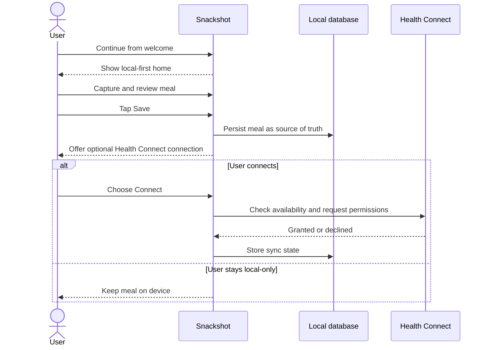
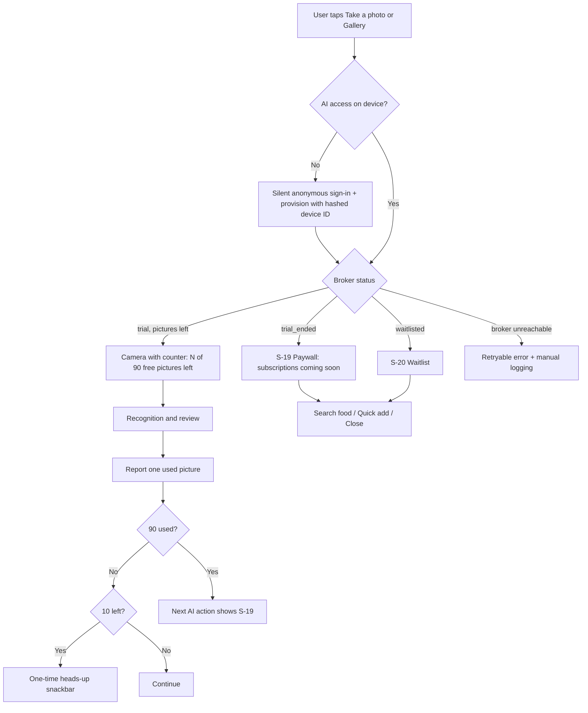
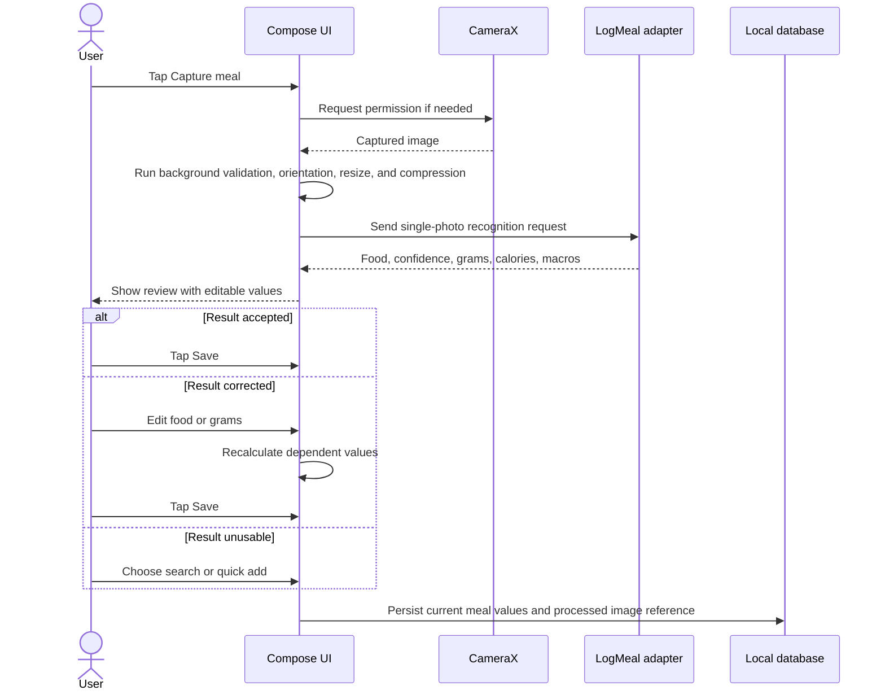
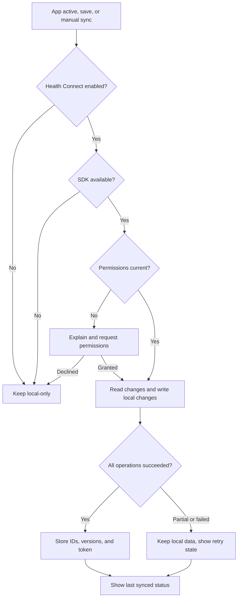

# Architecture & UX Specification: Snackshot

**Status:** Draft
**Version:** 1.1
**Date:** 2026-09-14 (v1.1: 2026-11-14, account-free AI access, 90-picture trial, paywall, waitlist)
**Target Platform:** Android (Kotlin, Jetpack Compose, Material 3)

## 1. Executive Summary & Design Principles

Snackshot is a privacy-first nutrition tracker for adults who want to log meals quickly while losing weight or improving general health. The MVP optimizes for the shortest reliable path from food to a saved local nutrition record: capture, recognize, correct only when needed, save, and review.

The local application database is the source of truth. Health Connect is an optional synchronization target, and LogMeal is a stateless recognition dependency. No Snackshot backend stores nutrition history. The only server component is the LogMeal Access Broker, which gives each anonymous install its own LogMeal access and counts free AI pictures ([11_logmeal-access-token-management.md](./11_logmeal-access-token-management.md)). Images and recognition payloads leave the device only for the selected recognition request and must follow the provider's confirmed retention and credential rules.

### 1.1 Product scope decisions

- **MVP:** F-01, F-02, F-03, F-10, F-11, F-16, F-19, F-20, F-23, F-30 (account-free access, no registration), F-32 (90-picture free AI trial, paywall as a screen only), and F-33 (minimal internal admin console, not part of the app UI).
- **App access:** no registration or sign-in anywhere. AI access is obtained silently on the first AI action. The MVP pilot is capped at 5 users; further users are waitlisted for AI but can log manually.
- **MVP flow:** one captured or gallery-selected image, LogMeal recognition, editable food and grams, local save, and optional Health Connect sync.
- **Fallback:** manual text search first, then quick calorie/macro entry. A failed request is retried once, then the preserved draft is routed to fallback.
- **Health Connect:** never blocks local logging. It is offered contextually at the first save and managed later from Settings.
- **AI Chat conflict:** the feature index marks F-05 as MVP, while the charter and AI analysis defer chat. This specification follows the charter and treats F-05 as decision-required/post-MVP; F-06 remains post-MVP.
- **Deferred:** mixed plates, barcode, recipes, copy previous, adaptive targets, micronutrients, advanced statistics, body/water/fasting tracking, recap, Wear OS, and profile configuration beyond MVP access and integration settings.

### 1.2 Design principles

1. **Glanceable:** daily totals and the next useful action are visible without deep navigation.
2. **Zero-edit by default:** AI results are immediately reviewable and saved with minimal interruption; editing is lightweight and reversible.
3. **Local-first:** local records remain available offline and are never hidden behind account or sync setup.
4. **Honest uncertainty:** confidence, missing values, and sync state are visible; the UI never presents an estimate as certainty.
5. **Contextual permissions:** request camera, gallery, and Health Connect access at the moment it is needed, with a clear benefit and a local-only path.
6. **Recoverable work:** an unfinished meal draft, including its processed image and recognition result, survives backgrounding and process death.

## 2. Screen & Flow Inventory

### 2.1 Screen catalog

| ID | Screen / surface | Purpose | Primary actions | Secondary actions |
|---|---|---|---|---|
| S-01 | Welcome / app access | Establish app entry, AI recognition value, and local-first promise. | Continue. | Privacy details. |
| S-01A | Privacy details | Explain local storage, LogMeal image processing, and optional Google Health Connect sharing. | Return to welcome. | Return via back. |
| S-02 | Home | Provide the primary meal-entry carousel and recent meals. | Choose and open the centered meal-entry action; open dashboard/history. | Sync; choose carousel action. |
| S-03 | Camera capture | Capture a usable meal image. | Take photo; toggle flash. | Gallery; close; photo guidance; free-pictures counter. |
| S-04 | Gallery picker | Select an existing image. | Choose image. | Cancel. |
| S-05 | Recognition progress | Communicate image validation and AI processing while preprocessing runs in the background. | Cancel and preserve draft. | Retry after failure. |
| S-07 | Edit nutrition bottom sheet | Correct food name, grams, calories, or macros. | Apply correction. | Cancel; reset estimate. |
| S-08 | Manual food search | Find a food and nutrition values when recognition is wrong or unavailable. | Search; select result; save. | Quick add; cancel. |
| S-09 | Quick add form | Record known calories/macros without recognition. | Save local entry. | Cancel. |
| S-10 | Save / Health Connect prompt | Explain optional sync at first save. | Keep local-only; connect. | Read privacy details; later. |
| S-11 | Health Connect authorization return | Reflect permission result and sync status. | Retry permission/sync. | Continue local-only; open system settings. |
| S-12 | Daily dashboard detail | Compare today's and historical daily totals. | Select date; switch day/week. | Open meal feed. |
| S-13 | Weekly summary | Show seven daily totals and daily averages. | Change week. | Select a day; return. |
| S-14 | Meal history feed | Review, edit, or delete chronological entries. | Open entry; delete. | Filter by date; manual sync. |
| S-15 | Meal review | Review a recognized or saved meal, including confidence, grams, calories, and macros. | Save; edit values. | Retake; manual search; quick add; discard. |
| S-16 | Settings / integration | Manage local preferences, Health Connect state, and see AI recognition status. | Connect, disconnect, sync. | Privacy; AI recognition (free pictures left); delete all data. |
| S-17 | Confirmation dialogs | Confirm destructive or consequential actions. | Confirm delete/disconnect. | Cancel. |
| S-18 | Snackbars / banners | Report save, sync, retry, and fallback results. | Retry; undo where supported. | Dismiss. |
| S-19 | AI paywall | Shown on an AI action after the 90 free pictures are used. MVP: "Subscriptions are coming soon". | Search food; Quick add. | Close. Post-MVP: Subscribe, Restore purchase. |
| S-20 | AI waitlist | Shown on an AI action when the 5-user pilot is full. | Search food; Quick add. | Close. |

### 2.2 Global navigation architecture

```mermaid
flowchart TD
    subgraph L1[Level 1]
        Welcome[S-01 Welcome]
    end

    subgraph L2[Level 2]
        Home[S-02 Home]
    end

    subgraph L3A[Level 3a]
        Dashboard[S-12 Dashboard]
    end

    subgraph L3B[Level 3b]
        History[S-14 History]
    end

    subgraph L3C[Level 3c]
        Camera[S-03 Take a photo]
        Gallery[S-04 Gallery]
        QuickAdd[S-09 Manual add]
        Search[S-08 Quick search]
        SavePrompt[S-10 Save / Health Connect prompt]
        HealthConnect[S-11 Health Connect authorization]
    end

    subgraph SettingsLevel[Settings]
        Settings[S-16 Settings]
    end

    subgraph L4B[Level 4b]
        Recognition[S-05 Recognition progress]
        Paywall[S-19 AI paywall]
        Waitlist[S-20 AI waitlist]
    end

    subgraph L4C[Level 4c]
        Confirmation[S-17 Confirmation]
        EditSheet[S-07 Edit nutrition]
        MealReview[S-15 Meal review]
    end

    subgraph L5A[Level 5a: Sub-settings and connections]
        PrivacyDetails[S-01A Privacy details]
        GoogleHealthConnection[Google Health connection]
        ImageRetentionPolicy[Image retention policy]
        NutritionPreferences[Nutrition preferences]
        Theme[Theme]
    end

    subgraph L4A[Level 4a: Sub-dashboards]
        Daily[Daily view]
        Weekly[Weekly view]
        Monthly[Monthly view]
        ThreeMonth[Three-month view]
        Yearly[Yearly view]
    end

    Welcome -->|Continue| Home
    Welcome -->|Privacy details| PrivacyDetails
    PrivacyDetails -->|Back| Welcome

    Home -->|Dashboard tab or daily widget| Dashboard
    Home -->|History tab| History
    Home -->|Capture meal| Camera
    Home -->|Choose image| Gallery
    Home -->|Manual add| QuickAdd
    Home -->|Quick search| Search
    Home -->|Settings tab| Settings

    Camera -->|Trial ended| Paywall
    Camera -->|Pilot full| Waitlist
    Gallery -->|Trial ended| Paywall
    Paywall -->|Search food| Search
    Paywall -->|Quick add| QuickAdd
    Paywall -->|Close| Home
    Waitlist -->|Search food| Search
    Waitlist -->|Quick add| QuickAdd
    Waitlist -->|Close| Home
    Camera -->|Photo captured| Recognition
    Camera -->|Choose gallery image| Gallery
    Camera -->|Close| Home
    Gallery -->|Image selected| Recognition
    Gallery -->|Cancel| Camera
    Recognition -->|Result returned| MealReview
    Recognition -->|Cancel or retake| Camera
    Recognition -->|Manual fallback| Search
    Recognition -->|Quick add fallback| QuickAdd
    MealReview -->|Edit result| EditSheet
    MealReview -->|Save| SavePrompt
    EditSheet -->|Apply or cancel| MealReview
    Search -->|Select result| SavePrompt
    QuickAdd -->|Submit| SavePrompt
    Search -->|Back or cancel| Home
    QuickAdd -->|Back or cancel| Home

    SavePrompt -->|Local-only save| Home
    SavePrompt -->|Connect selected| HealthConnect
    SavePrompt -->|Read privacy details| PrivacyDetails
    HealthConnect -->|Authorized or declined| Home
    HealthConnect -->|Open system settings| Settings

    Dashboard --> Daily: D tab
    Dashboard --> Weekly: W tab
    Dashboard --> Monthly: M tab
    Dashboard --> ThreeMonth: 3M tab
    Dashboard --> Yearly: Y tab
    Dashboard -->|Meal feed| History
    History -->|Entry selected| MealReview
    MealReview -->|Save update| History
    MealReview -->|Delete entry| Confirmation
    Confirmation -->|Confirm delete| History
    Confirmation -->|Cancel delete| MealReview
    History -->|Home tab| Home
    History -->|Settings tab| Settings

    Settings --> GoogleHealthConnection
    Settings --> ImageRetentionPolicy
    Settings --> NutritionPreferences
    Settings --> Theme
    Settings -->|Privacy details| PrivacyDetails
    GoogleHealthConnection -->|Back| Settings
    ImageRetentionPolicy -->|Back| Settings
    NutritionPreferences -->|Back| Settings
    Theme -->|Back| Settings
    Settings -->|Home tab| Home
    Settings -->|History tab| History
```

### 2.3 Key user journey flowcharts

#### First launch and first save



#### First AI use, free-picture trial, and paywall



No registration, sign-in, or personal data is requested at any step. Reinstalling on the same phone restores the same counter.

#### Camera to AI recognition and correction



#### Sync and recovery



## 3. Design Tokens & Material 3 System

### 3.1 Color roles

The supplied Google Health screenshots use a dark, low-chroma foundation with a bright sky-blue selection/action color and distinct chart colors. Use this as Snackshot's primary visual direction. These are screenshot-derived design seeds, not Google's proprietary tokens; validate them with Material 3 contrast tooling before release.

| Role | Light | Dark reference | Usage |
|---|---|---|---|
| Primary | `#075985` | `#79C8F5` | Primary actions, selected time range, active controls. |
| OnPrimary | `#FFFFFF` | `#073B58` | Text/icons on primary. |
| PrimaryContainer | `#C9E9FA` | `#075985` | Selected or emphasized action surfaces. |
| Secondary | `#5D6165` | `#C8C9CB` | Neutral controls and supporting actions. |
| Tertiary | `#356B45` | `#79D889` | In-range status and positive progress. |
| Surface | `#F8F9FA` | `#121314` | App background. |
| SurfaceContainer | `#FFFFFF` | `#1E2022` | Grouped metric rows and sheets. |
| SurfaceContainerHigh | `#F1F3F4` | `#292B2E` | Secondary grouped surfaces and chart tracks. |
| OnSurface | `#202124` | `#F1F3F4` | Primary content and large values. |
| OnSurfaceVariant | `#5F6368` | `#C5C7C9` | Supporting copy, axes, and metadata. |
| Error | `#B3261E` | `#FFB4AB` | Failed recognition, permission, or sync. |
| Outline | `#74777A` | `#74777A` | Text-field boundaries and subtle dividers. |

Chart and range colors are intentionally separate from semantic roles: `#32C5F0` cyan intake, `#6FD77C` in range, `#FF9A68` above range, `#8CB5FF` below range, and `#FFC15A` warning. Pair every color with a label, icon, or pattern; never use color as the only status signal. Use dark mode as the screenshot-matched default for statistics, with light mode retaining the same blue and chart accents on neutral surfaces.

### 3.2 Google Health-inspired statistic widgets

Statistics should read as a guided health insight, not a dashboard of unrelated cards. Use this compositional sequence for S-02, S-13, and S-14:

1. **Metric insight header:** metric name, selected period, oversized value plus unit, and one short interpretation such as “Your average was below your goal.”
2. **Time-range segmented control:** `D`, `W`, `M`, `3M`, `Y`, with one sky-blue selected segment and neutral charcoal unselected segments.
3. **Range navigation:** previous, next, and return-to-current-period icon buttons with 48dp targets.
4. **Primary chart:** one metric at a time, with large uncluttered plot area, labeled axes, rounded bars or a simple line, and a visible personal-goal band where applicable.
5. **Chart legend and metric selector:** use a compact legend for Personal range, In range, Above range, and Below range; use an `ExposedDropdownMenuBox` or `FilterChip` for the metric choice rather than multiple simultaneous charts.
6. **Chronological value rows:** full-width `ListItem` rows with date on the left and the measured value in a large right-aligned pill/value block. Use grouped surface rows with 12dp outer corners, not nested cards.
7. **Macro goal section:** three labeled horizontal progress tracks for carbohydrates, fat, and protein, each showing consumed percentage and grams against the goal. Include a `View full nutrients` text action for future micronutrients.

Avoid four equal statistic cards, donut charts that hide exact values, decorative gradients, and a dense multi-series chart. The user should be able to answer “what was my value, for which period, and how does it compare with my goal?” at a glance.

### 3.3 Typography hierarchy

The Android implementation uses Google Fonts through the Google Play services font provider. `GoogleSansFontFamily` is reserved for screen headings and large health metrics, while `GoogleSansTextFontFamily` is used for interface controls, body copy, metadata, and labels. The provider requires the Google Fonts provider authority, package, and certificate resource configured in `theme.kt`; screens must retain a readable fallback if the downloadable font is unavailable.

Use the following `HealthTypography` Material 3 mapping from `UX_UI/theme.kt`. Do not use display typography inside dense data surfaces. The negative tracking on `DisplayLarge` is an implementation-defined exception for large metric values; all other tracking values are explicit and must not be replaced with platform defaults.

| Token | Font family | Size / line height | Weight | Letter spacing | Usage |
|---|---|---:|---|---:|---|
| DisplayLarge | Google Sans Flex | 57 / 64sp | Normal | -0.25sp | Primary dashboard metrics and large health totals. |
| DisplaySmall | Google Sans Flex | 36 / 44sp | Normal | 0sp | Secondary metrics and prominent summary values. |
| HeadlineLarge | Google Sans Flex | 32 / 40sp | Normal | 0sp | Main screen headings such as “Today”. |
| TitleLarge | Google Sans Flex | 22 / 28sp | Normal | 0sp | Section and card headings. |
| TitleMedium | Roboto | 16 / 24sp | Normal | 0.15sp | Menu items, meal names, and important subheadings. |
| BodyLarge | Roboto | 16 / 24sp | Normal | 0.5sp | Primary readable text, explanations, and insights. |
| BodyMedium | Roboto | 14 / 20sp | Normal | 0.25sp | Supporting copy, feed metadata, and state messages. |
| LabelLarge | Roboto | 14 / 20sp | Normal | 0.1sp | Buttons and segmented controls. |
| LabelSmall | Roboto | 11 / 16sp | Normal | 0.5sp | Chart captions, timestamps, and compact metadata. |

#### Typography implementation rules

- Load `Google Sans Flex` with `Medium` and `Bold` weights in `GoogleSansFontFamily`.
- Load `Roboto` with `Normal` and `Medium` weights in `GoogleSansTextFontFamily`.
- Use `sp` dimensions and preserve the listed line heights so dynamic font scaling remains predictable.
- Use `HeadlineLarge` for the primary screen title; existing UX screen descriptions that refer to `HeadlineSmall` should use the nearest available implementation token unless a smaller title style is added to `HealthTypography`.
- Keep `DisplayLarge` and `DisplaySmall` out of forms, feed rows, dialogs, and other dense surfaces.
- Support font scaling without clipping or truncating essential nutrition values; long meal names must wrap.

### 3.4 Spacing, shapes, and elevation

- Use a 4dp base grid; standard content padding is 16dp and section spacing is 24dp.
- Keep interactive controls at least 48dp by 48dp, including icon-only buttons.
- Use 4dp for text fields and compact chips, 12dp for cards and bottom sheets, and 28dp for full-height modal sheets where M3 defaults apply.
- Prefer edge-to-edge Scaffold layouts with a stable 16dp content inset and a 64dp NavigationBar-safe bottom inset.
- Elevation: 0dp for page surfaces, 1dp for cards, 3dp for FABs and active controls, 6dp for dialogs, and 8dp for menus.
- Use `LazyColumn` and paged/cached aggregates for history; do not render an unbounded list in memory.

## 4. Screen-by-Screen Component & State Specification

### 4.1 Shared state contract

Every screen exposes explicit `Loading`, `Empty`, `Error`, and `Success/Default` states. A loading state disables duplicate submissions but never hides already available local data. Errors name the failed operation and offer retry or a local fallback. Empty states always have one clear next action.

### 4.2 S-01 Welcome / app access

**Purpose and role:** Introduce AI recognition, explain the local-first model, and enter the app without making Health Connect or a Google account a prerequisite for local logging.

**Component hierarchy:** `Scaffold` -> theme surface -> `Column` -> abstract `Icon` brand mark -> `HeadlineSmall` -> privacy summary `Text` -> `FilledButton` Continue -> `TextButton` privacy details.

**Copy:** “Your AI recognition and privacy-first nutrition tracker. No registration needed. We do not store your personal health data on external servers. Your first 90 AI pictures are free.”

**States:** Loading restores unfinished draft or access state. Empty is not applicable; use the default first-run state. Error offers retry for local initialization. Success opens Home. Privacy details opens S-01A.

**Edge cases:** Very large text must wrap without clipping and maintain readable contrast on the solid light or dark theme surface. There is no account or sign-in step; do not add one. AI access is obtained silently on the first AI action, not on the welcome screen.

### 4.3 S-01A Privacy details

**Purpose and role:** Give users a complete, readable explanation of where application data stays, what is sent for AI recognition, and what changes when Google Health Connect is connected.

**Component hierarchy:** `Scaffold` -> theme surface -> top app bar with `IconButton` back -> abstract `Icon` brand mark -> scrollable `Card`/reading surface -> section headings and body text.

**Content requirements:** State that Snackshot requires no registration and does not store customer profiles, nutrition logs, personal health data, or photos on its own servers. Explain that a small Snackshot service (the AI access service) keeps only an anonymous ID, a scrambled (hashed) device identifier, the number of AI pictures used, and the AI access status, so that free pictures can be counted and AI access can be managed; it never receives photos or nutrition data. Explain that photo recognition sends only the selected picture to LogMeal, without personal information linked to the user. Explain that Google Health Connect is optional, can be used with an existing or newly created Google account, and can share information with compatible applications for recommendations or other services.

**States:** Loading is not applicable because the document is bundled with the prototype. Empty is not applicable. Error is limited to an unavailable local document and returns to S-01. Success/default presents the complete scrollable long read with a clear return action.

**Edge cases:** Long content must scroll within the device frame without clipping. System text scaling must preserve readable line lengths and keep the back and theme controls reachable. Theme changes must preserve the current scroll position.

### 4.4 S-02 Home

**Purpose and role:** Provide the fastest entry to logging, recent meals, and navigation to dashboard and history.

**Component hierarchy:** `Scaffold` -> `TopAppBar` with sync status -> compact meal-entry carousel -> recent meal value rows -> `NavigationBar` for Home, History, Settings. The carousel order loops Take a photo -> Quick search -> Gallery -> Manual add; only the centered, larger action is enabled. The immediately preceding and following actions remain visible at reduced scale as non-interactive previews.

**States:** Loading uses stable skeletons for the carousel and recent meal rows while local aggregates load. Empty uses a short explanation and the centered meal-entry action. Error shows cached meal rows plus an inline retry banner. Success updates recent meals immediately after local save and marks sync separately.

**Edge cases:** Offline mode uses local data. The carousel must keep exactly one enabled center action, preserve the cyclic order, and prevent taps on the reduced adjacent previews.

### 4.5 S-03 Camera capture and S-04 Gallery picker

**Purpose and role:** Acquire a usable image with minimal friction.

**Component hierarchy:** Camera `Scaffold` -> `TopAppBar` close -> `PreviewView`/CameraX surface -> flash `IconButton` -> shutter `FloatingActionButton` -> gallery `IconButton`; Gallery uses the Android photo picker and a cancel action.

**States:** Loading initializes CameraX or photo picker. Empty camera state explains permission or unavailable hardware and offers Gallery. Error shows permission denial, unavailable camera, or invalid image with Settings/Gallery fallback. Success starts background validation and immediately opens the recognition progress state.

**AI access:** On entry, the camera checks AI access (§2.3 first-AI-use flow). In the trial state the top area shows a compact `AssistChip` "N of 90 free pictures left"; when 10 or fewer remain, the chip uses the warning colour plus a text label. Trial ended opens S-19 and pilot full opens S-20 before the camera preview starts.

**Edge cases:** Ask for camera permission only on entry. Preserve orientation, resize the maximum side to about 1000px, compress to JPG under about 1MB where practical, and delete the captured original after processing. Gallery originals remain untouched.

### 4.6 S-05 Recognition progress

**Purpose and role:** Show truthful status while the app validates the image and submits the recognition request in the background without exposing a dedicated prep screen.

**Component hierarchy:** `Scaffold` -> image preview -> validation status row -> `LinearProgressIndicator` -> provider progress `Text` -> cancel `OutlinedButton` -> retry/alternative actions in a compact action row.

**States:** Loading shows image validation and provider progress, disables duplicate requests, and keeps the draft recoverable in the background. Empty means no usable image and routes back to capture. Error permits one immediate retry, then preserves the draft and offers Search or Quick Add. Success routes to S-15 Meal review.

**Edge cases:** Poor lighting, blur, unsupported format, airplane mode, slow network, provider quota (LogMeal's 20 pictures per day: show "Daily AI limit reached — try again in N h" with Search and Quick Add), broker unreachable, access revoked (403) during the request, and p98 latency above 3 seconds must not discard the image or edits. Preprocessing is a background task, not a separate screen; if the app cannot finish within the expected window, show a recoverable pending state with fallback actions instead of a blocking preparation step.

### 4.7 S-07 Edit nutrition sheet and S-15 Meal review

**Purpose and role:** Make the AI result useful without requiring a full manual re-entry.

**Component hierarchy:** S-15 Review `Scaffold` -> `TopAppBar` -> processed image -> food name `ListItem` -> confidence `AssistChip` -> grams `OutlinedTextField`/stepper -> nutrition values `Card` -> `FilledButton` Save -> `TextButton` Search and Quick Add. S-07 Edit uses `ModalBottomSheet` with food name field, grams field, optional macro fields, Reset, and Apply.

**States:** Loading displays the image and skeleton values. Empty means no usable recognition and presents fallback actions. Error identifies missing or invalid fields and blocks save until corrected. Success enables Save, updates totals immediately after edits, and provides haptic confirmation and snackbar.

**Edge cases:** Below the 80% confidence threshold, emphasize review and fallback rather than silently accepting. Partial recognition can save only after the user supplies missing required values. Grams changes recalculate dependent nutrition values locally; manually supplied provider values remain the displayed source unless the correction contract says otherwise. Long food names wrap.

### 4.8 S-08 Manual food search and S-09 Quick add

**Purpose and role:** Preserve logging when recognition is uncertain, unavailable, or not worth correcting.

**Component hierarchy:** Search `Scaffold` -> `SearchBar` -> result `LazyColumn` of `ListItem`s with nutrition preview -> Quick Add `ModalBottomSheet` or destination form -> `OutlinedTextField`s for name, calories, protein, carbs, and fat -> `FilledButton` Save.

**States:** Loading shows result placeholders. Empty search shows the query and Quick Add CTA. Error offers retry and Quick Add. Success returns a complete local meal draft and preserves the selected timestamp/image reference where applicable.

**Edge cases:** Debounce search, handle offline database availability, validate non-negative numeric values, and prevent save with all nutrition fields blank. Text scaling must not hide the Save action.

### 4.9 S-10 Save / Health Connect prompt and S-11 authorization return

**Purpose and role:** Explain optional synchronization at the first save without blocking local value.

**Component hierarchy:** `AlertDialog` or `ModalBottomSheet` -> privacy explanation -> local-only `TextButton` -> connect `FilledButton`; return surface uses `LinearProgressIndicator`, sync status `AssistChip`, and retry action.

**States:** Loading persists locally first, then checks SDK and permissions. Empty is local-only with no connection. Error explains unavailable SDK, revoked permission, failed write, or partial sync and keeps the local record. Success confirms local save and Health Connect write separately.

**Edge cases:** Android 9+ and Health Connect availability vary. A user may decline, revoke, or reconnect later. Never require Google sign-in inside Snackshot as a Health Connect prerequisite; if Google Health requires its own account, direct the user to that system flow.

### 4.10 S-12 Dashboard ranges and S-13 Weekly summary

**Purpose and role:** Show current and historical calories, protein, carbs, and fat across daily, weekly, monthly, three-month, and yearly ranges. S-13 is the dedicated weekly summary surface; the remaining range views are S-12 dashboard variants.

**Component hierarchy:** `Scaffold` -> `TopAppBar` -> `SegmentedButton` `D`/`W`/`M`/`3M`/`Y` -> period label and previous/next/current icon buttons -> metric insight header -> single-metric chart with personal range band -> metric selector -> legend -> `LazyColumn` chronological value rows -> macro goal progress rows -> meal feed CTA.

**States:** Loading uses stable placeholders for the metric header and chart. Empty uses a large “No data” message with an explanation and Capture CTA. Error shows the last cached aggregate and retry. Success updates the headline, chart, selected range, and chronological rows after every local save and sync import.

**Range variants:** `D` presents a daily total and meal rows. `W` presents seven daily totals and a daily average. `M` presents a calendar-month aggregate. `3M` presents the last three complete or current calendar months as monthly bars with a daily average; the schema range is Jun 24-Sep 23, 2026. `Y` presents month-level aggregates for the current calendar year with a daily average; the schema range is Jan 1-Sep 23, 2026. The `3M` and `Y` variants reuse the same segmented control, aggregate header, macro averages, chart, and History CTA as weekly/monthly.

**Edge cases:** Time zones and day boundaries use the device locale consistently. No target band is shown when none exists; the header says that the goal is unavailable. Large values, seven-day labels, and font scaling must not overlap. Long-range charts aggregate by month rather than rendering one mark per day. Every chart has an accessible tabular/text summary, and the selected metric and period are announced to screen readers.

### 4.11 S-14 Meal history feed

**Purpose and role:** Provide chronological review, correction, and deletion.

**Component hierarchy:** History `Scaffold` -> date/filter controls -> `LazyColumn` of meal `Card`s with image, time, name, calories, and macro labels -> manual sync `IconButton`. Selecting a meal opens S-15 Meal review.

**States:** Loading uses list placeholders. Empty explains that no meals are logged and offers Capture/Search. Error retains cached entries and offers retry. Success supports edit, delete, undo snackbar where safe, and distinct sync status.

**Edge cases:** Deleted records require confirmation and propagate to Health Connect when linked. If external deletion arrives through changes, remove or mark the local record according to sync metadata. Missing images show a neutral placeholder, not a broken image layout.

### 4.12 S-16 Settings / integration and S-17 dialogs

**Purpose and role:** Manage local privacy choices, Health Connect connection, sync, and destructive actions.

**Component hierarchy:** `Scaffold` -> `TopAppBar` -> `ListItem` preference sections -> `Switch`/`AssistChip` connection state -> manual sync `FilledTonalButton` -> privacy and retention details. Destructive operations use `AlertDialog` with explicit consequences.

**States:** Loading reads integration state. Empty means local-only configuration. Error identifies permission or sync failure and links to system settings. Success shows last sync time and connection state.

**AI recognition section:** a `ListItem` showing the AI status: "N of 90 free pictures left", "Free pictures used — subscriptions coming soon" (opens S-19), "On the waitlist" (opens S-20), or "AI paused". **Delete all data** (S-17 confirmation) explains that local meals and the AI access record are deleted, but the used free pictures are not reset.

**Edge cases:** Connection may be revoked outside the app. Local deletion, disconnect, and provider data retention must be separately described; disconnecting sync does not silently delete local meals.

### 4.13 S-19 AI paywall and S-20 AI waitlist

**Purpose and role:** Explain honestly why AI recognition is not available and keep the user logging with free manual methods.

**Component hierarchy:** `ModalBottomSheet` (or full-screen `Scaffold` on compact heights) -> abstract `Icon` -> `TitleLarge` -> `BodyLarge` explanation -> `FilledButton` Search food -> `OutlinedButton` Quick add -> `TextButton` Close.

**S-19 copy (MVP):** Title "You've used your 90 free AI pictures". Body "Thanks for trying Snackshot AI. Subscriptions are coming soon. You can keep logging meals with search and quick add — your history, dashboards, and Health Connect sync stay free." Post-MVP adds the price, `FilledButton` Subscribe (Google Play Billing), and `TextButton` Restore purchase.

**S-20 copy:** Title "AI recognition is in a closed pilot". Body "All pilot places are taken right now. You're on the waitlist and AI will turn on automatically when a place frees up. Meanwhile, log meals with search or quick add."

**States:** Loading checks the broker status (skeleton text, actions enabled). Error (broker unreachable) shows "Couldn't check AI access" with Retry plus the manual actions. Success/default shows the copy above. S-20 switches to the trial flow automatically on the next status check after approval.

**Edge cases:** Never show these sheets for manual logging, history, dashboards, or Health Connect. Do not show them mid-recognition; a recognition already started completes. Announce the title to screen readers when the sheet opens. No payment SDK or price is shown in the MVP.

## 5. Accessibility & Interaction Specs

### 5.1 Touch, semantics, and focus

- Every action has a minimum 48dp touch target and a visible pressed/focused state.
- Provide `contentDescription` for camera, flash, gallery, sync, edit, delete, and close icons; decorative images are excluded from the accessibility tree.
- Set semantic headings for screen titles and macro sections. Focus order follows task order: context, data, primary action, alternatives.
- Bottom sheets trap focus while open and return focus to the invoking control when dismissed.
- Announce recognition completion, save success, sync completion, and errors through semantics and a visible state surface.

### 5.2 Contrast, scaling, and content resilience

- Target WCAG 2.1 AA contrast: at least 4.5:1 for normal text and 3:1 for large text and essential graphical elements.
- Support system font scaling without clipping, truncation of essential values, or horizontal scrolling for forms.
- Do not rely on color alone for confidence, sync, error, or macro categories; combine color with labels, icons, and text.
- Localize dates, decimal separators, units, and pluralization. Keep nutrition units explicit: kcal and g.

### 5.3 Motion and haptics

- Use Material shared-axis or fade-through transitions for capture, review, and history navigation; use short linear progress for provider work.
- Avoid shimmer on live camera surfaces and avoid motion that competes with nutrition values.
- Use a light confirmation haptic on successful local save and a distinct error haptic only for actionable failure. Respect system haptic and reduced-motion settings.
- Do not imply recognition certainty with celebratory animation; confidence is communicated through data and actionability.

### 5.4 Non-functional UX targets

- Recognition target: p98 under 3 seconds for the validated request path; show a recoverable pending state beyond that threshold.
- Recognition reliability target: at least 90% usable result or actionable fallback during validation.
- Local save must complete independently of network and Health Connect state.
- Store current meal values, processed image reference, timestamp, and sync metadata locally. Retain processed images according to the documented 365-day policy; delete captured originals after processing.
- Instrument time-to-log, recognition latency, fallback use, edits, zero-edit rate, local save success, and sync outcomes without sending dietary history to an app-owned server.

## 6. Feature Traceability and Scope

| Feature IDs | UX ownership | Status |
|---|---|---|
| F-01, F-02, F-03 | S-03 to S-08 recognition and correction | MVP |
| F-04 | Future multi-item review variant of S-07 | Post-MVP |
| F-05 | Chat entry variant; conflict with charter | Decision required / post-MVP |
| F-06 | Voice input variant of chat | Post-MVP |
| F-07 | Photo guidance from S-03 and the background validation path | Post-MVP, lightweight copy may ship in MVP |
| F-08 | Product recognition variant of S-07 | Post-MVP |
| F-09 | S-04 Gallery picker | Post-MVP in master list; supported as a low-cost MVP capture fallback |
| F-10, F-11 | S-09 and S-10 manual fallbacks | MVP |
| F-12, F-13, F-14 | Future input extensions from S-09/S-15 | Post-MVP or deferred |
| F-15, F-16 | S-02, S-13, S-14 totals and macro views | F-16 MVP; F-15 post-MVP target comparison |
| F-17, F-18 | Future nutrition and target extensions | Deferred |
| F-19, F-20, F-21 | S-11, S-12, S-17 integration surfaces | F-19/F-20 MVP; F-21 post-MVP |
| F-22 | Separate Wear OS surface | Deferred |
| F-23 | S-14 history feed and S-15 meal review | MVP |
| F-24, F-25 | Future timeline/statistics variants of S-13/S-14 | Post-MVP |
| F-26, F-27, F-28, F-29 | Future tracking and recap surfaces | Deferred |
| F-30 | No registration; silent anonymous AI access on first AI action (S-03/S-04) | MVP |
| F-32 | S-03 counter, S-16 AI section, S-19 paywall, S-20 waitlist | MVP (paywall as a screen only) |
| F-33 | Internal admin console (separate web app, not in the Android UI) | MVP (minimal) |
| F-31 | S-17 settings/profile extension | Deferred |

## 7. Open Decisions Before Implementation

1. Validate LogMeal's single-photo grams response, latency, quota, image retention, and training-use terms. Mobile credential protection is resolved by [11_logmeal-access-token-management.md](./11_logmeal-access-token-management.md).
2. ✅ Resolved (2026-11-14): no Google sign-in or registration in Snackshot, including for AI. AI access uses a silent anonymous identity (F-30), a 90-picture free trial with a paywall screen (F-32), and a 5-user pilot cap.
3. Confirm whether F-09 gallery selection ships in the MVP vertical slice; the feature file marks it post-MVP, while F-01 requires a gallery fallback.
4. Define the exact local persistence technology and schema migration strategy behind the repository boundary.
5. Validate Health Connect permission scopes, bootstrap import behavior, client record version handling, and deletion semantics on physical Android devices.

## 8. Quality Checklist

- [x] Every feature ID has a screen/component owner and scope status.
- [x] Global navigation and complex flows use Mermaid diagrams.
- [x] Components use Material 3 terminology.
- [x] Each primary screen and modal defines loading, empty, error, success, and relevant edge behavior.
- [x] Camera, gallery, AI failure, local-only, Health Connect denial, revocation, retry, and deletion paths are mapped.
- [x] Accessibility, touch targets, contrast, font scaling, motion, and haptics are specified.
- [x] The document is saved under `Project documentation/Architecture/UX_UI/`.