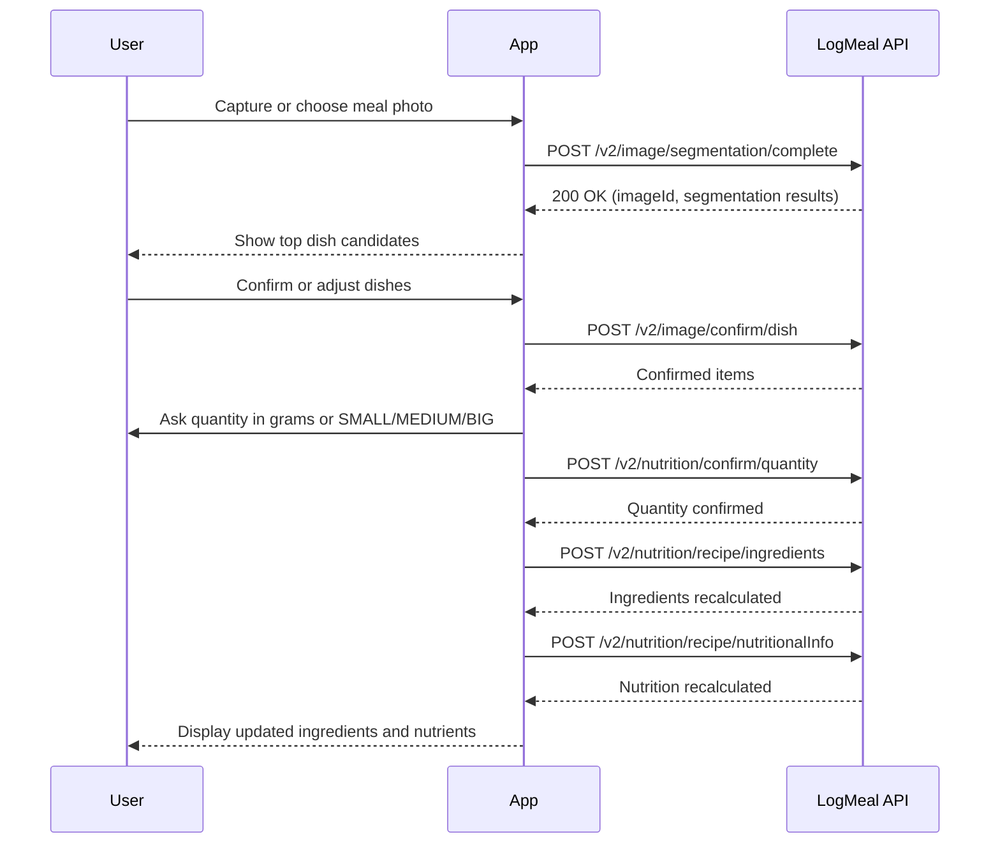

> Source: https://docs.logmeal.com/docs/guides-use-cases-food-quantity-confirmation

# Food Quantity Confirmation

## What You’ll Build

After a dish is detected and confirmed, let users specify how much they ate in grams, with SMALL / MEDIUM / BIG buttons, or with a slider. The selected quantity updates standardized ingredients and the nutritional breakdown.

MEDIUM can represent the dish’s standard serving size. Optionally use SMALL = -50% and BIG = +50% relative to MEDIUM, or accept a precise grams value.

## Prerequisites

- **Plan:** Analyse and above.
- **User type:** APIUser.
- Client HTTP library such as Python `requests`, Node `axios`, or Java `OkHttp`.
- One or two sample food images. For best results, confirm dishes before confirming quantity.

## Sequence Diagram

> **Portion guidance:** MEDIUM equals the dish’s standard serving size. Optionally use SMALL = -50% and BIG = +50% relative to MEDIUM.

## Implementation Guide

1. Set profile data once to improve language and regional dish recognition.
2. Segment the image and display the top five candidates per detected item.
3. Ask the user to confirm or correct the dishes.
4. Confirm the consumed quantity in grams, SMALL/MEDIUM/BIG, or with a slider.
5. Retrieve standardized ingredients adjusted to the confirmed quantity.
6. Retrieve nutritional information adjusted to the confirmed quantity.

### User Interaction Recommendations

- Provide SMALL / MEDIUM / BIG quick actions, with MEDIUM as default.
- Offer a grams field or slider for precise entry.
- Preview recalculated energy and macros before saving.
- For multi-dish images, confirm quantity per item and show per-item and total rows.
- Keep units consistent and localize labels and units by user profile.

### Related Endpoints

- [POST /image/segmentation/complete](https://docs.logmeal.com/reference/post_v2-image-segmentation-complete#/) detects and segments dishes.
- [POST /image/confirm/dish](https://docs.logmeal.com/reference/post_v2-image-confirm-dish#/) confirms or corrects dishes.
- [POST /nutrition/confirm/quantity](https://docs.logmeal.com/reference/post_v2-nutrition-confirm-quantity#/) confirms quantity in grams.
- [POST /nutrition/recipe/ingredients](https://docs.logmeal.com/reference/post_v2-nutrition-recipe-ingredients#/) retrieves recalculated ingredients.
- [POST /nutrition/recipe/nutritionalInfo](https://docs.logmeal.com/reference/post_v2-nutrition-recipe-nutritionalinfo#/) retrieves recalculated nutritional values.
- [GET /intake/{imageId}](https://docs.logmeal.com/reference/get_v2-intake-imageid#/) retrieves the updated intake.

### Common Pitfalls & Tips

- Confirm dishes first to improve quantity, ingredient, and nutrient accuracy.
- Treat MEDIUM as the standard serving; optionally apply +/-50% for SMALL/BIG.
- Recompute nutrition whenever users edit ingredients or quantities.
- Persist the original serving size and user-confirmed quantity for auditability and recalculation.

## Optional Enhancements

- Combine with Easy Ingredients Modulation for salt, sugar, or oil adjustments.
- Show daily goal progress after each intake is saved.

## Next Steps

- Chain with nutrition analysis and history dashboards.
- Offer ingredient editing after quantity confirmation.
- Review [Plans & Limits](../logmeal-plans-limits.md) before production.
