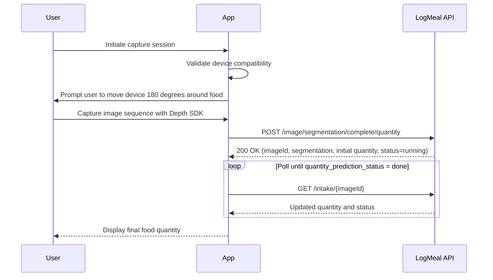
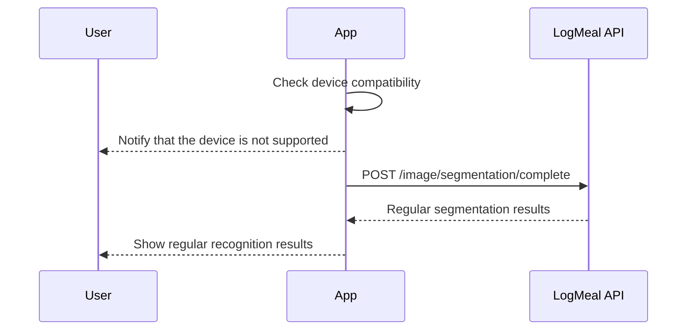

> Source: https://docs.logmeal.com/docs/guides-use-cases-food-quantity-detection

# Food Quantity Detection

> Capture a depth-based image sequence around food items to estimate their quantities using the LogMeal Depth SDKs and Quantity Detection API.

> Before integrating this use case, LogMeal recommends integrating the regular image food recognition procedure first.

## What You’ll Build

Implement a depth-based food quantity detection flow that:

- Validates device compatibility with the LogMeal Depth SDK.
- Captures a set of images or videos around food items using the SDK.
- Sends the sequence to [POST /image/segmentation/complete/quantity](https://docs.logmeal.com/reference/post_v2-image-segmentation-complete-quantity#/) to create an intake and start asynchronous quantity estimation.
- Polls [GET /intake/{imageId}](https://docs.logmeal.com/reference/get_v2-intake-imageid#/) until `quantity_prediction_status` becomes `done`.

## Prerequisites

- **Plan:** Recommend and above.
- **User type:** APIUser.
- LogMeal Depth SDK for iOS or Android.
- Device with a depth-sensing camera, ARCore, or LiDAR capability.
- Sample acquisition data for [iOS](https://api.logmeal.com/assets/food_quantity_examples/sample_data_iOS.zip) or [Android](https://api.logmeal.com/assets/food_quantity_examples/sample_data_Android.zip).

### SDK Access

- [LogMeal Depth SDK for iOS](https://gitlab.com/logmeal/logmeal-depth-sdk-ios)
- [LogMeal Depth SDK for Android](https://gitlab.com/logmeal/logmeal-depth-sdk-android)
- [React Native LogMeal Depth SDK](https://gitlab.com/logmeal/react-native-logmeal-depth-sdk)

### Device Compatibility Check

Not all devices support depth-based quantity estimation. Before capture, verify compatibility using the provided utilities:

- iOS: `LogMealDepthUtils` compatibility check.
- Android: `ArCoreUtils` compatibility check.

Devices that fail compatibility checks should use the [Regular Image Food Recognition](./food-recognition-confirmation.md) procedure.

## Sequence Diagrams

### Main flow

### Fallback flow for non-compatible devices

## Implementation Guide

1. **Access the SDK.** Download the appropriate SDK and review its setup, permissions, and camera requirements.
2. **Check device compatibility.** Fall back to regular segmentation if depth estimation is unsupported.
3. **Capture the image sequence.** Instruct the user to perform a slow 180-degree movement around the food, with at least 150 degrees of coverage, while keeping the camera pointed at it. Wait for successful capture.
4. **Send captured data and create the intake.** Upload the sequence with `POST /image/segmentation/complete/quantity`. The response creates an intake, returns `imageId`, returns segmentation results, and includes `quantity_prediction_status`, typically `running`.
5. **Poll until final quantities are ready.** Call `GET /intake/{imageId}` and inspect the status:
   - `running`: quantity estimation is still being refined. Approximate quantities may be shown, but polling must continue.
   - `done`: final quantity values are available. Stop polling.
   - `error`: handle gracefully, for example by showing approximate quantities and allowing manual editing with `POST /nutrition/confirm/quantity`.

The `done` status is usually reached in about 10 seconds on average, but it can vary with image size, dish count, and system load. Respect rate limits, avoid polling more than once per second per APIUser, and set a maximum polling duration and number of attempts.

### Related Endpoints

- [POST /image/segmentation/complete/quantity](https://docs.logmeal.com/reference/post_v2-image-segmentation-complete-quantity#/) starts quantity estimation.
- [GET /intake/{imageId}](https://docs.logmeal.com/reference/get_v2-intake-imageid#/) retrieves status and approximate or final quantities.
- [POST /image/confirm/dish](https://docs.logmeal.com/reference/post_v2-image-confirm-dish#/) confirms or corrects dish labels.
- [POST /nutrition/confirm/quantity](https://docs.logmeal.com/reference/post_v2-nutrition-confirm-quantity#/) confirms or adjusts serving size.
- [POST /image/segmentation/complete](https://docs.logmeal.com/reference/post_v2-image-segmentation-complete#/) runs standard recognition without depth-based estimation.

### Common Pitfalls & Tips

- Always poll until `quantity_prediction_status = "done"` before treating quantities as final.
- Always check device compatibility.
- Require full 180-degree user arcs; shorter movements reduce accuracy.
- Recommend bright, diffuse lighting.
- Keep each frame below 1 MB.
- Give clear capture guidance because incorrect movement patterns degrade accuracy.
