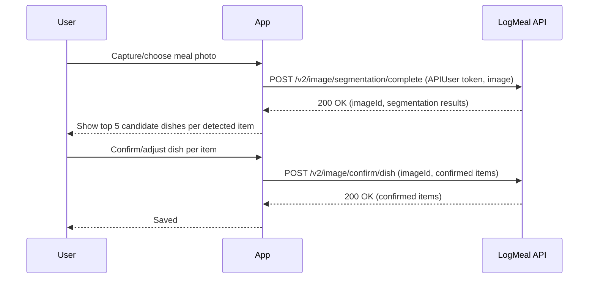
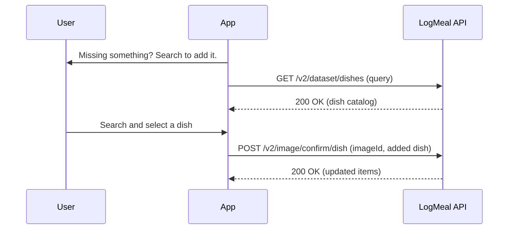

> Source: https://docs.logmeal.com/docs/guides-use-cases-food-recognition-confirmation

# Food Image Recognition with Confirmation

## What You’ll Build

Implement a **photo-to-dishes flow** where the app uploads a meal image, receives top-N dish candidates per region, displays them, and asks the user for quick confirmation before persisting the meal. This combines AI automation with a human-in-the-loop step that improves accuracy and user trust.

Before first use, consider setting the user’s country and language to improve recognition labels and ranking. See [POST /profile/modifyUserProfileInfo](https://docs.logmeal.com/reference/post_v2-profile-modifyuserprofileinfo#/).

## Prerequisites

- **Plan:** Analyse and above.
- **User type:** APIUser.
- Client HTTP library such as Python `requests`, Node `axios`, or Java `OkHttp`.
- One or two sample food images for testing.

## Understanding Segmentation

Segmentation divides a meal image into distinct regions, each representing a detected dish or food item. It allows LogMeal to identify multiple dishes within one photo and generate separate top-N predictions for each region.

For example, a photo containing pasta, salad, and bread can be segmented into three regions. Segmentation is performed automatically by [POST /image/segmentation/complete](https://docs.logmeal.com/reference/post_v2-image-segmentation-complete#/).

## Sequence Diagrams

### Main flow

### Fallback flow when something was not detected

## Implementation Guide

1. Set profile data once to improve label language and regional dishes.
2. Send the image for segmentation and obtain regions and top dish candidates. Display the top five candidates per region.
3. Ask the user to confirm or correct the dishes.
4. If an item is missing or incorrectly recognized, search the dataset and confirm the selected dish into the target region.

### User Interaction Recommendations

- Show top-N candidates for each detected food region.
- Let users confirm or adjust before saving.
- Provide fallback search if an item is not detected.
- Use thumbnails for bounding boxes or segmented regions.
- Use `processed_image_size` to map bounding boxes to the displayed image size.

### Related Endpoints

- [POST /image/segmentation/complete](https://docs.logmeal.com/reference/post_v2-image-segmentation-complete#/) detects and segments all food items and returns top dish predictions.
- [POST /image/confirm/dish](https://docs.logmeal.com/reference/post_v2-image-confirm-dish#/) confirms or corrects the selected dish for each region.
- [GET /dataset/dishes](https://docs.logmeal.com/reference/get_v2-dataset-dishes#/) retrieves the dish catalog for fallback search.
- [POST /profile/modifyUserProfileInfo](https://docs.logmeal.com/reference/post_v2-profile-modifyuserprofileinfo#/) sets language and country.
- [GET /intake/{imageId}](https://docs.logmeal.com/reference/get_v2-intake-imageid#/) retrieves the confirmed intake.

### Common Pitfalls & Tips

- Show candidates to users: human confirmation improves accuracy and trust.
- Use `processed_image_size` to scale segmentation bounding boxes.
- Set `language` for labels and `country` for regional dishes.
- Handle `413` payload-too-large and `429` rate-limit responses.

### Optional Enhancements

- Retrieve ingredients and quantities after confirmation.
- Retrieve macro and micronutrients after confirmation.
- Persist user corrections.
- Track latency and add a background upload with progress feedback.
