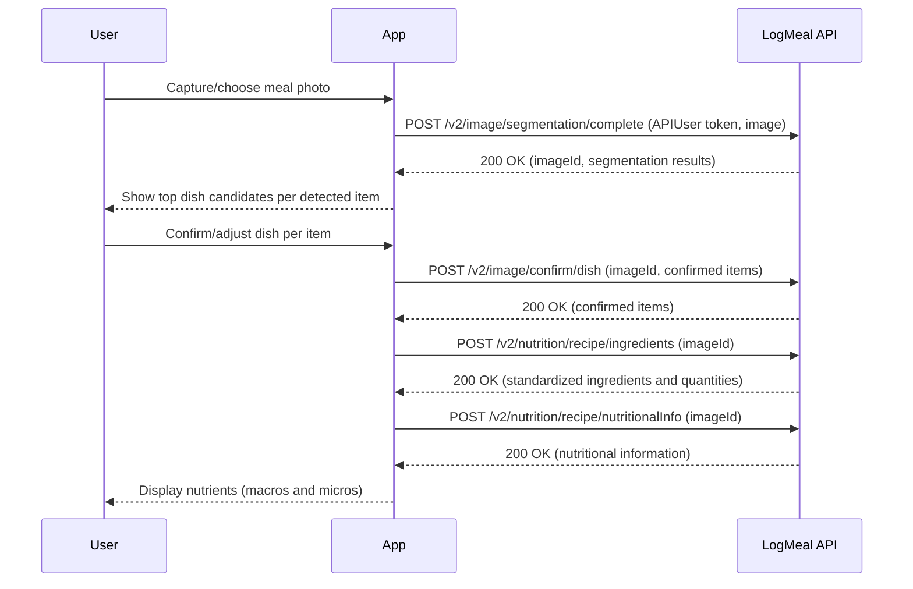

> Source: https://docs.logmeal.com/docs/guides-use-cases-nutritional-information-retrieval

# Nutritional Information Retrieval

## What You’ll Build

Implement an **image-to-nutrition** flow: upload a meal photo or manually submitted intake, confirm the detected dishes, retrieve the standardized ingredient list, and compute the nutritional breakdown (macros and micros) for each confirmed dish.

This chains LogMeal’s dish confirmation, standardized ingredients, and nutritional computation into a single flow for food diaries and nutrition tracking.

## Prerequisites

- **Plan:** Analyse and above.
- **User type:** APIUser.
- Client HTTP library such as Python `requests`, Node `axios`, or Java `OkHttp`.
- One or two sample food images. For best results, confirm dishes before requesting ingredients and nutrition.

## Sequence Diagram

## Implementation Guide

1. Set profile data once to improve label language and regional dishes.
2. Send the image for segmentation and obtain regions and top dish candidates. Display the top five candidates per region.
3. Ask the user to confirm or correct the dishes.
4. Retrieve the standardized list of ingredients associated with the intake.
5. Retrieve nutritional information for the confirmed dishes.

### User Interaction Recommendations

- After confirmation, display a nutritional summary per dish, with macros and expandable micronutrients.
- Provide a one-tap Confirm dishes step before requesting ingredients and nutrition.
- Retrieve nutrition again whenever quantities or ingredients change.
- Localize nutrient labels and units using the user profile.

### Related Endpoints

- [POST /image/segmentation/complete](https://docs.logmeal.com/reference/post_v2-image-segmentation-complete#/) detects and segments dishes.
- [POST /image/confirm/dish](https://docs.logmeal.com/reference/post_v2-image-confirm-dish#/) confirms or corrects detected dishes.
- [POST /nutrition/recipe/ingredients](https://docs.logmeal.com/reference/post_v2-nutrition-recipe-ingredients#/) retrieves standardized ingredients and quantities.
- [POST /nutrition/recipe/nutritionalInfo](https://docs.logmeal.com/reference/post_v2-nutrition-recipe-nutritionalinfo#/) retrieves macro and micronutrient information.
- [POST /nutrition/confirm/ingredients](https://docs.logmeal.com/reference/post_v2-nutrition-confirm-ingredients#/) updates ingredients or quantities before recalculation.
- [POST /nutrition/recipe/compute_nutrients](https://docs.logmeal.com/reference/post_v2-nutrition-recipe-compute-nutrients#/) computes nutrition from an explicit ingredient list.
- [GET /intake/{imageId}](https://docs.logmeal.com/reference/get_v2-intake-imageid#/) retrieves the complete intake.

### Common Pitfalls & Tips

- Confirm dishes first to maximize ingredient and nutrient accuracy.
- Nutrients are derived from standardized ingredients; recompute if users change ingredients or amounts.
- Handle `429` responses with backoff and respect per-user daily image limits.
- For multi-dish images, show per-item nutrition and a total row.
- Keep units such as g, mg, and kcal consistent in the UI and exports.

## Optional Enhancements

- Combine with daily nutritional goals.
- Add remaining daily intake widgets after each intake is saved.
