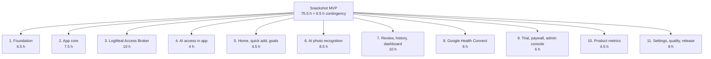
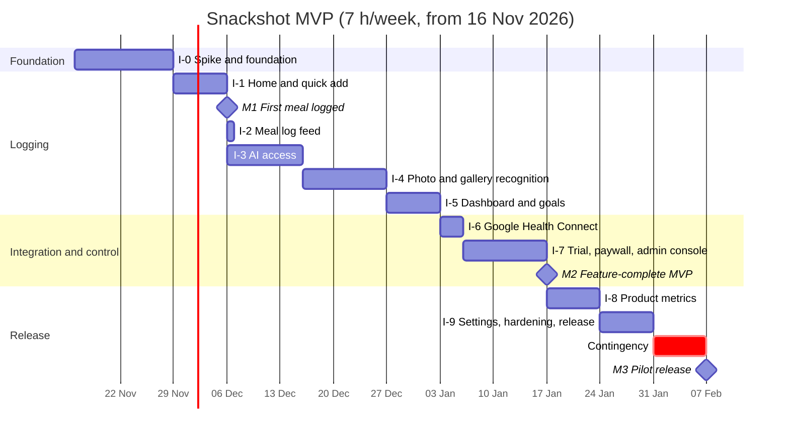
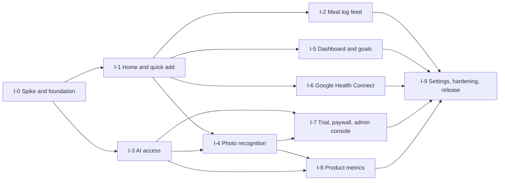

# WBS and MVP Implementation Plan

**Snackshot: AI-Powered Nutrition & Calorie Tracker**

**Status:** DRAFT
**Document Version:** 1.4
**Date:** November 18, 2026 (v1.4: scope revision of November 18, 2026, see §2 decision 6)

## 1. Purpose

This document breaks the Snackshot MVP into a Work Breakdown Structure (WBS) and orders the work into feature-by-feature increments, with dependencies and a Definition of Done for each increment. It covers roadmap step 4 of the [Project Charter](01_project_charter.md) ("Prepare WBS and plan of implementation (feature by feature) for the MVP").

Effort estimates (§5.2) and the schedule (§7.3) are planning values; they are re-checked at each milestone against actual hours.

Sources:

- [01 Project Charter](01_project_charter.md) §5 (MVP scope)
- [03 Feature List](03_feature_list.md) and [Features list](Features%20list/)
- [Architecture answers](Architecture/02_answers-architecture-checklist.md), [Stack analysis](Architecture/04_stack-comparative-analysis.md)
- [C4 container](Architecture/06_c4-container-diagram.md) and [component](Architecture/07_c4-component-diagram.md) diagrams, [process flows](Architecture/09_process-flow-diagrams.md)
- [Architecture & UX specification](Architecture/10_architecture_ux_spec.md) (screens S-01 … S-20)
- [LogMeal access token management](Architecture/11_logmeal-access-token-management.md) (broker, trial, admin console)
- [Development and test environment](Architecture/12_dev-and-test-environment.md) (environments, LogMeal fakes, CI/CD, devices, distribution)
- [LogMeal OpenAPI](services_documentation/logmeal/LogMeal_openapi_docs.yaml), [LogMeal multi-language support](services_documentation/logmeal/multi-language-support.md)

## 2. Decisions recorded

| # | Date | Decision | Effect on this plan |
| --- | --- | --- | --- |
| 1 | 15 Nov 2026 | **Keep the MVP scope and extend the timeline.** | All features in §3 are built before the pilot release. The charter's one-month / 28-hour constraint no longer applies. |
| 2 | 15 Nov 2026 | ~~F-05 AI Chat is in the MVP; F-10 and F-11 are not.~~ **Superseded by decision 6.** | — |
| 3 | 15 Nov 2026 | ~~Food lookup by text uses LogMeal's dish catalog.~~ **Superseded by decision 6** (no text lookup in the MVP). The APIUser still carries the user's `language` and `country`, which LogMeal uses to localize and refine recognized dishes. | Language and country are set at provisioning and can be changed in Settings (3.2, 3.3, 4.2). |
| 4 | 15 Nov 2026 | **Product metrics are sent through the LogMeal Access Broker.** Snackshot collects only product metrics (for example AI response time and usage statistics) to improve the product; they contain no personal data. | Broker endpoint and storage for anonymous daily metric aggregates (§6). No personal data, food names, images, or nutrition values leave the device for metrics. |
| 5 | 18 Nov 2026 | **Development and test environment per [12](Architecture/12_dev-and-test-environment.md).** Local emulators + `snackshot-dev` + `snackshot-prod`; automated tests never call real LogMeal; manual testing uses one test APIUser marked `isTest`; App Distribution for dev builds, Play internal testing for prod. | Scope of 1.1, 1.3, 1.4, 3.1, 3.2, 3.7, 9.3, 10.3, 11.3, 11.4 extended. The extra 1.5 h is taken from contingency (8 h → 6.5 h) and re-checked at M1. |
| 6 | 18 Nov 2026 | **Scope revision.** F-05 AI Chat and F-10 Manual Text Search are **out** of the MVP. F-11 Quick Add is **in** the MVP and is always free. F-09 Gallery is in the MVP. Multi-item (F-04) and product recognition (F-08) are post-MVP. The dashboard has D / W / M / 3M / Y ranges. The user can set optional calorie and macro goals in the app; goals are stored only locally and are not synchronized with Google Health Connect. | The start screen is S-02 Home. Quick Add is the fallback for every case where AI is unavailable (failure, trial ended, waitlisted, broker down, LogMeal daily limit). WBS 5 "AI chat and text logging" is replaced by "Home, quick add, and goals". |
| 7 | 18 Nov 2026 | **LogMeal special conditions.** LogMeal has agreed to special conditions with no limit on the number of APIUsers. | The pilot cap of 5 is Snackshot's own limit only; the test APIUser and the owner's devices do not take pilot places. |

## 3. MVP scope baseline

| Feature | Name | In MVP | Note |
| --- | --- | --- | --- |
| F-01 | AI Food Identification | Yes | Single dish or product from one photo; started from S-02 Home |
| F-02 | Volume / Portion Estimation | Yes | LogMeal grams + history/reference calibration |
| F-03 | Fast Fix of Recognized Values | Yes | Shared review / edit sheet |
| F-09 | Phone Gallery Usage | Yes | Gallery on S-02 Home and on the camera screen |
| F-11 | Quick Add Calories | Yes | Manual entry of name, kcal, and macros; always free; the fallback when AI is unavailable |
| F-16 | Macronutrient Dashboard | Yes | D / W / M / 3M / Y ranges; optional local goals |
| F-19 | Connect to Google Health Connect | Yes | Optional; managed in Settings |
| F-20 | Google Health Connect Sync | Yes | Meal records only; goals are not synchronized |
| F-23 | Calories & Macros Log Feed | Yes | |
| F-30 | Account-free App Access | Yes | Anonymous identity, no sign-in |
| F-32 | Free AI Trial & Paywall | Yes | Paywall screen only, no payments |
| F-33 | Broker Admin Console | Yes (minimal) | Clients, Client detail, Waitlist, Metrics |
| F-05 | AI Chat | No | Post-MVP |
| F-06 | AI Chat / Voice Logging | No | Post-MVP |
| F-10 | Manual Text Search | No | Post-MVP |
| F-04, F-08 | Mixed Plate Breakdown, AI Product Identification | No | Post-MVP |
| F-07 | Best Photo Practices | Optional | One line of guidance copy on the camera screen if convenient |

## 4. Technical baseline

- **App:** native Android, Kotlin, Jetpack Compose, CameraX, Android Photo Picker, Health Connect SDK, LogMeal REST API ([04](Architecture/04_stack-comparative-analysis.md) §9).
- **Broker:** Firebase Auth (anonymous), Cloud Functions (TypeScript), Firestore, Secret Manager, App Check, Remote Config, Hosting ([11](Architecture/11_logmeal-access-token-management.md) §0).
- **Local persistence (proposed):** Room behind repository interfaces. Confirmed in WBS 1.2.
- **Estimation basis:** AI-assisted (GitHub Copilot) development hours for one developer, including unit tests for each item. Contingency is about 8 %.
- **Capacity and start:** 7 hours per week (Mon 2 h, Wed 2 h, Sun 3 h), starting Monday, November 16, 2026.
- **LogMeal language and country:**
  - The broker sets `language` and `country` on each APIUser (`POST /v2/users/modifyUserProfileInfo/{userId}`) at provisioning, taken from the device locale. The user can change them in Settings.
  - LogMeal supports a limited set of languages (spa, cat, eng, ita, nld, fre, ger, tur, gre, heb). Other device languages fall back to English. Country refines recognition and dish relevance.
- **Goals:** optional calorie and macro goals are entered in Settings → Nutrition preferences and stored only in the local database. Without goals, the app works normally and dashboards show no goal band.

## 5. Work Breakdown Structure

### 5.1 WBS overview



### 5.2 WBS dictionary

| WBS | Work package | Features | Deliverable / scope | Est. (h) |
| --- | --- | --- | --- | --- |
| **1** | **Foundation** | | | **6.5** |
| 1.1 | LogMeal + Health Connect technical spike | F-01, F-02, F-20 | Throwaway build on a physical device with the test APIUser token ([12](Architecture/12_dev-and-test-environment.md) §3.4, never shipped). Photo → `segmentation/complete` → nutrition → quantity (grams). One `NutritionRecord` write. Record latency, grams quality, credits per call, ARCore availability. Decision-gate evidence for [04](Architecture/04_stack-comparative-analysis.md) §10. Capture and scrub LogMeal responses as shared fixtures in `test-fixtures/logmeal` ([12](Architecture/12_dev-and-test-environment.md) §3.1). | 3 |
| 1.2 | Close open decisions | — | Confirm persistence technology and the open questions in §8; update affected documents. | 0.5 |
| 1.3 | Android project skeleton | — | Kotlin + Compose project, Gradle version catalog, packages/modules (`domain`, `data-local`, `logmeal`, `healthconnect`, `access`, `metrics`, `ui`), Hilt, ktlint/lint; flavors `local` / `dev` / `prod` with `BuildConfig` URLs; monorepo layout, `.gitignore` / `.gitattributes`; GitHub Actions `android-ci` and `distribute-android` (App Distribution for dev) ([12](Architecture/12_dev-and-test-environment.md) §2, §4, §7). | 2 |
| 1.4 | Firebase projects | F-30, F-33 | `snackshot-dev` and `snackshot-prod` on Blaze with budget alerts; Emulator Suite (`demo-snackshot`) for development; APICompany token only in prod Secret Manager, readable only by the broker service account; test APIUser token in dev Secret Manager; Workload Identity Federation for GitHub Actions deploys ([12](Architecture/12_dev-and-test-environment.md) §1, §7.2, §9). | 1 |
| **2** | **App core** | | | **7.5** |
| 2.1 | Design system | all | Material 3 theme and tokens ([10](Architecture/10_architecture_ux_spec.md) §3), shared state contract components (loading, empty, error + retry, snackbar). | 1.5 |
| 2.2 | Navigation shell and entry screens | F-30 | Global navigation with S-02 Home as the start screen, S-01 Welcome, S-01A Privacy details (including the product metrics notice). No sign-in screens. | 1.5 |
| 2.3 | Domain model and nutrition calculation | F-01, F-03, F-11, F-16 | `MealEntry` (source: photo, gallery, or quick add), `NutritionValues`, `MealDraft`, `NutritionGoals`, `SyncState`; proportional recalculation after a grams edit; Atwater comparison for test builds only; unit tests. | 1.5 |
| 2.4 | Local persistence | F-16, F-20, F-23 | Room schema (meals, goals, settings, sync metadata, metric counters), DAOs, repositories, migration strategy, app-private storage. | 2 |
| 2.5 | Meal draft and image store | F-01, F-09 | Draft survives backgrounding and process death; processed image stored locally (raw photo deleted, 365-day retention) per [02](Architecture/02_answers-architecture-checklist.md) §1.5, §8.4. | 1 |
| **3** | **LogMeal Access Broker** | | | **10** |
| 3.1 | Broker project setup | F-30 | Cloud Functions (TypeScript), Firestore collections (`clients`, `devices`, `usage`, `audit`, `settings`, `metrics_daily`) with deny-all client rules, LogMeal company client with `LOGMEAL_MODE` (`fake` / `test-user` / `company`), token encryption, emulator config, fake LogMeal server, seed data, `broker-ci` workflow ([12](Architecture/12_dev-and-test-environment.md) §3.3, §10). | 1.5 |
| 3.2 | `provision` and `status` endpoints | F-30, F-32 | Anonymous ID token + App Check verification; device re-attach by hashed device ID; `signUp` APIUser; set APIUser `language` and `country`; pilot cap of 5 → waitlist (clients with `isTest` not counted); status with picture counter and `isTest`. | 3 |
| 3.3 | `profile` endpoint | F-30 | Update APIUser `language` / `country` when the user changes them in Settings. | 0.5 |
| 3.4 | `picture` and `DELETE /account` endpoints | F-32, F-30 | Idempotent picture count by `requestId`; trial ends at 90; account deletion keeps the device picture counter. | 1.5 |
| 3.5 | Client state machine | F-32, F-33 | Trial → TrialEnded / Waitlisted / Paused / Suspended / Cancelled; read-before-`toggleEnabled`; `deleteAPIUser`; serialized per-client jobs; audit records. | 1.5 |
| 3.6 | Cost controls | F-33 | Remote Config global kill switch; scheduled credit check with alert e-mail. | 1 |
| 3.7 | Broker tests | — | Emulator tests (Vitest, MSW with shared fixtures, no real LogMeal calls) for provision, waitlist, profile, picture idempotency, trial end, delete, metrics; Firestore rules tests. | 1 |
| **4** | **AI access in app** | | | **4** |
| 4.1 | AI Access module | F-30 | Silent anonymous sign-in on the first AI action (photo or gallery recognition); hashed device ID; Play Integrity App Check; broker client; token in DataStore encrypted with Tink + Android Keystore; backup exclusion; `LogMealCredentialProvider`; status cache (~1 h). | 3.5 |
| 4.2 | Language and country | F-01, F-30 | Detect device locale on provisioning; map to a LogMeal-supported language (fallback English) and ISO 3166-1 country. | 0.5 |
| **5** | **Home, quick add, goals** | | | **4.5** |
| 5.1 | Home screen (S-02) | F-01, F-09, F-11 | Start screen with the meal-entry carousel (Take a photo → Gallery → Manual add), today's totals, recent meals, sync status, navigation to Dashboard, History, and Settings. | 2 |
| 5.2 | Quick add (S-09) | F-11 | Form for name, kcal, protein, carbs, and fat; validation (non-negative, not all blank); optional calculated kcal from macros; local save through the shared save path. Always available, also when AI is unavailable. | 1.5 |
| 5.3 | Local nutrition goals | F-16 | Settings → Nutrition preferences: optional daily calorie and macro goals, stored only locally; clearing goals is allowed. | 1 |
| **6** | **AI photo recognition** | | | **8.5** |
| 6.1 | Camera and gallery (S-03, S-04) | F-01, F-09 | CameraX capture, contextual permission with rationale, flash, close; Photo Picker for gallery; started from S-02 Home. | 2.5 |
| 6.2 | Image preprocessing | F-01 | Resize, EXIF orientation, JPEG compression, size/format validation. | 1 |
| 6.3 | LogMeal recognition adapter | F-01, F-02 | Recognition → nutrition → quantity calls; mapping to domain (one dish or product per photo); 80% confidence threshold; error mapping (401, 403/116, 429); retry once; redact `Authorization` in logs. | 3 |
| 6.4 | Recognition progress and failure handling (S-05) | F-01, F-11 | Progress screen; cancel preserves the draft; failure → retry once → Quick add with the draft (image, time) kept. | 1 |
| 6.5 | Portion calibration | F-02 | Use the user's last grams for the same dish and reference average weights when LogMeal grams are missing or low-confidence. | 1 |
| **7** | **Review, history, dashboard** | | | **10** |
| 7.1 | Meal review and edit sheet (S-15, S-07) | F-03, F-11 | Shared review: name, grams, kcal, macros, confidence; edit sheet with instant recalculation; reset to estimate. Used by photo results, quick add, and history. | 2.5 |
| 7.2 | Meal history feed (S-14) | F-23 | Reverse-chronological list with time, name, photo thumbnail (placeholder for quick add), kcal, macros; "show more" after 7 days; open → edit; delete with S-17 confirmation and undo. | 2 |
| 7.3 | Dashboard (S-12, S-13) | F-16 | `D` / `W` / `M` / `3M` / `Y` ranges: daily total, 7 daily totals with daily average, month, three months, and year with monthly aggregates and daily average; previous / next / current period; goal band and macro goal progress only when goals are set; cached aggregates; accessible text summary. | 5.5 |
| **8** | **Google Health Connect** | | | **6** |
| 8.1 | Connect flow | F-19 | `getSdkStatus`, S-10 first-save prompt with privacy copy, permission request contract, S-11 result, local-only mode, revocation handling. | 2.5 |
| 8.2 | Write path | F-20 | Insert/upsert `NutritionRecord` with `clientRecordId` / `clientRecordVersion` on create and edit; delete on local delete; pending-sync queue. | 1.5 |
| 8.3 | Read path and sync triggers | F-20 | Bootstrap import on first connect; `getChangesToken` / `getChanges` pull; sync on app resume and manual sync; syncing state in UI. Goals are not read or written. | 2 |
| **9** | **Trial, paywall, admin console** | | | **6** |
| 9.1 | Trial and paywall UI | F-32 | "N of 90 free pictures left" on S-02 Home, the camera, and S-16; one-time heads-up at 10 left; S-19 paywall (screen only); S-20 waitlist; LogMeal daily-limit message; every state offers Quick add; async picture report. | 2 |
| 9.2 | Admin functions | F-33 | Admin custom-claim script; `adminListClients`, `adminGetClient`, `adminSetStatus`, `adminSetTest`, `adminGrantPictures`, `adminDeleteClient`, `adminApproveWaitlist`, `adminGetMetrics` — each checks the claim; actions write audit. | 1.5 |
| 9.3 | Admin SPA | F-33 | React + Vite on Firebase Hosting: Google admin sign-in, Clients list, Client detail actions (reason + confirmation), Waitlist approve/reject, Metrics page (§6.4) with test devices shown or hidden; "Mark as test" action; `admin-ci` workflow. | 2.5 |
| **10** | **Product metrics** | | | **4.5** |
| 10.1 | On-device metric collector | — | Record metric events locally (§6.2) and compute daily aggregates. | 1.5 |
| 10.2 | Upload job | — | WorkManager job sends the previous day's aggregates once per day through the broker; retries with backoff; deletes sent aggregates. Respects the Settings opt-out. | 1 |
| 10.3 | Broker `metrics` endpoint and storage | — | `POST /v1/metrics` validates the payload against an allow-list schema, drops unknown fields, and stores it in `metrics_daily` without any client or device identifier (§6.3); accepts the `test` flag. | 1 |
| 10.4 | Metrics aggregation | — | Scheduled function computes pilot-level north-star values (§6.4) for the admin console. | 1 |
| **11** | **Settings, quality, release** | | | **8** |
| 11.1 | Settings (S-16) | F-16, F-19, F-30, F-32 | Google Health Connect connect/disconnect/sync; AI section (pictures left, status); language and country for AI recognition; Nutrition preferences (goals); product metrics on/off; theme; image retention policy; privacy; "Delete all data" (local + `DELETE /account`); S-17 dialogs. | 2 |
| 11.2 | Accessibility pass | all | TalkBack labels, font scaling, contrast, touch targets per [10](Architecture/10_architecture_ux_spec.md) §5. | 1 |
| 11.3 | End-to-end device testing and fixes | all | Full test pass on the physical phone, the AVD set (API 28, 34, latest), and Firebase Test Lab devices ([12](Architecture/12_dev-and-test-environment.md) §6): photo and gallery recognition, quick add, dashboards and goals, offline, HC denied/revoked, reinstall, waitlist, trial end, metrics upload. | 2.5 |
| 11.4 | Google Play release | — | Play App Signing with an upload key in the GitHub `prod` environment, internal testing track, pre-launch report review, privacy policy page (including product metrics), Data safety form, Health Connect permission declaration, store listing. | 2.5 |
| | **Total** | | | **75.5** |
| | Contingency (8 h, minus 1.5 h used by decision 5) | | | 6.5 |
| | **Total with contingency** | | | **82** |

## 6. Product metrics through the broker

### 6.1 Principles

- Snackshot collects only **product metrics** (for example AI response time and usage statistics) to make the product better. They contain **no personal data**.
- Metrics are **anonymous aggregates**, not events. The device sends one small record per day.
- A metrics record carries **no client ID, device ID, Firebase UID, LogMeal user ID, IP-derived data, food names, images, nutrition values, or free text**.
- The broker verifies the request (App Check and the anonymous Firebase ID token, like every other endpoint) but **does not store** the caller's identity with the record. Request logs for this endpoint must not include the UID.
- Fields come from a fixed allow-list; numbers are counts or coarse buckets, so a record cannot identify a person.
- The user can switch metrics off in Settings. The privacy details screen and the Play Data safety form describe the data.

### 6.2 Collected on the device

| North-star metric ([charter §6](01_project_charter.md)) | Local measurement |
| --- | --- |
| Quality of food recognition | Recognitions with confidence ≥ 80 %; results where the user changed the name; results where the user changed only grams; failed recognitions that ended in Quick add |
| Speed of food recognition | Time from photo sent to result shown |
| Zero-Edit rate | Results saved without any edit / all saved AI results |
| Core habit formation | Days with at least 2 logged meals in the last 7 days |
| Time-to-log | Time from app open to save |

### 6.3 Daily payload

```json
{
  "schema": 1,
  "day": "2026-11-15",
  "appVersion": "1.0.0",
  "locale": "eng-GB",
  "test": false,
  "photoRecognitions": 4,
  "recognitionFailures": 1,
  "quickAdds": 2,
  "highConfidence": 3,
  "savedZeroEdit": 3,
  "savedGramsEdited": 1,
  "savedNameChanged": 0,
  "recognitionLatencyMs": { "p50": 1800, "p95": 2900 },
  "timeToLogSec": { "p50": 14, "p95": 41 },
  "mealsLogged": 5,
  "daysWith2PlusMealsLast7": 5
}
```

The broker stores it in `metrics_daily/{autoId}` exactly as validated. Latency values are rounded to 100 ms and time-to-log to whole seconds. `test` is `true` only on devices whose client is marked `isTest` (the owner's devices), so the console can exclude them from pilot totals ([12](Architecture/12_dev-and-test-environment.md) §3.4).

### 6.4 Reporting

A scheduled function aggregates `metrics_daily` into pilot-level values: recognition success rate, p50/p95 recognition latency, Zero-Edit rate, share of reports with 4 or more habit days, p50/p95 time-to-log, and the share of meals logged with Quick add. The admin console Metrics page shows them per day and per week. With a 5-user pilot, values are shown only as pilot totals, never per record.

## 7. Implementation plan (feature by feature)

### 7.1 Ordering principles

1. **Remove the biggest risk first.** The LogMeal + Health Connect spike (1.1) runs before any production code. If LogMeal cannot return usable grams or latency, the plan changes before production work starts.
2. **Manual logging before AI.** Quick add creates the full path — Home, review, local save, history — without LogMeal or the broker. Photo recognition then plugs into the same path.
3. **AI access before photo recognition.** The broker and the AI Access module are built before the camera flow, because every recognition needs the user's own LogMeal token.
4. **Each increment produces a working app** that can be installed on a phone and demonstrated.

### 7.2 Increments

| # | Increment | Features | WBS items | Effort (h) | Cumulative (h) | Target finish |
| --- | --- | --- | --- | --- | --- | --- |
| I-0 | Spike and foundation | — | 1.1, 1.2, 1.3, 1.4, 2.1, 2.2, 2.3, 2.4 | 13 | 13 | Sun, Nov 29 |
| I-1 | Home and quick add | F-11, F-03 | 5.1, 5.2, 7.1 | 6 | 19 | Sun, Dec 6 |
| **M1** | **Milestone: first meal logged end to end (quick add → review → local save)** | | | | | **Sun, Dec 6** |
| I-2 | Meal log feed | F-23 | 7.2 | 2 | 21 | Sun, Dec 6 |
| I-3 | AI access (broker core + app module) | F-30 | 3.1, 3.2, 3.3, 3.7 (core tests, 0.5 h), 4.1, 4.2 | 9.5 | 30.5 | Wed, Dec 16 |
| I-4 | Photo and gallery recognition | F-01, F-02, F-09 | 2.5, 6.1, 6.2, 6.3, 6.4, 6.5 | 9.5 | 40 | Sun, Dec 27 |
| I-5 | Dashboard and goals | F-16 | 5.3, 7.3 | 6.5 | 46.5 | Sun, Jan 3 |
| I-6 | Google Health Connect | F-19, F-20 | 8.1, 8.2, 8.3 | 6 | 52.5 | Wed, Jan 6 |
| I-7 | Free AI trial, paywall, admin console | F-32, F-33 | 3.4, 3.5, 3.6, 3.7 (remaining tests, 0.5 h), 9.1, 9.2, 9.3 | 10.5 | 63 | Sun, Jan 17 |
| **M2** | **Milestone: feature-complete MVP** | | | | | **Sun, Jan 17** |
| I-8 | Product metrics | — | 10.1, 10.2, 10.3, 10.4 | 4.5 | 67.5 | Sun, Jan 24 |
| I-9 | Settings, hardening, and release | F-16, F-19, F-30, F-32 | 11.1, 11.2, 11.3, 11.4 | 8 | 75.5 | Sun, Jan 31 |
| — | Contingency | — | — | 6.5 | 82 | Sun, Feb 7 |
| **M3** | **Milestone: pilot release (Google Play internal testing, 5 users)** | | | | | **Sun, Feb 7, 2027** |

### 7.3 Schedule



> The schedule assumes all 7 hours are available every week (Mon 2 h, Wed 2 h, Sun 3 h). The December 21 – January 3 holidays fall inside I-4 and I-5; if those two weeks are lost, M2 and M3 move by up to two weeks.

### 7.4 Dependencies



I-2, I-5, and I-6 depend only on I-1 and can be reordered. I-3 depends only on I-0 and can start in parallel with I-1 if useful. I-8 can start once photo recognition exists, because most metrics measure it.

### 7.5 Increment details and Definition of Done

#### I-0 Spike and foundation

- **Goal:** prove the risky integrations, then create the project that all features build on.
- **Done when:**
  - Spike results (photo latency, grams, credits per call, HC write) are recorded in the architecture docs, and the [04](Architecture/04_stack-comparative-analysis.md) §10 decision gates pass or the plan is revised.
  - The open questions in §8 have an owner decision.
  - The app builds in CI and opens S-01 → S-02 Home; navigation to History, Dashboard, and Settings works (placeholder screens allowed).
  - `snackshot-dev` and `snackshot-prod` exist; the APICompany token is in prod Secret Manager and the test APIUser token in dev Secret Manager.
  - LogMeal fixtures from the spike are committed; the local flavor runs against the emulators and the fake LogMeal server.
  - Room schema and nutrition calculation have unit tests.

#### I-1 Home and quick add — F-11, F-03

- **Goal:** the user can log a meal by hand from the start screen.
- **Done when:** S-02 Home is the start screen with the carousel (Take a photo and Gallery may be placeholders until I-4); Manual add opens S-09; a valid entry is reviewed and saved locally; Home shows today's totals and the new meal immediately; invalid values are blocked.
- **M1:** the first meal is logged end to end.

#### I-2 Meal log feed — F-23

- **Goal:** a clear history of all logged meals.
- **Done when:** S-14 lists entries newest first with time, name, photo (or placeholder), kcal, and macros; entries can be edited and deleted with confirmation and undo; Home and the feed show the same data.

#### I-3 AI access — F-30

- **Goal:** each anonymous install gets its own LogMeal access, with language and country set, and no credentials in the app.
- **Done when:** on the first AI action a new install silently provisions an APIUser with the device's language and country; the first 5 devices get access and the 6th is waitlisted (test clients not counted); reinstall on the same device re-attaches; the token is stored encrypted and excluded from backup; broker emulator tests pass.

#### I-4 Photo and gallery recognition — F-01, F-02, F-09

- **Goal:** photo or gallery image → AI result → review → save.
- **Done when:** camera and gallery images are recognized; grams, kcal, and macros appear on S-15; low-confidence results are emphasized for review; failed results are retried once and then offer Quick add with the draft kept; the draft survives process death; recognition latency is measured on a physical device (target p98 < 3 s); each successful recognition is reported to the broker as one picture.

#### I-5 Dashboard and goals — F-16

- **Goal:** totals for calories, protein, carbs, and fat over any range, compared with optional goals.
- **Done when:** the D, W, M, 3M, and Y views show correct totals and daily averages; previous / next / current period navigation works; goals can be set, changed, and cleared in Nutrition preferences; with goals, the goal band and macro progress appear; without goals, the dashboard works and says that no goal is set; totals update immediately after save, edit, and delete.

#### I-6 Google Health Connect — F-19, F-20

- **Goal:** optional, local-first sync with Google Health Connect.
- **Done when:** the first save shows S-10; declining keeps local-only mode; accepting shows the system dialog; create/edit/delete are reflected in Health Connect; sync runs on app resume and from a manual action; revoked permission is handled without data loss; the connection can be managed in Settings.

#### I-7 Free AI trial, paywall, admin console — F-32, F-33

- **Goal:** the trial is enforced and visible, and the owner can manage pilot users.
- **Done when:** the picture counter is correct after restart and reinstall; the heads-up shows once at 10 left; S-19 appears on the first AI action after 90 pictures; S-20 appears when the pilot is full and disappears after admin approval; both offer Quick add; the kill switch and credit alert work; the admin console lists clients, pauses/resumes/deletes them, marks test clients, approves the waitlist, and every action is in the audit log.
- **M2:** all MVP features are implemented.

#### I-8 Product metrics

- **Goal:** the five north-star metrics are measurable for the pilot without any personal data.
- **Done when:** the device sends one daily aggregate that matches §6.3; the broker rejects unknown fields and stores no identifier; turning metrics off in Settings stops uploads; the admin console Metrics page shows pilot totals per day and week.

#### I-9 Settings, hardening, and release

- **Goal:** a pilot build on Google Play internal testing.
- **Done when:** Settings covers Google Health Connect, AI status, language and country, Nutrition preferences, metrics opt-out, privacy, and "Delete all data"; the accessibility pass is done; the end-to-end test list passes on physical devices; the Data safety form, privacy policy, and Health Connect declaration are submitted; 5 pilot testers can install the app.

## 8. Open questions

| # | Question | Status |
| --- | --- | --- |
| 1 | How does a user log a meal after the 90-picture trial ends, or while waitlisted? | **Resolved (decision 6):** Quick add is always available and free. S-19 and S-20 offer Quick add. |
| 2 | Do text lookups count toward the 90 free pictures? | **No longer applies:** there is no text lookup in the MVP. |
| 3 | What happens when photo recognition fails? | **Resolved (decision 6):** retry once, then Quick add with the draft kept. |
| 4 | Which LogMeal plan covers the pilot? | **Resolved (decision 7):** LogMeal special conditions, no APIUser limit. Credit consumption is still watched with the alarm (3.6). |
| 5 | Can LogMeal's dish catalog handle free-text quantities? | **No longer applies:** text logging is post-MVP (F-05, F-10). |

## 9. Documents aligned

All documents were aligned with decisions 6 and 7 on 18 November 2026. The HTML prototypes and draw.io schemas in [UX_UI](UX_UI/) show the **final UX/UI solution**, including post-MVP features such as the "Quick search" carousel action and S-08; in the MVP build these features are shown disabled. Still open: there are no schemas yet for S-19 and S-20 or a prototype for S-20.

## 10. Risks

| Risk | Impact | Mitigation |
| --- | --- | --- |
| LogMeal grams or latency are not good enough | Core value not proven | Spike in I-0 before production code; SMALL/MEDIUM/BIG portion confirmation as fallback; Quick add always available; decision gate in [04](Architecture/04_stack-comparative-analysis.md) §10 |
| Estimates are optimistic | Schedule slip | Re-plan at each milestone using actual hours; contingency week |
| AI is unavailable (LogMeal or broker down, trial ended, waitlisted) | No AI logging | Clear retryable errors; keep the draft; Quick add as the fallback |
| LogMeal credits run out | AI stops during the pilot | Credit alarm; kill switch; special conditions agreed with LogMeal |
| Metrics could identify a pilot user (5 users) | Privacy breach | Aggregates only, no identifiers, coarse values, pilot totals only in the console, opt-out |
| Health Connect behaves differently across devices | Sync bugs | Test on the physical phone, AVDs (API 28, 34, latest), and Firebase Test Lab devices from other vendors in I-6 and 11.3 ([12](Architecture/12_dev-and-test-environment.md) §6) |
| Google Play review of Health Connect permissions takes long | Release delay | Prepare the declaration and privacy policy early in I-6; use the internal testing track |

## 11. Out of scope of this plan

Post-MVP features (F-04, F-05, F-06, F-07, F-08, F-10, F-13, F-14, F-15, F-21, F-24, F-25, F-27), synchronization of goals with Google Health Connect, Google Play Billing payments ([11](Architecture/11_logmeal-access-token-management.md) §6.4), the full admin console (dashboard, audit UI, settings UI, LogMeal sync), and iOS / Kotlin Multiplatform extraction are planned separately.
