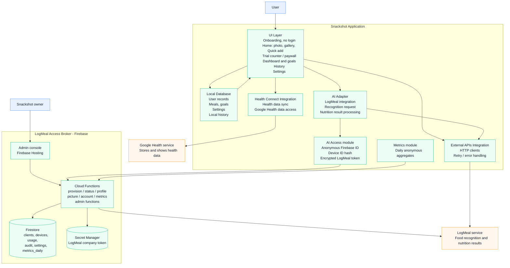

# C4 Container Diagram for Snackshot

## 1. Purpose

This is a C4 Level 2 container diagram. It shows the application as a single deployable software unit and the major internal subsystems that make up the app.

The project uses one application container for the MVP, plus a minimal server-side broker for AI credentials:

- Snackshot mobile application
- local database for stored meal and health records
- AI adapter for food recognition and nutrition estimation
- Health Connect integration for health-data sync and display
- UI layer for screens and user interaction
- external APIs integration layer for external services
- LogMeal Access Broker (Firebase Cloud Functions + Firestore + Secret Manager) and its admin console (Firebase Hosting)

## 2. Container boundaries

### Snackshot application
This is the core application container. It contains the internal components that deliver the product's user-facing functionality.

### Internal components
- UI Layer: onboarding (no registration), Home with meal entry (photo, gallery, Quick add), AI trial counter / paywall / waitlist, dashboard with optional goals, history, settings
- Local Database: storing meals, goals, settings, nutrition entries, sync metadata, and local history
- AI Adapter: integration with LogMeal service for recognition and nutrition estimation; gets the per-user LogMeal token from the AI Access module
- AI Access module: silent anonymous Firebase identity, hashed device ID, encrypted LogMeal token storage (Android Keystore), broker status and picture counter
- Health Connect Integration: optional Google Health Connect sync of meal nutrition records
- Metrics module: records anonymous product metrics on the device and uploads one daily aggregate through the broker
- External APIs Integration: handles HTTP requests, API contracts, retries, and external service communication

## 3. C4 Container Diagram

## 4. Relationship explanation

| Component | Responsibility |
| --- | --- |
| UI Layer | Handles the screens and user flow for meal logging, AI trial/paywall/waitlist states, and checking health data (no registration) |
| Local Database | Keeps the local source of truth for meal records and app data |
| AI Adapter | Sends meal data/images to LogMeal and converts the response into app-friendly nutrition results |
| Health Connect Integration | Optional Google Health Connect sync of meal nutrition records (goals stay local) |
| Metrics module | Records anonymous product metrics (for example AI response time and usage statistics) and uploads one daily aggregate through the broker; no personal data |
| External APIs Integration | Wraps API calls, error handling, and service communication to external systems |
| AI Access module | Creates the anonymous identity, provisions AI access from the broker, stores the per-user LogMeal token encrypted, reports used pictures |
| LogMeal Access Broker | Holds the LogMeal company token, creates and controls per-user LogMeal accounts, counts free pictures, enforces the 5-user pilot cap, stores anonymous daily product metrics without client identifiers, and serves the admin console. Stores no health data. |

## 5. Key architectural interpretation

This container diagram reflects the MVP architecture decision:

- The app is a single deployable mobile application container; the broker is a separately deployed serverless container that stores no health data.
- Local storage remains the primary source of truth.
- AI recognition is handled through an adapter boundary.
- Health Connect acts as an external health-data integration.
- External API calls are isolated behind a dedicated integration layer to simplify maintenance and testing.

## 6. Why this is a container diagram

This diagram is intentionally higher level than a component diagram:

- It describes deployable application parts, not internal class-level logic.
- It focuses on runtime boundaries and responsibility separation.
- It explains how the app interacts with external systems without going into code structure.

## 7. Source basis

This diagram is based on the project decisions recorded in:

- [Project charter](../01_project_charter.md)
- [Architecture checklist](01_must-answer-architecture-checklist.md)
- [Architecture answers](02_answers-architecture-checklist.md)
- [Technology stack analysis](04_stack-comparative-analysis.md)
- [AI provider analysis](03_ai-model-comparative-analysis.md)
- [LogMeal access token management](11_logmeal-access-token-management.md)
