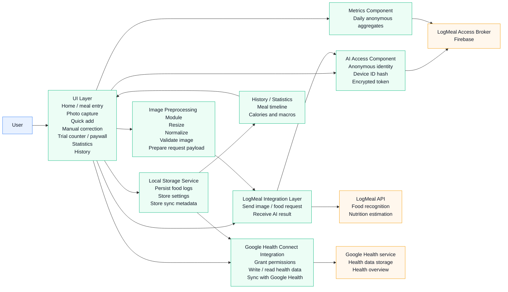

# C4 Component Diagram for Snackshot

## 1. Purpose

This is a C4 Level 3 component diagram. It shows the internal building blocks of the Snackshot application and how they collaborate to support the product flows:

- AI-powered meal logging
- meal entry from the Home screen: photo, gallery, and Quick add
- image capture / preprocessing
- Google Health Connect synchronization
- local persistence of meal logs
- statistics and history views

## 2. Component overview

The application contains the following major components:

### 2.1 UI layer
Responsible for all user-facing application flows:
- AI access states: free-picture counter, paywall, waitlist (no registration or sign-in)
- Home and meal entry (photo, gallery, Quick add)
- camera and photo capture
- manual correction of recognized data
- dashboard (D / W / M / 3M / Y) with optional local goals
- history of logs
- Google Health Connect connection and consent experience

### 2.2 Local data storage
Responsible for persisting nutrition records locally:
- food logs
- nutrition goals (local only)
- user settings
- sync state
- meal metadata
- local history used for offline-first behavior

### 2.3 LogMeal integration layer
Responsible for communication with the LogMeal API:
- request generation
- API calls authenticated with the user's own LogMeal token (from the AI access component)
- response parsing
- error handling and retry logic

### 2.3a AI access component
Responsible for obtaining and protecting AI access without registration:
- silent Firebase anonymous sign-in on the first AI action
- hashed device ID (`ANDROID_ID` + salt) so a reinstall on the same phone is recognized
- `provision`, `status`, `profile` (language and country), `picture`, and `DELETE /account` calls to the LogMeal Access Broker
- encrypted storage of the per-user LogMeal token (Android Keystore + DataStore, excluded from backup)
- exposing trial / trial ended / waitlisted / paused state to the UI
- `LogMealCredentialProvider` interface used by the LogMeal integration layer

See [LogMeal access token management](11_logmeal-access-token-management.md).

### 2.4 Image preprocessing module
Responsible for preparing the images before sending them to the AI service:
- compressing images
- resizing if needed
- normalization
- metadata preparation
- validation of the image payload

### 2.5 Google Health Connect integration layer
Responsible for the optional Google Health Connect sync when the user has connected to Google Health Connect (signed in to the Google Health app and linked Snackshot):
- permission check and request flow
- save nutrition records to Health Connect
- read nutrition records for the bootstrap import and change sync (goals are not read in the MVP)
- synchronize local changes to Health Connect
- handle permission revocation and fallback cases

### 2.6 Metrics component
Responsible for anonymous product metrics:
- record metric events locally (recognition latency, edits, Quick add use, time-to-log)
- compute one daily aggregate with no identifiers, food names, images, or nutrition values
- upload it through the broker (`POST /v1/metrics`) with WorkManager, respecting the Settings opt-out

## 3. C4 Component Diagram

## 4. Description of the main component interactions

### UI Layer
The UI is the primary interaction layer for the user. It handles:
- AI access states (free-picture counter, paywall, waitlist); no registration
- meal logging through photo, gallery, and Quick add
- confirmation and manual edits
- health integration configuration
- statistics and history display

### Local Storage Service
The app keeps a local source of truth for user meal history and settings.

Responsibilities:
- store food logs
- keep tracking history and timestamps
- store user corrections and manual edits
- maintain synchronization state with Google Health
- support local offline operations

### LogMeal Integration Layer
This component isolates external API logic from the UI. It is responsible for:
- building requests to LogMeal
- submitting images or meal data
- receiving AI prediction results
- mapping results into app models
- handling API exceptions and retries

### Image Preprocessing Module
The preprocessing module ensures the app sends a valid image to the AI service and reduces failures caused by poor input quality.

Typical tasks:
- downscale large images
- normalize orientation
- convert formats if required
- crop/prepare the image region
- validate size and content

### Google Health Connect Integration
This layer manages the optional synchronization of nutrition data with Google Health.

Responsibilities:
- request or check Health Connect permissions
- write completed meal data
- propagate local data changes to Google Health
- handle permission loss or unavailable service scenarios

## 5. Architectural intent

This component diagram reflects the intended app structure:

- The UI remains the main user interaction surface.
- AI recognition is separated into a dedicated integration component.
- Image preparation is separated from API communication.
- Health Connect is handled through a dedicated integration layer.
- Local storage is the persistent source of truth and can be synchronized with Google Health when enabled.

## 6. Why this is a component diagram

This is a component-level representation because it describes the internal application building blocks and their responsibilities, without going into class-level implementation detail.

It is not a code diagram and not a full subsystem decomposition of the entire platform; it captures the app’s architecture at the module boundary level.

## 7. Source basis

This diagram is based on the project decisions and architecture notes in:

- [Project charter](../01_project_charter.md)
- [Architecture checklist](01_must-answer-architecture-checklist.md)
- [Architecture answers](02_answers-architecture-checklist.md)
- [Technology stack analysis](04_stack-comparative-analysis.md)
- [AI provider analysis](03_ai-model-comparative-analysis.md)
- [LogMeal access token management](11_logmeal-access-token-management.md)
