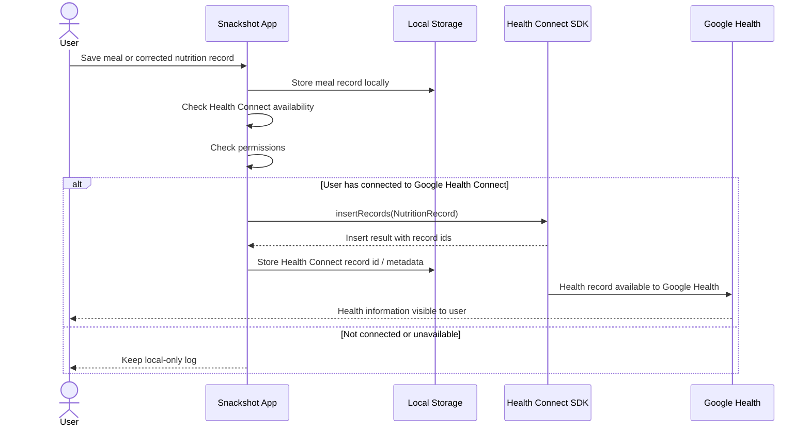
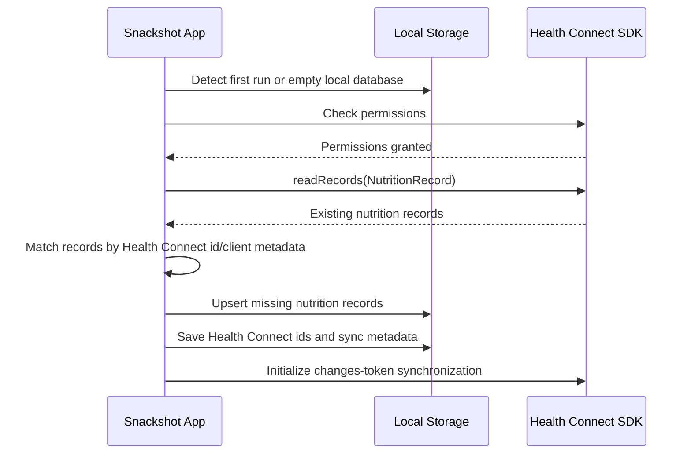
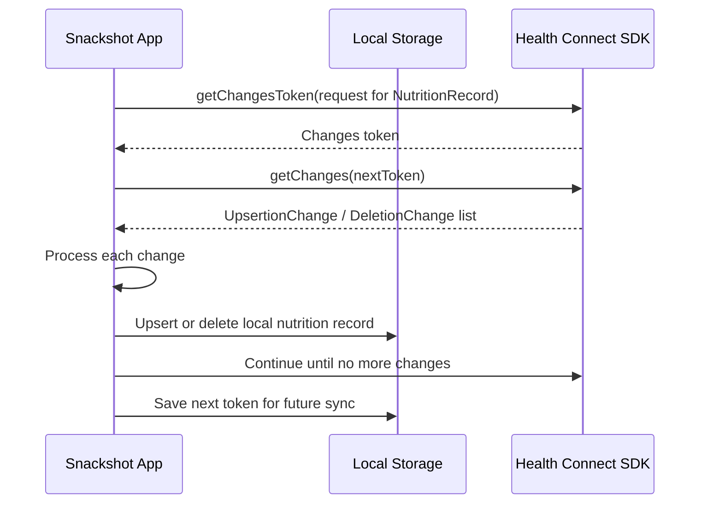
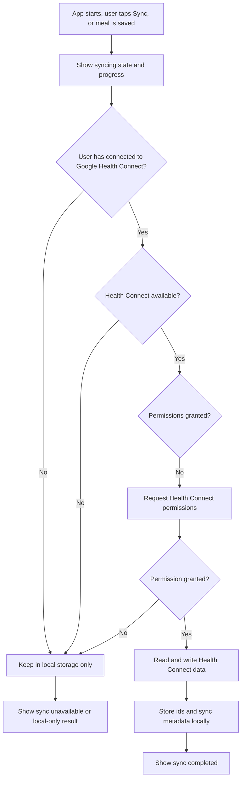
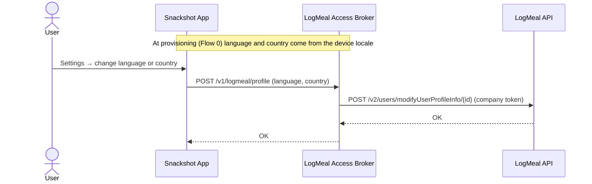

# Process Flow Diagrams for Snackshot

**Updated:** 18 November 2026 (scope revision: Quick add in the MVP, AI chat post-MVP, local goals, product metrics, language and country)

## 1. Purpose

This document shows the process flows for the main data movements between the app and external services.

It covers:
- AI access, free-picture trial, and paywall (Flow 0)
- photo and gallery recognition with LogMeal (Flow 1)
- Quick add, the manual logging path (Flow 2)
- local save and Google Health Connect sync (Flows 3–6)
- local nutrition goals (Flow 7)
- language and country updates (Flow 8)
- product metrics upload (Flow 9)

Google Health Connect is optional. The user connects it in one way only: they sign in to the Google Health app with their Google account and link Snackshot there, then grant the Health Connect permissions. Snackshot never shows its own sign-in.

## 2. Flow 0: AI access without registration, trial counter, and paywall

```mermaid
sequenceDiagram
    actor User
    participant App as Snackshot App
    participant FB as Firebase Auth
    participant BR as LogMeal Access Broker
    participant LM as LogMeal API

    User->>App: Tap Take a photo or Gallery on Home (first AI action)
    App->>FB: signInAnonymously() (silent, no UI)
    FB-->>App: anonymous ID token
    App->>BR: POST /v1/logmeal/provision (ID token, hashed device ID, language, country)
    alt new device and pilot slot free (max 5, test clients not counted)
        BR->>LM: POST /v2/users/signUp (company token)
        LM-->>BR: APIUser id + token
        BR->>LM: POST /v2/users/modifyUserProfileInfo/{id} (language, country)
        BR-->>App: status trial, token, pictures 0/90
    else device already known (reinstall)
        BR-->>App: existing token, existing picture counter
    else pilot full
        BR-->>App: status waitlisted
        App-->>User: S-20 Waitlist with Quick add
    else trial already used
        BR-->>App: status trial_ended
        App-->>User: S-19 Paywall with Quick add
    else broker unreachable
        App-->>User: Retryable error with Quick add
    end
    App->>App: store token encrypted (Android Keystore)
    App->>LM: Recognition (Flow 1) with the user's own token
    LM-->>App: result
    App->>BR: POST /v1/logmeal/picture (async)
    BR-->>App: pictures used / 90
    opt 90th picture used
        BR->>LM: POST /v2/users/toggleEnabled/{id} (disable)
        Note over App,BR: next AI action shows S-19 Paywall; Quick add keeps working
    end
    Note over BR,LM: hourly: GET /v2/info/usages reconciles the counter
```

Details: [LogMeal access token management](./11_logmeal-access-token-management.md).

## 3. Flow 1: Photo and gallery recognition

```mermaid
sequenceDiagram
    actor User
    participant App as Snackshot App
    participant Pre as Image Preprocessing
    participant LM as LogMeal API

    User->>App: Take a photo or choose a gallery image on Home
    App->>Pre: Prepare image payload (background)
    Pre-->>App: Optimized JPG / resized image
    App->>LM: POST /v2/image/segmentation/complete
    LM-->>App: Recognition result
    App->>LM: Nutrition and quantity calls (exact chain confirmed in the spike)
    LM-->>App: Nutrition and grams
    App-->>App: Map to one dish, drink, or raw fruit/vegetable
    alt Result returned
        App-->>User: S-15 Meal review (low confidence is emphasized)
        User->>App: Confirm or edit values
        App->>App: Save to local storage (Flow 3)
    else Failed after one retry, daily limit (429), or access revoked (403/116)
        App-->>User: Retryable error; offer Quick add with the draft (photo, time) kept
    end
```

### LogMeal API methods relevant to this flow

- `POST /v2/image/segmentation/complete` — entry point; one successful call counts as one free picture.
- Nutrition and quantity endpoints in the segmentation / quantity family; the exact call chain and credit cost are confirmed in the spike (WBS 1.1).
- Confirmation endpoints for correction, if the app sends user confirmation back.

Multi-item breakdown (F-04) and packaged-product recognition (F-08) are post-MVP.

### LogMeal preparation rules from project docs

Before sending the image, the app follows the LogMeal pre-processing guidance:

- convert to JPG
- preserve EXIF orientation
- resize max side to 1000 px
- keep file under 1 MB if possible
- avoid blurry or cluttered photos

Source:
- [LogMeal image preprocessing guide](../services_documentation/logmeal/image-pre-processing.md)
- [LogMeal recognition capabilities guide](../services_documentation/logmeal/recognition-capabilities.md)

## 4. Flow 2: Quick add (manual logging)

Quick add is always free and needs no AI access, broker, or network connection.

```mermaid
sequenceDiagram
    actor User
    participant App as Snackshot App
    participant Local as Local Storage

    alt From Home
        User->>App: Tap Manual add in the carousel
    else From a fallback
        App-->>User: S-05 failure, S-19 Paywall, S-20 Waitlist, or daily limit offers Quick add
        User->>App: Tap Quick add (draft photo and time kept if present)
    end
    App-->>User: S-09 Quick add form (name, kcal, protein, carbs, fat)
    User->>App: Enter values; optionally calculate kcal from macros
    App->>App: Validate (non-negative, not all blank)
    User->>App: Save
    App->>Local: Store meal (source: quick add)
    App->>App: Continue with Flow 3 (optional Google Health Connect sync)
```

## 5. Flow 3: Local save and sync to Google Health Connect



### Health Connect API methods relevant to this flow

- `HealthConnectClient.getSdkStatus(context)`
- `PermissionController.createRequestPermissionResultContract()`
- `HealthPermission.getReadPermission(...)`
- `HealthPermission.getWritePermission(...)`
- `healthConnectClient.insertRecords(listOf(record))`
- `healthConnectClient.updateRecords(...)`
- `healthConnectClient.getChangesToken(...)`
- `healthConnectClient.getChanges(...)`
- `healthConnectClient.deleteRecords(...)`
- `healthConnectClient.readRecords(...)`

These methods align directly with the Health Connect docs:
- request permission before writing
- insert or upsert records
- read changes from Health Connect
- sync local state with Health Connect
- delete records when local data is removed

## 6. Flow 4: Bootstrap Health Connect data into local app storage

This flow runs when the user connects to Google Health Connect for the first time or when the local application data has been deleted. It also applies whenever the app detects that its local database is empty while Health Connect contains nutrition data.



The imported records are copied into local storage. The local application database remains the source of truth after the bootstrap import; Health Connect is not used as the permanent primary datastore.

## 7. Flow 5: Pull changes from Health Connect to local app storage



The Health Connect sync design in the official docs recommends that the local app datastore is the source of truth, Health Connect is a synchronized secondary store, changes are read by token, and Health Connect ids are stored locally to apply deletions. This matches Snackshot's local-first design.

## 8. Flow 6: Synchronization decision flow

Synchronization has three triggers: the app becomes active, a meal is saved, edited, or deleted, and the user selects the sync action. The app displays a visible syncing state while Health Connect data is being read or written. The state ends with a completed, partially completed, or failed result; local data remains available while synchronization is in progress.



## 9. Flow 7: Local nutrition goals

Goals are optional. The user sets them in Snackshot; they are stored only in the local database and are not read from or written to Google Health Connect in the MVP. Without goals, every screen works normally.

```mermaid
sequenceDiagram
    actor User
    participant App as Snackshot App
    participant Local as Local Storage

    User->>App: Settings → Nutrition preferences
    App->>Local: Read current goals (may be empty)
    App-->>User: Calorie, protein, carbs, and fat goal fields
    alt User sets or changes goals
        User->>App: Save goals
        App->>Local: Store goals
    else User clears goals
        User->>App: Clear goals
        App->>Local: Remove goals
    end
    User->>App: Open dashboard (D / W / M / 3M / Y)
    App->>Local: Read aggregates and goals
    alt Goals set
        App-->>User: Totals with goal band and macro progress
    else No goals
        App-->>User: Totals; header says that no goal is set
    end
```

## 10. Flow 8: Language and country update

LogMeal uses the APIUser's language and country to localize and refine recognized dishes.



## 11. Flow 9: Product metrics upload

Snackshot collects only product metrics (for example AI response time and usage statistics) to make the product better. They contain no personal data. Details: [WBS](../04_wbs_and_mvp_implementation_plan.md) §6.

```mermaid
sequenceDiagram
    participant App as Snackshot App
    participant Local as Local Storage
    participant WM as WorkManager
    participant BR as LogMeal Access Broker

    App->>Local: Record metric events (latency, edits, Quick add use, time-to-log)
    WM->>Local: Once a day: compute yesterday's aggregate
    alt Metrics switched on in Settings
        WM->>BR: POST /v1/metrics (aggregate; no identifiers, food names, images, or nutrition values)
        BR->>BR: Validate against allow-list; store in metrics_daily without client or device id
        BR-->>WM: 204
        WM->>Local: Delete sent aggregate
    else Metrics switched off
        WM->>Local: Delete aggregate without sending
    end
```

## 12. Recommended API usage for the Snackshot MVP

### 12.1 LogMeal

- obtain AI access from the LogMeal Access Broker without registration (Flow 0)
- preprocess image locally
- send the request to the LogMeal image-recognition endpoint with the user's own token
- receive recognized food / nutrition data
- allow the user to review and correct the result
- save the accepted result locally
- on failure, offer Quick add (Flow 2)

### 12.2 Health Connect

- `getSdkStatus()` to confirm support
- request permissions from the user
- `insertRecords()` to write nutrition records
- `updateRecords()` / `insertRecords` with `clientRecordId` for upsert patterns
- `readRecords()` for the bootstrap import
- `getChangesToken()` and `getChanges()` to read external changes
- `deleteRecords()` to remove deleted records from Health Connect

## 13. Architectural interpretation

- The user interacts with the app UI; logging never depends on Google Health Connect.
- The app stores all meal data and goals locally first.
- External AI is used for recognition only; Quick add works without it.
- Google Health Connect is used for optional sharing of meal records.
- App sync logic is based on record ids, metadata, and changes tokens.
- The broker receives only AI access data and anonymous product metrics.

## 14. Key implementation recommendations

1. Save all accepted meal data locally first.
2. Send images to LogMeal only after preprocessing, with the user's own LogMeal token from the broker; never ship the LogMeal company token in the app.
3. Let the user review AI output before the final save.
4. Keep Quick add available in every state.
5. If the user has connected to Google Health Connect, sync the local nutrition record using `NutritionRecord` + `insertRecords` and local metadata tracking.
6. Keep goals local; do not read or write them in Health Connect in the MVP.
7. Use `getChangesToken` / `getChanges` for future synchronization and consistency checks.

## 15. Source basis

- [Health Connect sync docs](../services_documentation/health-connect/HC_sync_data.md)
- [Health Connect write data docs](../services_documentation/health-connect/HC_write_data.md)
- [LogMeal recognition docs](../services_documentation/logmeal/recognition-capabilities.md)
- [LogMeal pre-processing docs](../services_documentation/logmeal/image-pre-processing.md)
- [LogMeal user token docs](../services_documentation/logmeal/users-and-access-tokens.md)
- [LogMeal access token management](./11_logmeal-access-token-management.md)
- [WBS and MVP Implementation Plan](../04_wbs_and_mvp_implementation_plan.md) §6
