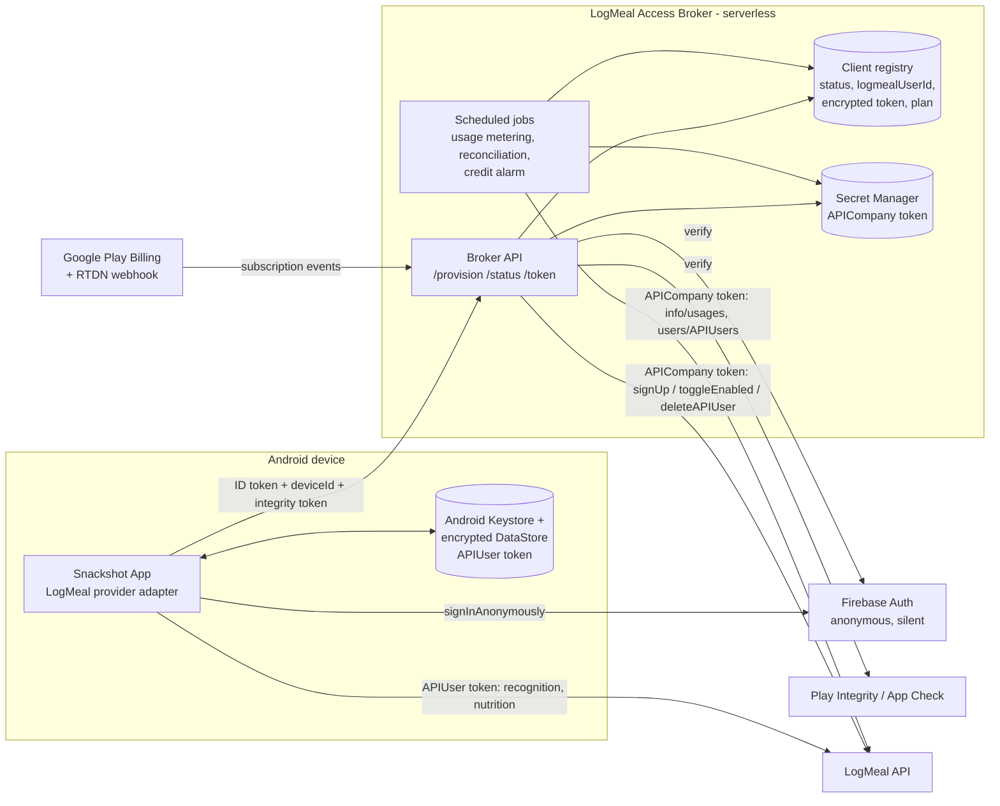
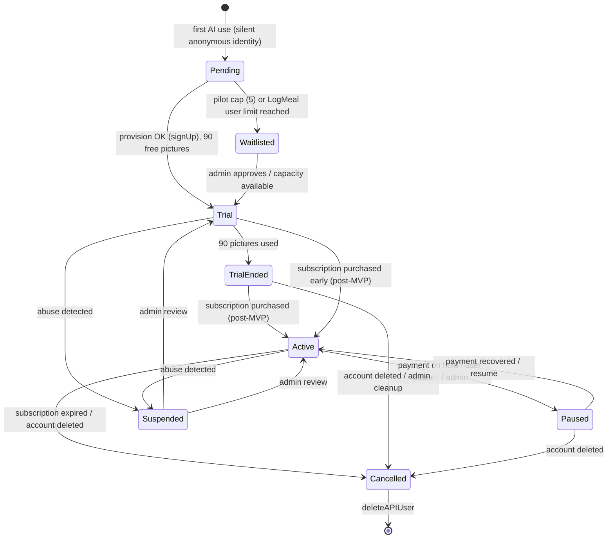
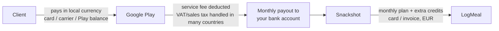
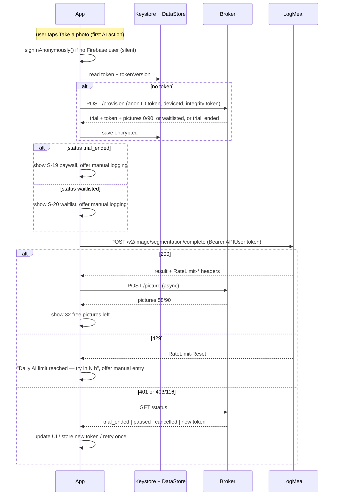

# LogMeal Access Token Management

**Decision:** How Snackshot stores, issues, updates, and revokes LogMeal credentials for the Android client, with per-client billing and the ability to pause or cancel LogMeal usage for an individual client.
**Date:** 12 November 2026 (updated 14 November 2026)
**Status:** Accepted, decisions in §0. Resolves the open risk "API credential exposure" and the decision gate "LogMeal tokens can be handled without exposing an unacceptable long-lived secret" in [04_stack-comparative-analysis.md](./04_stack-comparative-analysis.md) §8, §10.

**Recommendation:** Introduce a thin, stateless-for-health-data **LogMeal Access Broker** (serverless). It holds the APICompany token, provisions one LogMeal **APIUser per Snackshot client**, hands that client only its own APIUser token, and controls the client's lifecycle (trial / trial ended / active / paused / cancelled) through LogMeal's `toggleEnabled` and `deleteAPIUser` endpoints. The user never registers: identity is a silent anonymous Firebase user plus a hashed device ID. The Android app keeps calling LogMeal directly with its APIUser token. No meal, photo, or nutrition data passes through or is stored on the broker, so the local-first principle is preserved.

---

## 0. Decisions recorded (14 November 2026)

| # | Question | Decision | Effect on this design |
| --- | --- | --- | --- |
| 1 | Free or paid MVP? | **Free MVP** (refined by decisions 8–9). | No Play Billing in MVP. Cost is controlled by the 90-picture trial, the 5-client pilot cap, credit alarms, and a kill switch (§6.3). Payments are designed for post-MVP (§6.4). |
| 2 | Devices per client? | **One active device.** | A free client is tied to one device by design. A paying client who restores a purchase on a new phone gets a rotated token, and the old phone is disabled (§5.3). |
| 3 | Payment grace period? | **Keep AI active during grace.** | RTDN `IN_GRACE_PERIOD` causes no state change; only `ON_HOLD`/`EXPIRED` act (post-MVP). |
| 4 | Self-service APICompany token regeneration? | **Not available.** | A leaked APICompany token can only be replaced through LogMeal support, so it must sit only in Secret Manager and be readable only by the broker service account (§4, §7). |
| 5 | Use LogMeal-side intake history? | **No.** | Rotation can recreate APIUsers freely. |
| 6 | Broker platform | **Firebase.** | Firebase Auth, Cloud Functions, Firestore, Secret Manager, App Check, Hosting (admin console). Requires the **Blaze** (pay-as-you-go) plan. |
| 7 | Registration before AI? | **No registration.** The user starts using the app and AI immediately. | Silent **Firebase Anonymous Authentication** plus a hashed device ID (§5.3). No Google sign-in anywhere in Snackshot, consistent with [02_answers](./02_answers-architecture-checklist.md) §2.1–2.3. |
| 8 | Free AI allowance | **90 AI recognitions in total per client** (one-time trial, not monthly), then a subscription paywall. | New status `trial_ended` (§5.1). The counter survives reinstall on the same device (§5.3). |
| 9 | Payment in MVP | **Paywall screen only.** | S-19 paywall explains that subscriptions are coming soon; manual logging keeps working. Play Billing stays post-MVP (§6.4). |
| 10 | MVP pilot size | **Maximum 5 clients.** | The 6th client is waitlisted. Matches the LogMeal trial cap of 5 APIUsers. |

> ⚠ **LogMeal plan check:** the LogMeal free trial is limited to **30 days, 5 users, and 200 queries**. 5 clients × 90 pictures = 450 pictures, and one picture uses at least one credit (more if nutrition or quantity endpoints are called separately). The trial therefore cannot cover the full pilot. Plan for the **Analyse plan (from 144 EUR/month)**, or accept that the trial runs out after about 200 requests.

---

## 1. Facts from the LogMeal documentation

Sources: [users-and-access-tokens.md](../services_documentation/logmeal/users-and-access-tokens.md), [logmeal-plans-limits.md](./ai-models/logmeal-plans-limits.md), [logmeal-pricing.md](./ai-models/logmeal-pricing.md), [LogMeal_openapi_docs.yaml](../services_documentation/logmeal/LogMeal_openapi_docs.yaml).

| Fact | Consequence for Snackshot |
| --- | --- |
| **APICompany token** — one per subscription; creates, deletes, enables/disables users; all usage is billed to it. | Must **never** be shipped in the app. Leakage = anyone can create users, delete users, and spend company credits. |
| **APIUser token** — one per end user, issued by `POST /v2/users/signUp`; required for recognition/intake endpoints. "Each final user must have their own APIUser." | Natural unit of per-client identity, metering, and control. |
| LogMeal: "Do not expose [tokens] in client-side code." | Even APIUser tokens must be stored protected on device and never hard-coded. |
| **No token rotation / refresh / expiry endpoint** exists in the OpenAPI spec. Tokens are long-lived. | "Rotation" = create a new APIUser and delete the old one. Acceptable because LogMeal is not our source of truth. |
| `POST /v2/users/toggleEnabled/{userId}` — a disabled APIUser gets **HTTP 403, code 116** on privileged endpoints, **does not consume monthly credits and does not count toward MAUs**; re-enabling restores the same configuration. | Exact mechanism for **pause / suspend**. |
| `DELETE /v2/users/deleteAPIUser/{userId}` — soft delete if the user processed images, hard delete otherwise. | Mechanism for **cancel / account deletion**. |
| `GET /v2/users/APIUsers` returns `id`, `username`, `token`, `enabled`. | Reconciliation source of truth for user state. |
| `GET /v2/info/usages?date_start&date_end&api_user_id` returns each request (`service_id`, `timestamp`, `userId`). | Authoritative **per-client usage metering** for billing. |
| Response headers: `RateLimit-Limit/Remaining/Reset` (per APIUser, rolling 24 h) and `X-Account-Credits-Used/Remaining` (company). `GET /v2/info/limitations` is free. | Client-side quota display; broker-side company credit alarm. |
| Standard plans: **20 images/day and 1 image/s per APIUser**; monthly credits shared across all users; overage charged extra; HTTP 429 when exceeded. | Per-client cap is enforced by LogMeal for free; the company-wide budget must be watched by us. |
| `signUp` returns **403** when the plan's user limit is reached; **409** if username exists. Trial: max **5 users, 200 queries**. | Provisioning must handle "capacity full" gracefully; usernames must be globally unique. |

> Note on "billing separately for each client": LogMeal bills **only the APICompany** (Snackshot). It cannot invoice end users. Per-client billing therefore means: *Snackshot meters each client's LogMeal usage via its APIUser and charges the client itself* (e.g. Google Play subscription / in-app credits). The design below supports both a flat subscription and usage-based pricing.

---

## 2. Options considered

| Option | Description | Security | Per-client control | Fits local-first / MVP budget | Verdict |
| --- | --- | --- | --- | --- | --- |
| **A. Embedded key** | APICompany (or one shared APIUser) token compiled into the APK. | ❌ Extractable from any APK; full account takeover. | ❌ None — all clients look identical. | ✅ Zero effort | **Rejected** |
| **B. Token broker (recommended)** | Backend holds APICompany token, provisions one APIUser per client, returns only that APIUser token. App calls LogMeal directly. | ✅ Blast radius of a leaked token = one user, capped at 20 images/day; revocable server-side. | ✅ Enable / disable / delete per client; usage per APIUser. | ✅ No health data on server; ~1 serverless function set + 1 small table. | **Recommended for MVP** |
| **C. Full proxy** | All LogMeal calls go through Snackshot backend; client only holds a short-lived Snackshot JWT. | ✅✅ No LogMeal token on device at all. | ✅✅ Custom quotas per call, exact real-time metering, instant kill switch. | ❌ Photos transit our server (privacy policy + infra changes), extra latency, image bandwidth cost, larger build effort. | **Post-MVP option** if fraud or fine-grained pricing requires it |

Option B is chosen because it gives every requested capability (separate billing, pause, cancel) using LogMeal's own per-user primitives, while keeping photos flowing device → LogMeal only, exactly as already documented in [08_data-flow-diagram.md](./08_data-flow-diagram.md). The LogMeal provider adapter in the app is designed so that switching to Option C later only changes the adapter's base URL and auth header.

---

## 3. Target architecture



**Implementation (decided):** Firebase Authentication with the **anonymous provider** (no UI, no personal data; see [F-30](../Features%20list/F-30-google-account-registration-login.md)), Cloud Functions for the broker, Firestore for the client registry, Google Secret Manager for the APICompany token, Firebase App Check with Play Integrity, Cloud Scheduler for jobs. Any equivalent serverless stack works; the contract below is provider-neutral.

---

## 4. Where each secret lives

| Secret | Stored where | Who can read it | Never |
| --- | --- | --- | --- |
| **APICompany token** | Secret Manager (server). Loaded at function cold start. | Broker service account only. | In the APK, repo, CI logs, Firestore, client responses. |
| **APIUser token (server copy)** | Client registry, encrypted with a KMS key (envelope encryption). | Broker only. | Plaintext in DB, logs, analytics. |
| **APIUser token (device copy)** | Encrypted DataStore; AES-GCM key held in **Android Keystore** (hardware-backed where available, e.g. via Tink `AndroidKeysetManager`). | The app process only. | `SharedPreferences` plaintext, logs, crash reports, Health Connect, cloud backup (exclude via `dataExtractionRules` / `fullBackupContent`). |
| **Snackshot session** | Firebase Auth SDK, anonymous user (short-lived ID token, auto-refreshed). Lost on uninstall; recovered through the device ID (§5.3). | App + broker. | — |

Notes:

- Do **not** use `androidx.security:security-crypto` (`EncryptedSharedPreferences`) for new code — the library is deprecated; use Keystore + Tink + DataStore.
- Excluding the token from Android Auto Backup is intentional: after restore on a new device the app re-provisions via the broker, which keeps one active token per client and lets the broker see device changes.
- The OkHttp/Ktor client must redact the `Authorization` header in any logging interceptor.

---

## 5. Client lifecycle and per-client control

### 5.1 States



| Snackshot state | LogMeal action | LogMeal effect | App behaviour |
| --- | --- | --- | --- |
| **Trial** (MVP default) | `signUp` (once), `enabled = true` | Calls allowed; uses credits; counts as MAU. | AI recognition available; counter "N of 90 free pictures left". |
| **TrialEnded** | `toggleEnabled` → `false` | 403/116; **no credits, no MAU**. | **S-19 paywall** when the user opens AI capture. MVP: "Subscriptions are coming soon". Manual search, quick add, history, dashboards, and Health Connect keep working. |
| **Active** (paid, post-MVP) | `enabled = true` | Calls allowed. | Unlimited AI within LogMeal's 20 pictures/day cap. |
| **Paused** (payment on hold, user, admin) | `toggleEnabled` → `false` | 403/116; no credits, no MAU. | "AI paused" message with reason; manual logging works. |
| **Suspended** (abuse) | `toggleEnabled` → `false` | Same as paused. | "AI recognition unavailable, contact support". |
| **Cancelled** | `deleteAPIUser` (soft delete), token wiped from registry | Token permanently invalid. | Local data untouched (local-first); AI disabled. |
| **Waitlisted** | none (no APIUser created) | — | "AI recognition is in a closed pilot — you're on the waitlist"; manual logging works. |

Important: `toggleEnabled` is a **toggle**, not a setter. The broker must read the current `enabled` value (`GET /v2/users/APIUsers`) before calling it, and run state changes as idempotent, serialized jobs per client to avoid double toggles.

**When to provision:** on the **first AI action** (camera or gallery recognition), not at app start. Users who only log manually never use up a pilot slot or a LogMeal APIUser.

### 5.2 Who triggers state changes

| Trigger | Source | Resulting transition |
| --- | --- | --- |
| First AI action, capacity available | `POST /provision` | Pending → Trial |
| First AI action, pilot cap (5) reached | `POST /provision` | Pending → Waitlisted |
| 90th picture used | Picture counter (§6.1) | Trial → TrialEnded |
| Subscription purchased (post-MVP) | `billing/verify`, RTDN `SUBSCRIPTION_PURCHASED` | Trial / TrialEnded → Active |
| Subscription renewed | RTDN `RENEWED` | stays Active |
| Payment failed: grace period | RTDN `IN_GRACE_PERIOD` | No change: AI stays Active (decision 3) |
| Payment failed: account hold | RTDN `ON_HOLD` | → Paused |
| User pauses subscription | RTDN `PAUSED` | → Paused |
| Subscription expired / revoked / refunded | RTDN `EXPIRED`, `REVOKED` | → Cancelled (the trial is **not** restored) |
| User deletes app data in Settings ("Delete all data") | In-app → `DELETE /v1/account` | → Cancelled + registry record erased (picture counter kept by device, §5.3) |
| Abuse heuristics (see §7) | Scheduled job | → Suspended |
| Admin | Admin console with audit log | Any |

### 5.3 Client identity without registration

The user never registers or signs in. Identity is created silently and tied to **the device**, so it survives uninstalling and reinstalling the app on the same phone.

| Key | Source | Survives reinstall? | Survives new phone / factory reset? | Used for |
| --- | --- | --- | --- | --- |
| `clientId` | Random ID generated by the broker at first provisioning | ✅ (re-attached through `deviceId`) | ❌ new phone = new client | Registry primary key, picture counter, usage ledger, audit |
| `deviceId` | `SHA-256(Settings.Secure.ANDROID_ID + app salt)`, sent by the app | ✅ ANDROID_ID is stable for the same app signing key, Android user, and device (Android 8+) | ❌ | Recognising the same device; one active client per device |
| Firebase anonymous UID | `FirebaseAuth.signInAnonymously()`, no UI | ❌ new UID after reinstall | ❌ | Authenticating calls to the broker only; linked to `clientId` in the `authUids` list |
| Firebase Installation ID | Firebase SDK | ❌ | ❌ | Diagnostics only |

Registry additions: `clients/{clientId}` holds `deviceId`, `authUids[]`, `picturesUsed`, `pictureAllowance` (90); `devices/{deviceId}` maps to `clientId`.

**Scenarios**

| Scenario | What the broker sees on `POST /provision` | Action |
| --- | --- | --- |
| **First AI use on a new phone** | New anonymous UID, unknown `deviceId` | Pilot slot free → create client + APIUser, status Trial, 0 of 90 used. Otherwise → Waitlisted. |
| **App reopened** | Known UID | Return the current status and token (no LogMeal call). |
| **Uninstall → reinstall on the same phone** | **New** anonymous UID, **known** `deviceId` | Re-attach the existing client: add the new UID to `authUids`, return the **existing** token and the **existing picture counter**. The trial is **not** reset by reinstalling. |
| **Clearing app data** | Same as reinstall | Same as reinstall. |
| **New phone or factory reset** | New UID, unknown `deviceId` | Treated as a new client. Without an account the broker cannot link phones; this is accepted. In the MVP the 5-client pilot cap limits exposure; after MVP, Play Integrity and the `deviceId` limit it to one free trial per physical device. |
| **Paid user on a new phone (post-MVP)** | New UID, unknown `deviceId`, plus a Play purchase restored with `queryPurchasesAsync` | The purchase's `obfuscatedAccountId` is the old `clientId` hash, so the broker **moves** the client to the new device: rotate the APIUser token, disable the old one, update `deviceId`. This enforces **one active device** without any sign-in, because the Google Play account acts as the cross-device identity for paying users. |
| **Paid user switches back and forth** | `deviceSwitchCount30d` above 3 | Refuse and show "contact support"; an admin can reset it. |
| **"Delete all data" in Settings** | `DELETE /v1/account` | Delete the APIUser and the registry record. Keep only `devices/{deviceId}` → `picturesUsed`, so deleting data does not grant a new trial (state this in the privacy policy). |

Uninstalling also removes the local meal history (local-first). It can be restored only if Health Connect sync was enabled; see the bootstrap flow in [09_process-flow-diagrams.md](./09_process-flow-diagrams.md). The broker does not and cannot restore meals.

**Why no Google sign-in?** The architecture decision ([02_answers](./02_answers-architecture-checklist.md) §2.1–2.3, [10_architecture_ux_spec](./10_architecture_ux_spec.md) §1.2) is that Snackshot never requires a Google account. Anonymous auth + `deviceId` gives the broker everything it needs for the trial, pause, cancel, and metering. For paying users, the Play purchase handles moving to a new phone. An **optional** "Link Google account" can be added post-MVP if users ask to move a *free* trial between phones; Firebase `linkWithCredential` keeps the same UID, so nothing in this design changes.

To confirm with LogMeal: do soft-deleted APIUsers still count toward the plan's user limit? If they do, `TrialEnded` clients should be deleted (not just disabled) to free LogMeal capacity, with the picture counter kept in `devices/{deviceId}`.

---

## 6. Per-client billing and metering

### 6.1 Usage ledger

A scheduled job (hourly or nightly) calls `GET /v2/info/usages?date_start&date_end&api_user_id=<id>` — or once without `api_user_id` for all users — and writes rows to a **usage ledger**:

| Field | Example |
| --- | --- |
| `clientId` | Broker-generated client ID (§5.3) |
| `logmealUserId` | 435 |
| `periodStart` / `periodEnd` | billing period of the client |
| `serviceId` | 86 (map via `/v2/info/services` to endpoint & credit cost) |
| `requests` | 37 |
| `creditsConsumed` | 37 (only credit-consuming endpoints count) |

LogMeal's usage log is the **authoritative** meter (the device cannot be trusted to self-report). Client-side reporting of `RateLimit-*` headers is used only for UX.

### 6.1a Picture counter for the 90-picture trial

- **What counts as one picture:** one successful call to the recognition entry endpoint (`POST /v2/image/segmentation/complete`, identified by its `service_id`). Follow-up calls for the same image (confirmation, nutrition, quantity) do **not** count as extra pictures, though they may use LogMeal credits. Failed calls (4xx/5xx) do not count.
- **Fast path:** after each successful recognition the app sends `POST /v1/logmeal/picture` (fire-and-forget, retried later if offline). The broker increments `picturesUsed` and answers with the remaining count, which the app shows ("57 of 90 free pictures left").
- **Authoritative path:** the hourly ledger job recounts recognition calls per APIUser from `info/usages` and sets `picturesUsed = max(app-reported, ledger)`. A modified app that skips reporting is caught within an hour; the worst-case overrun is bounded by LogMeal's own 20 pictures/day cap.
- **At 90:** the broker disables the APIUser (`toggleEnabled` → false), sets status `TrialEnded`, and the app shows the S-19 paywall on the next AI action. Any recognition already in flight completes normally.

### 6.2 Pricing models supported

| Model | How it works with this design |
| --- | --- |
| **Free trial, then subscription** (decided) | 90 pictures in total per client (§6.1a). Then `TrialEnded` and the paywall. MVP: paywall screen only. Post-MVP: Play subscription → Active. |
| **Flat subscription** (recommended after MVP) | Play subscription → Active. LogMeal's own 20 images/day cap bounds the worst-case cost per client: ≤ ~600 credits/month. Price the subscription above this worst case. |
| **Usage-based / credit packs** | Ledger balance per client. When the balance hits 0 the broker sets the client to Paused until the next purchase. Granularity is limited by ledger frequency (hourly lag ⇒ small overrun possible; acceptable, or move to Option C for exact real-time enforcement). |
| **B2B / per-organisation** (e.g. clinic) | Add an `organisationId` to the registry and aggregate the ledger per organisation. If a customer wants its own LogMeal contract, store *their* APICompany token as a separate tenant secret — the rest of the design is unchanged. |

### 6.3 Company-level cost protection

- Every broker call and every metering run reads `X-Account-Credits-Remaining`. Alert at 70 % / 90 % of monthly credits; at 100 % optionally pause the free tier first, paid tier last.
- Global **kill switch** flag (Firebase Remote Config, read by the app) disables AI recognition for everybody without touching LogMeal users — for incidents or unexpected overage.
- Plan user-cap monitoring: count Active + Paused users vs. plan limit; Cancelled users are deleted so they free capacity.
- **MVP pilot cap:** at most **5 clients** in Trial/TrialEnded/Active/Paused (admin setting `maxClients`, default 5). Further clients are Waitlisted and approved from the admin console when a slot is freed.
- **Worst-case MVP cost:** 5 clients × 90 pictures = 450 recognitions plus follow-up calls. This is more than the LogMeal trial's 200 queries, so a paid LogMeal plan is needed for the full pilot (see §0).

### 6.4 How payments reach Snackshot (post-MVP)

In the MVP, the paywall is a screen only (decision 9): clients who used their 90 pictures see "Subscriptions are coming soon" and keep manual logging. This section is the target design for when real payments launch.

**Money flow**



1. **Collection:** Google Play policy requires **Google Play Billing** for digital features sold inside an Android app distributed on Play, and AI recognition is a digital feature. Clients pay Google, never Snackshot directly. Some regions allow alternative or user-choice billing programs; they add work and save little, so they are not recommended at launch. Check the current Play payments policy for your target countries before launch.
2. **Fees:** Google keeps a service fee, currently **15 % for auto-renewing subscriptions**. Check the Play Console for current rates.
3. **Taxes:** In many countries Google calculates, collects, and remits VAT or sales tax on Play sales. Income tax on payouts remains Snackshot's responsibility.
4. **Payout:** Google pays out monthly to the bank account of the **Google payments merchant profile** linked in Play Console. Setup: create the merchant account, add tax info, verify the bank account.
5. **Cost side:** Snackshot pays LogMeal separately (plan from 144 EUR/month plus extra credits beyond the plan allocation).

**Technical flow**

| Step | Where | Detail |
| --- | --- | --- |
| 1 | App | Play Billing Library launches the purchase. Set `obfuscatedAccountId = SHA-256(clientId)` so every purchase is tied to the client. The purchase follows the user's Google Play account, so it also identifies them on a new phone (§5.3). |
| 2 | App → Broker | Send `purchaseToken` to `POST /v1/billing/verify`. |
| 3 | Broker | Verify with the **Google Play Developer API** (`purchases.subscriptionsv2.get`), check that `obfuscatedAccountId` matches the caller, **acknowledge** the purchase (unacknowledged purchases are auto-refunded after 3 days), and set the client Active with plan `premium`. |
| 4 | Google → Broker | **RTDN** through Cloud Pub/Sub to `/v1/billing/rtdn`: renewals, `IN_GRACE_PERIOD` (no change, per decision 3), `ON_HOLD` → Paused, `EXPIRED`/`REVOKED` → Cancelled, `PAUSED` → Paused. |
| 5 | App on reinstall or new phone | `queryPurchasesAsync` restores the purchase; `POST /v1/billing/restore` re-verifies it and moves the client to this device (token rotation). |

**Pricing check:** LogMeal's 20 images/day per user cap limits the worst case to about 600 credits per client per month. The price for extra credits is not in the project docs; get it from LogMeal. Set the price so that `price × (1 − 0.15) ≥ expected credits × credit price + share of LogMeal base plan + Firebase cost`.

---

## 7. Token update, rotation, and revocation

Because LogMeal has no rotate endpoint, rotation is implemented as **re-provisioning**:

1. Broker creates a new APIUser (`signUp` with a new opaque username, same language/country via `modifyUserProfileInfo`).
2. Registry stores the new id/token and increments `tokenVersion`.
3. Old APIUser → `toggleEnabled(false)` immediately, `deleteAPIUser` after the app has picked up the new token (or after 24 h).
4. App receives 403/116 on the old token → calls `/status` → gets new token → retries once.

Since the app is the source of truth for nutrition history, losing LogMeal-side intake history for the old APIUser is acceptable. (If LogMeal intake history is later used — e.g. `getIntakesList`, Monitor plan — rotation should be limited to compromise cases only.)

**When to rotate / revoke**

| Event | Action |
| --- | --- |
| Suspected token leak / abuse (see signals below) | Rotate immediately; on repeat → Suspended. |
| Same client on the same device (reinstall) | Return the existing token. No rotation. |
| Paid client restores a purchase on a new device (post-MVP) | **Rotate** (one-active-device decision, §5.3). |
| Trial ended (90 pictures) | Disable (`toggleEnabled` → false); delete later if LogMeal capacity is needed. |
| Play Integrity verdict fails | Refuse provisioning/token delivery; do not rotate. |
| Account deletion / cancellation | Revoke (delete APIUser). |
| APICompany token compromise | **No self-service regeneration.** Contact LogMeal support immediately, turn on the kill switch, update Secret Manager once a new token is issued. APIUser tokens may need to be re-provisioned depending on LogMeal's response. |

**Abuse signals** (from the usage ledger): requests at the daily cap for many consecutive days, calls from a client whose subscription is inactive, usage pattern inconsistent with app behaviour (e.g. endpoints the app never calls, from `service_id`).

---

## 8. Broker API contract (minimal)

All endpoints require a valid Firebase ID token (from the **anonymous** user) **and** an App Check / Play Integrity token. No endpoint asks for personal data.

| Endpoint | Purpose | Response |
| --- | --- | --- |
| `POST /v1/logmeal/provision` | Called on the **first AI action**. Idempotent. Body: `{ deviceId, locale }`. Re-attaches an existing client by `deviceId` (§5.3), otherwise creates client + APIUser if a pilot slot is free, otherwise waitlists. | `{ status, token?, tokenVersion, pictures: { used, limit } }` |
| `GET /v1/logmeal/status` | Called on app start (cached about 1 h) and after any 401/403 from LogMeal. | `{ status: trial\|trial_ended\|active\|paused\|suspended\|cancelled\|waitlisted, token? (only if tokenVersion changed), reason, pictures: { used, limit } }` |
| `POST /v1/logmeal/picture` | Reports one successful recognition (fast path of §6.1a). Idempotent by `requestId`. | `{ status, pictures: { used, limit } }` |
| `DELETE /v1/account` | "Delete all data" in Settings: delete APIUser, erase registry record; keep only the device's picture counter (§5.3). | `204` |
| `POST /v1/billing/verify`, `/restore` *(post-MVP)* | Verify a Play purchase; restore and move the client to this device. | `{ status, token? }` |
| `POST /v1/billing/rtdn` *(post-MVP)* | Pub/Sub push from Google Play; verifies the purchase via the Play Developer API and drives the state machine. | `204` |

Registry record (Firestore `clients/{clientId}`):

```json
{
  "status": "trial",
  "deviceId": "9c1e…",                    // SHA-256(ANDROID_ID + salt)
  "authUids": ["anonUid1", "anonUid2"],   // anonymous Firebase UIDs, one per install
  "picturesUsed": 57,
  "pictureAllowance": 90,
  "logmealUserId": 435,
  "logmealUsername": "gldm_7f3c…",       // opaque, no email/PII; must be globally unique in LogMeal
  "tokenCiphertext": "…",                // KMS-encrypted
  "tokenVersion": 3,
  "plan": "trial",                        // post-MVP: "premium_monthly"
  "entitlementSource": null,              // post-MVP: "google_play"
  "purchaseToken": null,
  "language": "eng",
  "createdAt": "2026-11-12T10:00:00Z",
  "statusChangedAt": "…",
  "statusReason": "provisioned"
}
```

Plus `devices/{deviceId}` → `{ clientId, picturesUsed }` and an append-only `audit/{id}` collection for every state change and admin action.

### 8.1 Broker admin console

A small web UI for operating the broker. It never talks to LogMeal or Firestore directly; every action goes through admin Cloud Functions, so the same validation, state machine, and audit log apply to admins and automation alike.

**Stack:** single-page app (React + Vite) on **Firebase Hosting**. Admin sign-in uses Firebase Auth (Google), restricted to accounts with the custom claim `admin: true`, which is set once with an Admin SDK script. App Check is enforced. Firestore security rules **deny all client SDK access** to `clients`, `usage`, `audit`, `devices`, and `settings`; only Cloud Functions (Admin SDK) read or write them.

**Screens**

| Screen | Content | Actions |
| --- | --- | --- |
| **Dashboard** | LogMeal credits used/remaining this period (from `X-Account-Credits-*`), clients vs pilot cap (x of 5), clients by status (Trial / TrialEnded / Waitlisted / …), pictures used across all trials, recognitions per day (30 days), top consumers, alarms | **Global kill switch** (Remote Config), "Sync with LogMeal" |
| **Clients** | Searchable table: client ID, LogMeal user id, status + reason, pictures used / 90, device (hashed, last seen), app version, created. No e-mail or name exists, because clients are anonymous. | Filter by status; bulk pause/resume |
| **Client detail** | Profile, status history (from audit), usage chart by endpoint, device binding history, token shown **masked** (`••••a3ed`, `tokenVersion`) | Pause · Resume · Suspend · **Rotate token** · **Grant extra pictures / reset trial** · Delete (APIUser + registry) to free a pilot slot. Each action requires a reason and a confirmation dialog. |
| **Waitlist** | Devices waiting for a pilot slot, in order of first AI attempt | Approve (provision when a slot is free) / reject |
| **Audit log** | Who, what, when, reason, before/after state | Export CSV |
| **Settings** | Trial picture allowance (default 90), pilot cap `maxClients` (default 5), paywall text variant, credit alarm thresholds, device switch limit, alert e-mail | Save (audited) |

**Rules**

- Full APIUser tokens are **never shown** in the UI. Admins never need them; to fix a broken token, rotate it.
- The APICompany token is not visible or editable in the UI. It is changed only in Secret Manager.
- "Sync with LogMeal" compares the registry with `GET /v2/users/APIUsers` and flags drift: users created or toggled manually in LogMeal's own Users dashboard, `enabled` mismatches, and orphan APIUsers. The admin resolves each item explicitly. Use LogMeal's dashboard only in emergencies.

**Admin functions:** `adminListClients`, `adminGetClient`, `adminSetStatus`, `adminRotateToken`, `adminGrantPictures`, `adminDeleteClient`, `adminApproveWaitlist`, `adminGetDashboard`, `adminSyncLogMeal`, `adminUpdateSettings`. Each one checks the `admin` claim and writes an `audit` record.

---

## 9. Android client behaviour



Rules:

- The LogMeal adapter reads the token through a `LogMealCredentialProvider` interface — this is the seam for a future switch to Option C.
- Never retry automatically on 403/116 or 429 beyond one status check (avoid burning requests).
- Manual food search, quick-add, history, and Health Connect sync must keep working in all states — only AI recognition is gated.
- There is no sign-in or sign-out UI. "Delete all data" in Settings calls `DELETE /v1/account` and wipes the device token copy.
- Show the remaining free pictures quietly (camera screen and Settings); show a one-time heads-up at 10 pictures left.

---

## 10. Impact on existing project documents

Applied on 14 November 2026:

| Document | Change |
| --- | --- |
| [01_project_charter.md](../01_project_charter.md) | v1.2: "backend-less" narrowed to "no backend for health data"; Google sign-in removed from the MVP; monetization = 90-picture trial + paywall; 5-client pilot. |
| [03_feature_list.md](../03_feature_list.md), [F-30](../Features%20list/F-30-google-account-registration-login.md), [F-32](../Features%20list/F-32-free-ai-trial-paywall.md), [F-33](../Features%20list/F-33-broker-admin-console.md) | F-30 becomes "Account-free app access (anonymous identity)"; new F-32 Free AI trial & paywall; new F-33 Broker admin console. |
| [F-01](../Features%20list/F-01-ai-food-identification.md) | AI capture gated by trial / waitlist status. |
| [02_answers-architecture-checklist.md](./02_answers-architecture-checklist.md) §3.3, §8.1, §8.6 | "No app-owned backend" → "no backend for health data; a minimal access broker stores only anonymous client status and usage counters". |
| [04_stack-comparative-analysis.md](./04_stack-comparative-analysis.md) | Credential-exposure risk marked as resolved by this document. |
| [05](./05_c4-context-diagram.md), [06](./06_c4-container-diagram.md), [07](./07_c4-component-diagram.md) C4 diagrams | LogMeal Access Broker, Firebase, and admin console added; "Registration / Login" removed. |
| [08_data-flow-diagram.md](./08_data-flow-diagram.md), [09_process-flow-diagrams.md](./09_process-flow-diagrams.md) | Provisioning, picture counting, and trial-ended flows added. |
| [10_architecture_ux_spec.md](./10_architecture_ux_spec.md) | New S-19 Paywall and S-20 Waitlist states; picture counter on S-03 and S-16; S-01 / S-01A copy updated. |
| UX prototypes ([s01_welcome](../UX_UI/Prototype/s01_welcome.html), [s01a_privacy](../UX_UI/Prototype/s01a_privacy.html), [s19_paywall](../UX_UI/Prototype/s19_paywall.html)) | Copy updated; paywall prototype added. The draw.io schemas are not updated yet. |

---

## 11. Rollout plan

| Step | Scope | Rough effort |
| --- | --- | --- |
| 1 | **Identity + provisioning:** Firebase project on Blaze, anonymous auth in the app, `deviceId`, broker `provision` + `status`, Secret Manager, Keystore storage in the app. | 4–6 h |
| 2 | **Trial lifecycle:** state machine (Trial → TrialEnded, Waitlisted), `toggleEnabled` (read before toggle), `deleteAPIUser`, "Delete all data". | 2–3 h |
| 3 | **Picture counter & cost controls:** `/picture` fast path, hourly `info/usages` reconciliation, pilot cap of 5, company credit alarm, Remote Config kill switch, S-19 paywall + S-20 waitlist screens in the app. | 3–4 h |
| 4 | **Admin console:** admin functions + SPA (Dashboard, Clients, Client detail, Waitlist, Audit, Settings). | 6–8 h |
| 5 | **Hardening:** App Check / Play Integrity enforcement, abuse heuristics, drift sync with LogMeal. | 2–4 h |
| 6 | **Payments (post-MVP):** Play Billing subscription, `billing/verify` + `restore` (device move), RTDN via Pub/Sub, merchant account setup. | 5–7 h |

Steps 1–5 total about **18–26 h**, which is most or all of the 28-hour MVP budget on top of the Android app itself. To fit, ship steps 1–3 with the MVP and use a minimal console (Clients list + Client detail actions only, about 3 h) until the full console is built.

---

## 12. Remaining questions

1. LogMeal: do soft-deleted APIUsers count toward the plan's user limit? (Affects whether TrialEnded clients must be deleted to free capacity, §5.3.)
2. LogMeal: price per extra credit, and how many credits one picture uses in the chosen flow (recognition + nutrition + optional quantity). (Needed for cost per trial and later pricing, §6.4.)
3. LogMeal plan for the pilot: the free trial (30 days, 200 queries) cannot cover 5 × 90 pictures. Analyse plan from day one, or accept the trial running out early? (§0)
