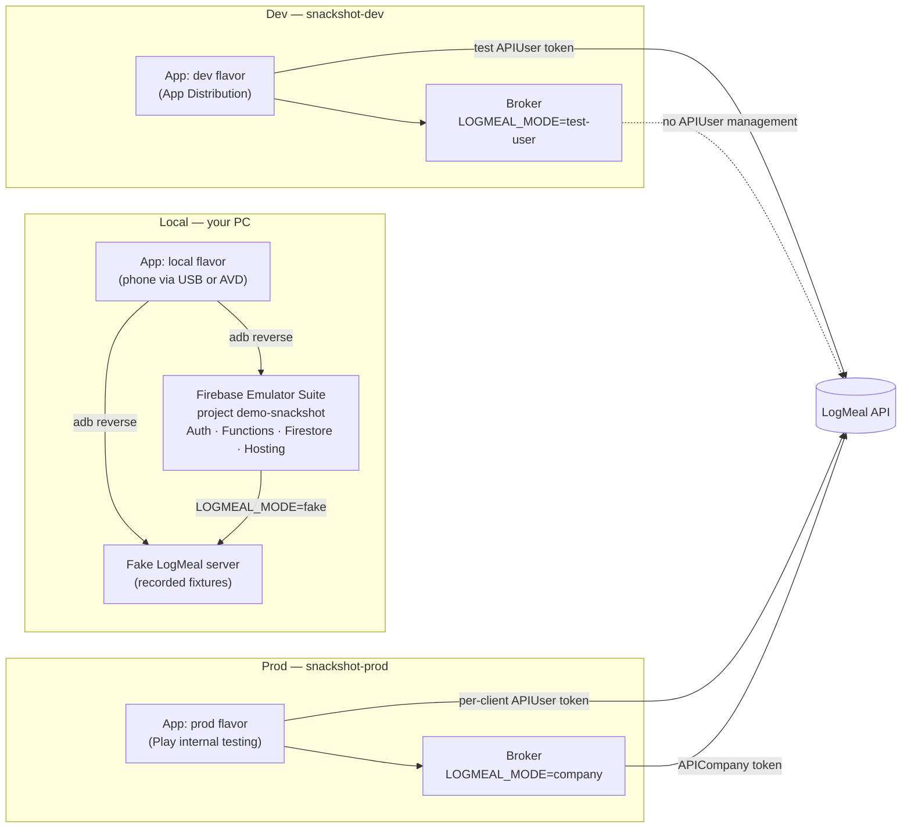

# Development and Test Environment

**Snackshot: AI-Powered Nutrition & Calorie Tracker**

**Decision:** How Snackshot is developed, tested, built, and distributed: environments, LogMeal usage in tests, repository layout, CI/CD, test devices, and secrets.
**Date:** 18 November 2026
**Status:** Accepted, decisions in §0. Refines WBS items 1.1, 1.3, 1.4, 3.1, 3.2, 3.7, 9.3, 10.3, 11.3, and 11.4 of the [WBS and MVP Implementation Plan](../04_wbs_and_mvp_implementation_plan.md).

Sources:

- [04 WBS and MVP Implementation Plan](../04_wbs_and_mvp_implementation_plan.md) §4, §5.2, §7.5
- [11 LogMeal access token management](11_logmeal-access-token-management.md) (broker, APICompany and APIUser tokens, pilot cap)
- [04 Stack comparative analysis](04_stack-comparative-analysis.md) §9
- [02 Architecture answers](02_answers-architecture-checklist.md) (Health Connect requires Android 9+, API 28)

---

## 0. Decisions recorded (18 November 2026)

| # | Question | Decision | Effect |
| --- | --- | --- | --- |
| 1 | How many environments? | **Local (Firebase Emulator Suite), Dev (`snackshot-dev`), Prod (`snackshot-prod`).** | Two Firebase projects on Blaze, each with a budget alert. Pilot data never mixes with test data. §1 |
| 2 | Real LogMeal in automated tests? | **No.** Automated tests (unit, UI, broker, CI) use recorded LogMeal responses served by fakes. | Zero credits and no LogMeal secret in CI. Real LogMeal is used only in manual testing. §3 |
| 3 | Which LogMeal credentials for manual testing? | **One dedicated test APIUser** with its own token. It is a real APIUser of the Snackshot company, so its usage appears in LogMeal statistics and in the admin console, marked as test. | The APICompany token stays in the prod project only. The dev broker never creates APIUsers. §3.3 |
| 4 | Repository | **One private GitHub monorepo** (`sergeybelyuga-ops/snackshot`, already exists). | Android, broker, admin console, shared test fixtures, and docs (`docs/`, renamed from `Project documentation/`) live together. GitHub Actions with path filters. §4, §7 |
| 5 | Test devices | **One physical Android phone + Android Studio emulators**, plus Firebase Test Lab and the Play pre-launch report for other devices and OS versions. | §6 |
| 6 | Test APIUser and the LogMeal user limit | ~~The test APIUser counts against the LogMeal plan's user limit.~~ **Superseded (18 November 2026):** LogMeal has agreed to special conditions with no limit on the number of APIUsers. | All 5 pilot users fit; the test APIUser and the owner's devices (`isTest`) do not take pilot places. §3.4 |
| 7 | Broker deploys to dev | **Automatic on every push to `main`** that changes `broker/**` or `admin/**`. Prod stays manual with approval. | §7.1 |
| 8 | Test build distribution | **Firebase App Distribution** for dev builds, **Google Play internal testing** for prod builds. (TestFlight is iOS-only.) | §8 |

---

## 1. Environments



| | **Local** | **Dev** | **Prod** |
| --- | --- | --- | --- |
| Purpose | Daily development, automated tests | Manual testing against real LogMeal on your phone | Pilot (5 users) |
| Firebase | Emulator Suite, project ID `demo-snackshot` (the `demo-` prefix means no real cloud resource can be touched) | Project `snackshot-dev`, Blaze, budget alert (5 EUR) | Project `snackshot-prod`, Blaze, budget alert |
| Android flavor | `local` | `dev` | `prod` |
| Application ID | `…snackshot.local` | `…snackshot.dev` | `…snackshot` |
| App Check | Not enforced in the emulator | Debug provider (debug tokens registered in the console) | Play Integrity (works only for Play-distributed builds) |
| Broker LogMeal mode | `fake` | `test-user` | `company` |
| LogMeal | Fake server, 0 credits | Test APIUser token (real credits) | APICompany token + one APIUser per client |
| Data | Seed data, wiped freely | Your test devices only | Pilot users (+ your phone, marked as test) |
| Distribution | `gradlew installLocalDebug` | Firebase App Distribution | Google Play internal testing track |

The three app flavors use different application IDs, so all three can be installed on the same phone at once.

---

## 2. Android app configuration

### 2.1 Product flavors

One flavor dimension, `env`, with `local`, `dev`, and `prod`. Each flavor sets `BuildConfig` fields; no environment `if`s are scattered through the code, because a Hilt module reads `BuildConfig` once.

| `BuildConfig` field | `local` | `dev` | `prod` |
| --- | --- | --- | --- |
| `BROKER_BASE_URL` | `http://localhost:5001/demo-snackshot/<region>/api` | `https://<region>-snackshot-dev.cloudfunctions.net/api` | `https://<region>-snackshot-prod.cloudfunctions.net/api` |
| `LOGMEAL_BASE_URL` | `http://localhost:8090` | `https://api.logmeal.com` | `https://api.logmeal.com` |
| `USE_FIREBASE_EMULATORS` | `true` | `false` | `false` |
| `APP_CHECK_PROVIDER` | `none` | `debug` | `playIntegrity` |

- `local` builds its `FirebaseOptions` in code with project ID `demo-snackshot` and calls `useEmulator("localhost", …)` for Auth.
- `dev` and `prod` use their own `google-services.json` (`android/app/src/dev/`, `android/app/src/prod/`). These files are committed. Firebase config is public by design; the API keys are restricted in Google Cloud to the app's package name and signing certificate.
- Cleartext HTTP is allowed only for `localhost` and only in the `local` flavor (`network_security_config.xml` in `src/local/`).
- Release builds of `local` are disabled.

### 2.2 Reaching the emulators from a device

The same `localhost` URLs work for a USB-connected phone and for an Android Studio emulator (AVD), because `adb reverse` forwards the device's ports to the PC:

```powershell
adb reverse tcp:9099 tcp:9099   # Auth emulator
adb reverse tcp:5001 tcp:5001   # Functions emulator (broker)
adb reverse tcp:8090 tcp:8090   # Fake LogMeal server
```

A helper script `tools/adb-reverse.ps1` runs these lines. They must be repeated after the phone is reconnected.

---

## 3. LogMeal in development and tests

### 3.1 Recorded fixtures (single source)

All fakes use the same recorded LogMeal responses, kept in one folder:

```
test-fixtures/
  logmeal/
    segmentation-complete/  ok-single-dish.json, ok-mixed-plate.json, low-confidence.json
    nutritional-info/       ok.json
    quantity/               ok.json, missing-grams.json
    errors/                 401.json, 403-116.json, 429.json, 500.json
    README.md               recording date, LogMeal API version, scrubbing rules
  images/                   sample meal photos for gallery and camera tests
```

- **How they are made:** during the spike (WBS 1.1), real responses are captured with the test APIUser token. Then they are **scrubbed** (user IDs, image IDs, and tokens replaced with fixed fake values) and committed.
- **When they are refreshed:** when LogMeal changes its API, or when a new case is needed. Refreshing is a manual task with the test token, never part of CI.
- **Contract check:** a small manual script (`tools/logmeal-contract-check`) calls each real endpoint once with the test token and compares the response shape with the fixtures. You run it before each milestone to catch API drift at a cost of a few credits.

### 3.2 Fakes per layer

| Layer | Fake | Uses fixtures from |
| --- | --- | --- |
| Android unit tests (`logmeal` module) | OkHttp `MockWebServer` | `test-fixtures/logmeal` (added as a test resource folder in Gradle) |
| Android instrumented / Compose UI tests | `MockWebServer` + Hilt test modules that replace the broker client | same |
| Broker tests (Vitest + emulator) | MSW (`msw/node`) intercepts `fetch` to `api.logmeal.com` | same |
| Local manual development | **Fake LogMeal server** `tools/fake-logmeal` (Node, `node:http`, port 8090), used by both the app and the broker emulator | same |

The fake LogMeal server picks a scenario from a request header or a startup flag (`--scenario low-confidence`, `--scenario 429`, `--delay 2500`). This lets you test failures, retries, and the waiting state by hand without spending credits.

### 3.3 Broker LogMeal modes

The broker's LogMeal client reads `LOGMEAL_MODE`:

| Mode | Used in | `provision` behaviour | Secrets needed |
| --- | --- | --- | --- |
| `fake` | Local emulator, broker tests | Creates the client record and returns a fixed fake token. LogMeal calls go to the fake server (or MSW in tests). | none |
| `test-user` | `snackshot-dev` | Creates the client record and returns the **test APIUser token**. Never calls `signUp`, `toggleEnabled`, `deleteAPIUser`, or `modifyUserProfileInfo`; those calls are logged and skipped. | `LOGMEAL_TEST_USER_TOKEN` |
| `company` | `snackshot-prod` | Full design from [11](11_logmeal-access-token-management.md). | `LOGMEAL_COMPANY_TOKEN` |

Reasons for this split:

- The APICompany token exists in **exactly one place**, prod Secret Manager. This keeps decision 4 of [11](11_logmeal-access-token-management.md) §0: the token can't be regenerated, so it must not be copied.
- Reinstalls, emulators, and wiped dev data never create new APIUsers, so the LogMeal user count stays clean.

### 3.4 The test APIUser

- **Created once** by the owner with a one-off script, `broker/scripts/create-test-user.ts`. The script runs in a short-lived shell that reads the APICompany token from prod Secret Manager (`gcloud secrets versions access`), so the token is never written to disk. It calls `signUp`, sets `language`/`country`, and prints the new APIUser token once.
- **Stored** in `snackshot-dev` Secret Manager as `LOGMEAL_TEST_USER_TOKEN`. On the developer PC it goes in `broker/functions/.secret.local` (gitignored) only when you want the local emulator in `test-user` mode.
- **Registered in prod Firestore** as `clients/{id}` with `isTest: true`, so the admin console shows its usage with a "test" label.

How `isTest` affects the rest of the system:

- **Pilot cap:** test clients are **not counted** toward `maxClients` (5).
- **Owner's phone:** when you install the prod build from the Play internal track, it provisions a normal prod client. You then mark it `isTest` in the admin console (Client detail → "Mark as test").
- **Metrics:** the broker's `status` response includes `isTest`. The app adds `"test": true` to its daily metrics payload ([WBS](../04_wbs_and_mvp_implementation_plan.md) §6.3). The admin console Metrics page then shows pilot totals with or without test devices. The flag only marks the owner's own records, so pilot users' records stay anonymous.

> ✅ **LogMeal user limit (resolved 18 November 2026):** under the LogMeal special conditions there is no limit on the number of APIUsers ([11](11_logmeal-access-token-management.md) §0 decision 15). The test APIUser and the owner's prod installs are extra APIUsers and do not reduce the 5 pilot places.

---

## 4. Repository layout

```
snackshot/
  android/                Kotlin + Compose (Gradle version catalog, modules from WBS 1.3)
  broker/
    firebase.json         emulators, functions, firestore, hosting
    .firebaserc           aliases: dev → snackshot-dev, prod → snackshot-prod
    firestore.rules       deny-all client access
    functions/            Cloud Functions (TypeScript), Vitest tests
    seed/                 emulator seed data and scripts
    scripts/              admin-claim, create-test-user (owner-only, never in CI)
  admin/                  React + Vite admin console (deployed by broker/firebase.json hosting)
  test-fixtures/          shared LogMeal fixtures and sample images (§3.1)
  tools/                  fake-logmeal, adb-reverse.ps1, logmeal-contract-check
  docs/                   project documentation (renamed from "Project documentation/")
    UX_UI/                design brief, prototype, theme sources
  .github/workflows/      CI/CD (§7)
  .gitattributes          * text=auto eol=lf; *.bat, *.cmd, *.ps1 eol=crlf
  .gitignore
```

**`.gitignore`:** the root `.gitignore` used to ignore all of `.github/`, which kept CI workflows out of the repo. It now ignores `.github/*` except `.github/workflows/`, so local Copilot agents and skills stay private while workflows are committed. It also contains:

```
# Android
.gradle/
build/
local.properties
*.jks
*.keystore
captures/
# Node / Firebase
node_modules/
.secret.local
*.local
firebase-debug.log
firestore-debug.log
ui-debug.log
broker/seed/emulator-export/
# IDE
.idea/
*.iml
```

Branching: trunk-based. `main` is protected and needs green CI to merge. Short feature branches are named after the WBS item (`feat/3.2-provision`).

---

## 5. Test strategy

| Level | What | Tools | Where it runs | When |
| --- | --- | --- | --- | --- |
| Android unit | Domain (Atwater, recalculation), repositories, ViewModels, LogMeal adapter mapping and error handling, broker client | JUnit 5, MockK, Turbine, kotlinx-coroutines-test, MockWebServer | JVM | Every push |
| Android persistence | Room DAOs, migrations | Robolectric + in-memory Room, `MigrationTestHelper` | JVM | Every push |
| Android UI | Key screens and flows (Home → photo/gallery → review → save; Quick add; dashboard with and without goals; waitlist; trial ended; HC denied) | Compose UI test, Hilt testing, MockWebServer | AVD API 34 in CI | PR to `main`, manual |
| Health Connect | Write/read/changes against a real HC | Instrumented tests + Health Connect Toolbox app for inspection | Your phone + AVDs | Manual, I-6 and 11.3 |
| Broker | Endpoints, state machine, idempotency, cap/waitlist, `isTest`, metrics allow-list | Vitest, MSW, Firebase Emulator Suite (`firebase emulators:exec`) | Node 22 | Every push to `broker/**` |
| Firestore rules | Deny-all client access | `@firebase/rules-unit-testing` | Emulator | Every push to `broker/**` |
| Admin console | Components, admin-claim gating | Vitest + Testing Library | Node 22 | Every push to `admin/**` |
| LogMeal contract | Fixtures still match the real API | `tools/logmeal-contract-check` with the test token | Your PC | Before each milestone (manual) |
| End-to-end | WBS 11.3 checklist | Dev build on your phone (real LogMeal via test APIUser) + Test Lab | Device | Per increment, full pass in I-9 |

Coverage is a guide, not a gate: aim for high coverage on `domain`, `logmeal` mapping, and the broker state machine, and do not chase it on UI code.

---

## 6. Devices and Android versions

minSdk is **28 (Android 9)**, the Health Connect minimum. targetSdk is the latest stable API.

| Target | Device | Purpose |
| --- | --- | --- |
| Main | **Your physical phone** | Camera (CameraX), real photos, latency measurement (p98 < 3 s), Health Connect, Play Integrity with the prod build |
| AVD — minimum | API 28, Google Play image | Health Connect as a Play Store app (Android 13 and below); oldest supported behaviour |
| AVD — CI | API 34, Google APIs image | Compose UI tests in CI; Health Connect built into the OS (Android 14+) |
| AVD — latest | Latest stable API, Google Play image | Newest permission and photo picker behaviour |
| Firebase Test Lab | 1–2 real devices from other vendors (for example Samsung, Pixel) | Covers the "two physical devices" risk in WBS §10 for I-6 and 11.3. Runs Robo or instrumented tests within the free daily quota. |
| Play pre-launch report | Automatic, on every upload to a Play testing track | Crashes, accessibility, and screenshots on a range of real devices, at no cost |

Camera testing on AVDs uses gallery images: `adb push test-fixtures/images/ /sdcard/Pictures/`. Real camera quality and latency are measured only on the physical phone.

---

## 7. CI/CD (GitHub Actions)

### 7.1 Workflows

| Workflow | Trigger | Steps |
| --- | --- | --- |
| `android-ci.yml` | push / PR, paths `android/**`, `test-fixtures/**` | JDK 21 (Temurin), Gradle cache → `ktlintCheck`, `lintLocalDebug`, `testLocalDebugUnitTest`, `assembleDevDebug` |
| `android-ui-tests.yml` | PR to `main`, manual | AVD API 34 (`reactivecircus/android-emulator-runner`) → `connectedLocalDebugAndroidTest` |
| `broker-ci.yml` | push / PR, paths `broker/**`, `test-fixtures/**` | Node 22, JDK 21 → `npm ci`, lint, `tsc`, `firebase emulators:exec --project demo-snackshot "npm test"` |
| `admin-ci.yml` | push / PR, path `admin/**` | Node 22 → `npm ci`, lint, `vitest run`, `vite build` |
| `deploy-broker.yml` | **dev:** automatic on push to `main`, paths `broker/**`, `admin/**` (after `broker-ci` / `admin-ci` pass); **prod:** manual, input `env: prod` | Deploys Functions, Firestore rules/indexes, and Hosting (admin console) to the project. `prod` waits for approval in the GitHub `prod` environment. |
| `distribute-android.yml` | manual, input `env: dev \| prod` | `dev`: build `devRelease`, upload to Firebase App Distribution (group `owner`). `prod`: build a signed `prodRelease` AAB and attach it as an artifact, which you upload to the Play internal track. Gradle Play Publisher can automate this upload later. |

No workflow has the LogMeal APICompany token or the test APIUser token. CI never calls LogMeal.

### 7.2 Authentication to Google Cloud

- Deploys use **Workload Identity Federation** (`google-github-actions/auth`), so no service-account JSON keys are stored in GitHub.
- There is one deploy service account per project, with only the roles that deploying needs (Functions, Firestore rules, Hosting, App Distribution, plus read access to the secrets the functions use).
- The WIF provider and service account names are GitHub **variables**, not secrets.

### 7.3 GitHub environments

| Environment | Protection | Secrets |
| --- | --- | --- |
| `dev` | none | — |
| `prod` | Required reviewer: owner | `UPLOAD_KEYSTORE_BASE64`, `UPLOAD_KEYSTORE_PASSWORD`, `UPLOAD_KEY_ALIAS`, `UPLOAD_KEY_PASSWORD` |

The app uses **Play App Signing**: Google holds the app signing key, and the repo signs with an upload key only. You keep an offline backup of the upload keystore outside the repo.

---

## 8. Distributing test builds

TestFlight is Apple's iOS beta service and cannot distribute Android apps. Its Android equivalents are:

| Channel | Builds | Who | Notes |
| --- | --- | --- | --- |
| **Firebase App Distribution** | `dev` flavor | You (and up to a few helpers) | Free. Builds go straight from CI with no store review, and testers install through the App Tester app. Uses the App Check debug provider, because Play Integrity doesn't work outside Play. |
| **Google Play internal testing** | `prod` flavor | 5 pilot users + you | Closest to TestFlight: up to 100 testers by e-mail, builds are available within minutes, and installs go through the Play Store. Needed for Play Integrity / App Check. Triggers the pre-launch report. |
| Closed / open testing | `prod` flavor | Larger beta | Post-MVP. |

For different **Android OS versions** and devices, use the AVD set, Firebase Test Lab, and the Play pre-launch report (§6).

---

## 9. Secrets

| Secret | Where it lives | Who can read it |
| --- | --- | --- |
| LogMeal APICompany token | `snackshot-prod` Secret Manager **only** | Prod broker service account; the owner through a short-lived `gcloud` session when running `create-test-user` |
| LogMeal test APIUser token | `snackshot-dev` Secret Manager; optionally `broker/functions/.secret.local` on your PC | Dev broker service account; the local emulator |
| Upload keystore + passwords | GitHub `prod` environment secrets; offline backup | `distribute-android.yml` (prod) |
| App Check debug tokens | Registered in the `snackshot-dev` console; on the device / in `local.properties` | Dev builds only |
| Firebase config (`google-services.json`, web config) | Committed | Public by design; API keys restricted per app |
| WIF provider, deploy service account names | GitHub variables | Workflows |

Rules:

- Never log the `Authorization` header (WBS 6.3).
- `.secret.local` and `local.properties` are never committed.
- A leaked test token is replaced by running `create-test-user` again and deleting the old APIUser.

---

## 10. Developer machine (Windows 11)

| Tool | Version | Why |
| --- | --- | --- |
| Android Studio | Latest stable | IDE, SDK, AVDs; its bundled JBR runs Gradle |
| JDK | 21 (Temurin) on `PATH` | Firestore emulator and command-line Gradle |
| Node.js | 22 LTS, pinned in `.nvmrc`; managed with `fnm` | Cloud Functions runtime, admin console, fake LogMeal server |
| Firebase CLI | Pinned `firebase-tools` dev dependency in `broker/`, run with `npx firebase` | Same CLI version locally and in CI |
| Google Cloud CLI | Latest | Secret Manager, WIF setup, `create-test-user` |
| Git, GitHub CLI | Latest | Run `git config core.longpaths true` (deep Gradle paths on Windows) |

### 10.1 One-time setup

1. Install the tools above, clone the repo, and run `npm ci` in `broker/functions`, `admin`, and `tools/fake-logmeal`.
2. Create AVDs: API 28 (Google Play), API 34 (Google APIs), and the latest stable API (Google Play).
3. Create `snackshot-dev` and `snackshot-prod` (Blaze, budget alerts). Register the Android apps (`.dev`, prod) and the admin web app, and add the dev App Check debug provider.
4. Set up WIF and the deploy service accounts for both projects; add the GitHub variables and the `prod` environment.
5. Put the APICompany token in prod Secret Manager. Run `create-test-user` and put the test token in dev Secret Manager.
6. Seed the local emulator: `npm run seed` (settings with `maxClients = 5`, an admin user with the `admin` claim, sample clients in `trial`, `trial_ended`, and `waitlisted`).

### 10.2 Daily loop

```powershell
cd broker;  npm run dev          # emulators (demo-snackshot) + fake LogMeal, seed import
cd admin;   npm run dev          # Vite in emulator mode (optional)
tools\adb-reverse.ps1            # phone or AVD → PC
cd android; .\gradlew installLocalDebug
```

Manual testing against real LogMeal: merge to `main` (the broker deploys to dev automatically), then install the `dev` build from App Distribution or run `gradlew installDevDebug`.

---

## 11. Impact on other documents

| Document | Change |
| --- | --- |
| [04 WBS](../04_wbs_and_mvp_implementation_plan.md) | Decision 5; scope of items 1.1, 1.3, 1.4, 3.1, 3.2, 3.7, 9.3, 10.3, 11.3, 11.4; `test` field in §6.3; risk mitigation for device coverage. Extra effort of about 1.5 h is taken from contingency and re-checked at M1. |
| [11 LogMeal access token management](11_logmeal-access-token-management.md) | `isTest` on `clients`, excluded from `maxClients`; `isTest` in the `status` response; `LOGMEAL_MODE`; APICompany token only in the prod project. Applied on 18 November 2026 (§0 decision 14, §8.2). |

## 12. Open questions

None. The two questions from the first draft are answered by decisions 6 and 7 in §0.
